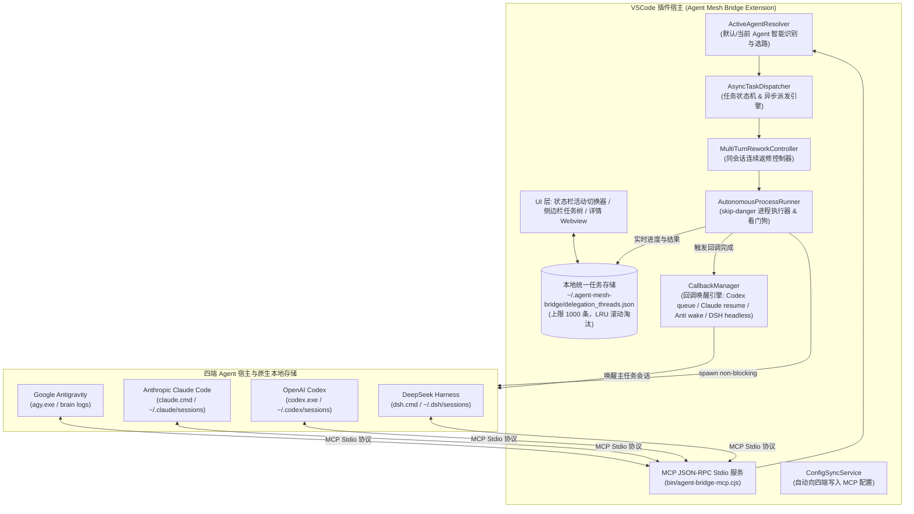
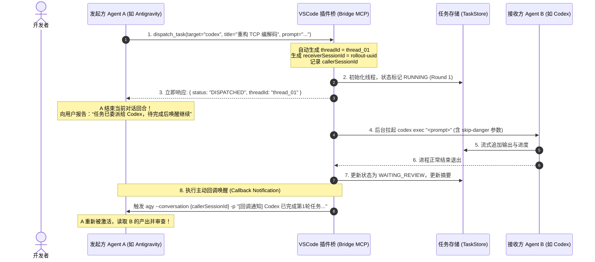
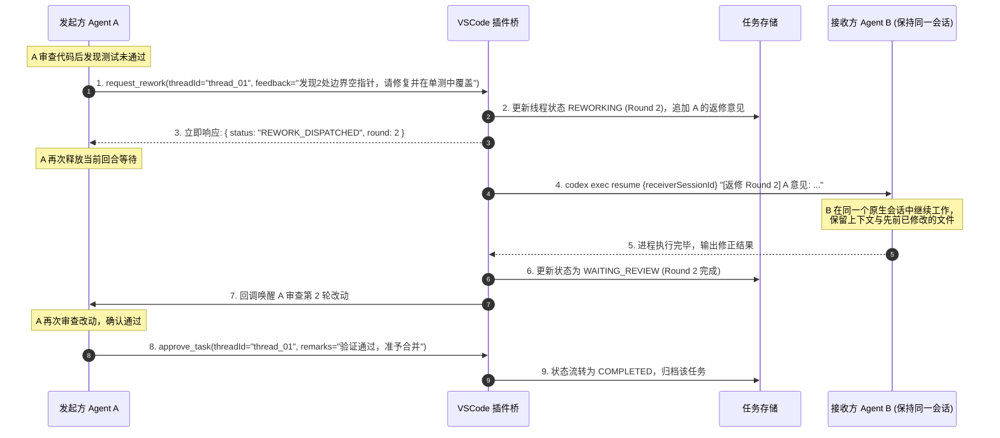

# 🌉 多 Agent 协同桥接 VSCode 插件设计与架构规范 (Agent Mesh Bridge)

> **版本**：1.0.0  
> **状态**：已评审 (Approved)  
> **适用范围**：VSCode 扩展、本地 Agent 协同网格 (Antigravity ⟷ OpenAI Codex ⟷ Anthropic Claude Code ⟷ DeepSeek Harness)

---

## 1. 系统定位与核心价值

本项目旨在构建一个高可靠的 Visual Studio Code 插件（**Agent Mesh Bridge**），将本地运行的四大主流 AI Agent——**Google Antigravity (`agy`)**、**OpenAI Codex (`codex`)**、**Anthropic Claude Code (`claude`)** 与 **DeepSeek Harness (`dsh`)**——无缝打通为对等协作网络（Peer-to-Peer Agent Mesh）。

### 核心能力与关键特性

1. **默认 Agent 智能选路**：若有多款 Agent 可用，默认自动使用当前 VSCode 插件环境正在使用的 Agent，亦支持状态栏快速手动锁定。
2. **全向互派任务**：任意 Agent 均可作为发起方（Caller/A），通过插件内置 MCP 桥向任意接收方（Receiver/B）派发复杂开发任务；**接收方执行期间不得再次转发任务**。
3. **接收方原生会话留痕**：任务严格注入到接收方自身的原生会话存储中（Codex `rollout`、Claude `sessions`、Antigravity `brain`），接收方历史完全可见且可查。
4. **异步非阻塞回调 (Reactive Callback)**：A 下发任务后**立即释放当前对话**（无需长轮询等待），B 在后台无人值守运行；任务完成后，插件通过回调机制**主动唤醒 A 的原对话继续**。
5. **同会话多次返修直至认可 (Multi-Turn Rework)**：若 A 对 B 的产出不满意，可在**同一个原生会话中多次要求其返修**（保留上下文、修改历史与中间思考），直至 A 验收通过。
6. **1000 条任务中心与对话看板**：VSCode 侧边栏提供实时任务列表，以 `A -> B 标题` 格式呈现，显示对话摘要与轮次进度，支持点开查看全量多轮对话与 Diff 详情，持久化保留最新 1,000 条。
7. **全自动无人值守运行 (`skip-danger`)**：严格封装非交互与权限旁路参数，避免后台进程因权限询问、终端等待或 Git 安全检查而挂起卡死；Codex 的全局审批参数必须位于 `exec` 之前，DSH 必须注入 `DSH_PERMISSION_MODE=danger-full-access`。
8. **严格串行执行**：任意时刻整个网格只允许一个任务轮次真实执行；排队单位是**任务**，一个任务在 `completed` 之前始终占用全局任务槽（含 `waiting_review` / `paused`），其他任务继续排队；跨进程由 `execution.lock` 裁决，不再以文件范围是否重叠作为并发依据。

---

## 2. 整体系统架构与模块分解



### 核心模块职责说明

1. **`ActiveAgentResolver`（默认 Agent 判定）**：
   - 侦测当前 VSCode 前台宿主（Antigravity IDE 识别）；
   - 侦测前台活动扩展（`openai.chatgpt-*` 活跃状态）；
   - 侦测最近 5 分钟内会话文件（`mtime`）活跃度；
   - 响应状态栏手动切换事件。
2. **`AsyncTaskDispatcher`（异步派发引擎）**：
   - 负责解析 A 的下发意向，生成全局唯一 `threadId` 与接收方原生 `receiverSessionId`；
   - 立即向发起方返回 `DISPATCHED` / `QUEUED` 确认报文，断开长连接等待，允许 A 结束当前 Turn；
   - 只要已有任务在执行（无论文件范围是否重叠），新任务一律进入 **全局 FIFO 队列**，不再并发启动。
3. **`MultiTurnReworkController`（多轮返修控制器）**：
   - 维系 `threadId` ↔ `receiverSessionId` 强绑定；
   - 处理 A 的 `request_rework` 指令，递增轮次并在接收方原有原生会话中触发续聊命令；
   - **硬不变量**：同一任务任一时刻只允许一个轮次处于 `running`。上一轮未终结时，`request_rework` / `retry_failed_round` 一律拒绝，轮号严格单调递增（`nextRoundNumber`），杜绝并发轮次导致的两个 Agent 进程同时改写同一工作区。
4. **`AutonomousProcessRunner`（无人值守执行器）**：
   - 适配 Windows/macOS/Linux 跨平台进程拉起；
   - 注入各 Agent 专属的免交互与权限旁路标志（`--dangerously-skip-permissions` 等）；
   - 关闭 `stdin` 并配置 `CI=1` 环境变量；
   - 内置输出静默看门狗与最大超时保护。
5. **`CallbackManager`（回调唤醒引擎）**：
   - 监听任务各轮次完成状态；
   - 根据发起方类型调用各 Agent 原生唤醒信道（`codex queue`、`claude --resume`、`agy --conversation`、`dsh headless --session-id`），触发 A 的下一轮推理。
6. **`TaskStore`（1,000 条任务中心）**：
   - 单文件/轻量存储 `~/.agent-mesh-bridge/delegation_threads.json`；
   - 保证最多 1,000 条任务历史，超出部分自动截断清理；
   - 跨进程文件监听与原子写入。
7. **`ExecutionGate`（跨进程全局单飞）**：
   - 以 `~/.agent-mesh-bridge/execution.lock` 的原子 `wx` 创建作为唯一裁决点，协调“扩展宿主 supervisor + 各 Agent 独立 MCP server”多个进程；
   - 5 秒心跳刷新、30 秒僵尸判定、按 token 安全释放；进程崩溃后锁可被安全接管。
8. **`QueueDrainer`（回退队列泵）**：
   - 无常驻 supervisor 时，轮次结束后由当前 MCP 进程按 FIFO 继续泵下一轮；
   - 每个进程都可以泵，但只有拿到 `ExecutionGate` 租约的进程真正执行。

### 2.1 运行时三条硬准则

1. **拆分任务不因权限停摆**：所有被派发的轮次必须携带各端 `skip-danger` 参数；Codex 的 `--ask-for-approval` 是全局参数，必须位于 `exec` 之前；DSH 注入 `DSH_PERMISSION_MODE=danger-full-access`，使其 `approval` 策略变为 `never`。
2. **严格一来一回、全局串行**：任意时刻整个网格只允许一个任务轮次执行。任务按创建时间 FIFO 排队；上一轮未结束，任何下一轮（包括另一个任务）都不得 spawn。
3. **接收方不转发**：`AutonomousRunner` 以 `MESH_TASK_RECEIVER=1`（及 `MESH_TASK_THREAD_ID` / `MESH_TASK_ROUND`）标记任务接收方进程；该进程继承给其 MCP server 后，`dispatch_task` / `invoke_agent` / 旧版 `invoke_*` 会被隐藏并拒绝，`request_rework` / `approve_task` 也不能作用于它自己正在执行的任务。`CallbackManager` 唤醒发起方时会显式清除这些标记。
4. **锁范围只到具体文件**：`expectedFiles` 必须是具体代码文件路径，`validateExpectedFiles()` 在派发前拒绝目录、结尾斜杠、`*`/`?` 通配符；`doPathsConflict()` 只做精确同文件匹配，不再做目录前缀或 glob 展开。这样声明 `src/service/Foo.ts` 不会锁住 `src/service/` 下的其他文件。

### 2.2 单任务角色链（reviewer → developer → reviewer）

同一 `threadId` 任一时刻只允许一个活跃角色：

- `reviewer`（下发 / 检视）：负责输出设计与开发任务、验收结论、修改意见和报告；
- `developer`（开发 / 返修）：负责输出开发报告与修改结果。

角色锁写入 `~/.agent-mesh-bridge/roles/<threadId>.json`（5s 心跳、30s 僵尸回收）。规则：

1. `CallbackManager.notifyCaller()` 必须先校验 `waiting_review`、无在飞轮次，并取得 `reviewer` 锁；重复唤醒直接拒绝，不再拉起第二个检视进程。
2. developer 轮次必须先取得 `developer` 锁；若 reviewer 仍持有，则任务进入 `queued`，等交接后由 supervisor/queue-drainer 启动。
3. developer 轮次结束、状态落为 `waiting_review` 后，先释放 developer 锁，再唤醒 reviewer，避免双向等待死锁。
4. reviewer 在 `request_rework` / `approve_task` 成功时视为完成决策并释放 reviewer 锁（`TaskRoleLock.releaseIfRole`）；其 CLI 进程继续打印最终文本不构成新的活跃检视。
5. **中断恢复不是新建任务**：只能沿用原 `threadId`、原 `receiverSessionId` / `callerSessionId`，并以账本中的历轮 `prompt`（设计/返修指令）、`output`（开发/返修报告）、review feedback 作为中间文档链继续；禁止新建任务、另起会话或把同一任务拆成新的 reviewer/developer 任务。

### 2.3 响应成功判定（错误码 + 流健康）

Agent 响应成功不再只看退出码，而是两段式判定：

1. **错误码**：`exitCode === 0`；非 0 记录 `NONZERO_EXIT`，暂停/超时/看门狗记录对应中断码。
2. **流质量**：
   - stdout 必须能提取到**实际最终答案**（不能只是 JSON status/元数据）；
   - 至少收到一个输出 chunk；
   - 相邻 chunk（含启动到首个 chunk）的最长间隔不超过 `silenceTimeoutMs`。

结果写入 `RunResult.assessment` 并持久化到 `round.assessment`：

```ts
interface ResponseAssessment {
  success: boolean;
  errorCode: 'OK' | 'NONZERO_EXIT' | 'EMPTY_OUTPUT' | 'STREAM_STALLED' | 'PAUSED' | 'TIMEOUT' | 'WATCHDOG' | ...;
  exitCode: number;
  stream: {
    chunkCount: number;
    stdoutBytes: number;
    stderrBytes: number;
    firstOutputAtMs?: number;
    lastOutputAtMs?: number;
    maxGapMs: number;
    gapThresholdMs: number;
    hasActualOutput: boolean;
    continuous: boolean;
  };
  reason?: string;
}
```

`exitCode === 0` 但没有实际输出（例如只有 status 事件）时，轮次必须判为 `failed`，不得进入 `waiting_review`，也不得唤醒 reviewer。

已适配的最终答案来源：

- Codex `exec --json`: `{"type":"item.completed","item":{"type":"agent_message","text":"..."}}`，并由 `thread.started.thread_id` 采纳原生会话 ID；
- DSH: `{"type":"final","text":"..."}`；
- Antigravity: `{"event":"result","result":{"response":"..."}}`；
- Claude Code: `result` 字符串；
- 非 JSON 纯文本：原始文本本身。

### 2.4 任务级 FIFO（端到端单任务）

排队单位是**任务**，不是单轮：

- 一个任务从进入队列到 `completed` 之前，始终占用唯一的全局任务槽；
- `queued` / `running` / `reworking` / `waiting_review` / `paused` 都算未完成；
- 即使任务已经交付并处于 `waiting_review`，其他任务也不得启动；
- `failed` 作为终止态释放队列（避免历史失败任务永久阻塞），重试后重新占用；
- 队头按 `createdAt` 由 `findQueueHead()` 选出；
- `TaskSupervisor` / `QueueDrainer` 只允许启动队头任务；队头无在飞轮次时直接停止调度；
- `AsyncDispatcher` 只要有任意未完成任务，新任务立即返回 `QUEUED`，并注明等待的 `threadId` 与阶段；
- approve / delete / retry / resume 改变队头状态后，通过 `TaskStore.changed` 或 supervisor 轮询自动推进队列。

### 2.5 MR 收口（调用者）

任务或同一批任务验收通过后，MR 由**调用者/检视方**统一收口，不由开发者负责：

1. 开发者(receiver)只交付代码与测试报告，不提交、不推送、不建 MR；
2. 调用者汇总该任务及同批尚未推送的改动，只创建一个 MR，使用仓库既有远端与 `gh` / `glab` / 等价 CLI 推送；
3. 推送后调用 `record_merge_request(threadId, url, branch, commit, remote, baseBranch, status, summary)`；
4. 桥接器把 `MergeRequestInfo` 持久化到 `thread.mergeRequest`，并在任务树与详情面板展示；
5. `record_merge_request` 是调用者控制面工具，receiver 进程不可调用；已完成任务仍允许补记 MR；
6. MR 是一批任务的收口动作，不为每个子任务单独推送/建 MR。

### 2.6 暂停 / 删除 / 中断追溯

- **暂停**：`TaskControlService.pauseTask()` 先把线程与当前轮次标记为 `paused`，写入 `TaskInterruption { kind: 'paused', reason, at, by }`，然后通过 `CancellationRegistry` 发布跨进程取消请求；真正持有子进程的 `AutonomousRunner` 轮询到请求后终止进程树，并在 `RunResult.interruption` 中回传同一原因。暂停轮次保留原 prompt 与原生会话。
- **恢复**：`ReworkController.resumePausedTask()` 清除当前 `interruption`（历史保留在 `interruptions[]`），将轮次恢复为 `running`；`shouldResumeNativeSession()` 决定是续聊（已捕获原生会话/返修轮）还是以初始轮重新执行。
- **删除**：`TaskControlService.deleteTask()` 先发布 `delete` 取消请求并终止进程，再 `TaskStore.deleteTask()` 移除账本条目，并把 `{ threadId, title, statusAtDeletion, reason, by, at }` 追加到 `~/.agent-mesh-bridge/deleted_tasks.log` 墓碑日志。
- **自动中断**：看门狗与总超时由 runner 直接写入 `interruption.kind = 'watchdog' | 'timeout'`；所有执行器通过 `TaskStore.updateRound(..., interruption)` 统一落盘，UI 在任务详情与轮次卡片中展示原因。

---

## 3. 核心业务流程与交互时序

### 3.1 初始下发与异步回调流程 (Initial Dispatch & Callback)



### 3.2 同会话多轮返修流程 (Multi-Turn Rework Loop)



---

## 四、数据契约与存储规格 (保留 1000 条)

### 4.1 数据模型定义 (`DelegationThread`)

```typescript
export type AgentId = 'antigravity' | 'claude_code' | 'codex' | 'deepseek_harness' | 'vscode_chat';
export type ThreadStatus = 'queued' | 'running' | 'waiting_review' | 'reworking' | 'paused' | 'completed' | 'failed';
export type RoundStatus = 'running' | 'paused' | 'completed' | 'failed';
export type InterruptionKind = 'paused' | 'stopped' | 'deleted' | 'timeout' | 'watchdog' | 'error';

export interface TaskInterruption {
  kind: InterruptionKind;
  reason: string;
  at: string; // ISO8601
  by?: string; // user / agent / supervisor / watchdog
}

export interface DelegationThread {
  threadId: string; // 唯一任务线程ID, e.g. "thread_20261016_163000_a7f9"
  title: string; // 任务简短标题, e.g. "修复 TCP 游标错位"
  initiatorAgent: AgentId; // 发起方 A
  targetAgent: AgentId; // 执行方 B
  status: ThreadStatus; // 线程生命周期状态
  currentRound: number; // 当前轮次 (1: 初次, 2+: 返修第N轮)
  createdAt: string; // ISO8601 创建时间戳
  updatedAt: string; // ISO8601 最近更新时间戳

  // 原生会话标识绑定 (关键: 支持在同一会话中持续 resume)
  receiverSessionId: string; // 目标 Agent 原生会话 ID
  receiverSessionCaptured?: boolean; // 是否已捕获真实原生会话（决定暂停恢复能否续聊）
  callerSessionId?: string; // 发起方会话 ID (用于回调定位)
  workspacePath: string; // 执行工作区绝对路径

  // 中断追溯
  interruption?: TaskInterruption; // 最近一次暂停/停止/超时
  interruptions?: TaskInterruption[]; // 完整中断历史

  // 列表快速摘要 (用于侧边栏直接展示)
  summary: {
    lastPromptSnippet: string; // A 最近一次发言简述 (前 100 字符)
    lastOutputSnippet: string; // B 最近一次回复简述 (前 150 字符)
    totalDurationMs: number; // 累计耗时 (毫秒)
  };

  // 完整多轮交互历史 (点开详情时展示)
  rounds: DelegationRound[];
}

export interface DelegationRound {
  round: number; // 轮次编号: 1, 2, 3...（严格单调递增；同一任务任一时刻最多一个轮次为 running）
  type: 'initial' | 'rework' | 'approval';
  prompt: string; // A 在此轮下发的任务说明或返修意见
  output?: string; // B 在此轮产出的回复正文与修改描述
  error?: string; // 若执行失败，记录错误信息
  durationMs: number; // 该单轮执行耗时
  status: 'running' | 'paused' | 'completed' | 'failed';
  timestamp: string; // 该轮触发时间
  interruption?: TaskInterruption; // 该轮被暂停/中断的原因
}
```

### 4.2 1000 条容量控制与磁盘持久化规则

1. **物理路径**：`~/.agent-mesh-bridge/delegation_threads.json`。
2. **截断策略**：每次更新或新增任务后，按 `updatedAt` 降序排序，超出 1,000 条的记录从尾部自动剔除，确保文件大小维持在可控范围内（通常约 10–20 MB）。
3. **原子写入**：使用 `fs.writeFileSync` 写入临时文件后执行原子重命名，防止多进程或多窗口写入竞争。
4. **变动监听**：VSCode 扩展宿主采用 `fs.watchFile`（1秒防抖轮询），一旦磁盘数据变化即触发侧边栏 UI 响应刷新。

---

## 五、全自动无人值守执行规范 (`skip-danger`)

针对四端 Agent，制定统一的免交互、提权与防挂起命令行矩阵：

| 目标 Agent                 | 命令行执行模板                                                                                                                                               | 关键安全与免交互参数说明                                                                                                                                                                                 |
| :------------------------- | :----------------------------------------------------------------------------------------------------------------------------------------------------------- | :------------------------------------------------------------------------------------------------------------------------------------------------------------------------------------------------------- |
| **OpenAI Codex**           | `codex.exe --ask-for-approval never exec "<prompt>" --dangerously-bypass-approvals-and-sandbox --dangerously-bypass-hook-trust --skip-git-repo-check --json` | • `--ask-for-approval` 是**全局参数，必须在 `exec` 之前**；放在子命令后会被 CLI 判为 `unexpected argument` 并导致派发任务直接失败<br/>• `--dangerously-bypass-approvals-and-sandbox`：绕过命令执行确认<br/>• `--skip-git-repo-check`：允许非 Git 或有未提交改动的目录 |
| **Codex (返修续聊)**       | `codex.exe --ask-for-approval never exec resume <receiverSessionId> "<feedback>" --dangerously-bypass-approvals-and-sandbox --dangerously-bypass-hook-trust --skip-git-repo-check --json` | 继承上一次的 thread/session 会话上下文继续执行，并保持同样的权限旁路                                                                                                                                       |
| **Claude Code**            | `cmd.exe /c "claude.cmd" -p "<prompt>" --session-id <uuid> -n "<title>" --permission-mode bypassPermissions --output-format json`                            | • `--permission-mode bypassPermissions`：跳过所有权限确认<br/>• `-p`：非交互式管道模式<br/>• `--session-id`：指定会话以供后续 resume                                                                     |
| **Claude (返修续聊)**      | `cmd.exe /c "claude.cmd" -p "<feedback>" --resume <receiverSessionId> --permission-mode bypassPermissions --output-format json`                              | 利用 `--resume` 原生参数在原对话中执行返修                                                                                                                                                               |
| **Antigravity**            | `agy.exe -p "<prompt>" --dangerously-skip-permissions --mode accept-edits --output-format stream-json`                                                       | • `--output-format stream-json`：流式输出防止看门狗误杀，并在首行获取原生 conversation_id<br/>• `--dangerously-skip-permissions`：自动同意所有工具调用<br/>• `--mode accept-edits`：自动接受代码编辑改动 |
| **Antigravity (返修续聊)** | `agy.exe --conversation <receiverSessionId> -p "<feedback>" --dangerously-skip-permissions --mode accept-edits --output-format stream-json`                  | 自动在原有 conversation 中追加回合，流式传输降低静默看门狗误杀风险（默认阈值 10 分钟）                                                                                                                    |
| **DeepSeek Harness**       | `<安装根>/DeepSeek Harness.exe --expose-internals <cli.js> headless --json "<prompt>"`（注入 `ELECTRON_RUN_AS_NODE=1`、`DSH_PERMISSION_MODE=danger-full-access`） | • `headless --json`：单次任务跑完即退出，输出 NDJSON 事件流<br/>• 首个 `{"type":"session"}` 事件回传原生 `sessionId`<br/>• 首轮**不传** `--session-id`（该参数只用于接管已存在会话）<br/>• `DSH_PERMISSION_MODE=danger-full-access` 同时把 sandbox 设为 full-access、approval 设为 `never`<br/>• `stdin.end()` 立即关闭，杜绝交互挂起 |
| **DSH (返修续聊)**         | `<安装根>/DeepSeek Harness.exe --expose-internals <cli.js> headless --json --session-id <receiverSessionId> "<feedback>"`（同样注入 `DSH_PERMISSION_MODE=danger-full-access`） | 以 `--session-id` 接管原生 Session 继续执行；未知 id 会直接报错，因此必须使用首轮回填的真实 id                                                                                                          |

### 进程防护机制：

- **`child.stdin.end()`**：进程启动后立即关闭标准输入流，若 CLI 尝试等待用户交互键盘输入将立即退回或报错，防止永久假死。
- **环境变量注入**：
  `CI=1`, `NON_INTERACTIVE=true`, `FORCE_COLOR=0`, `TERM=dumb`, `DEBIAN_FRONTEND=noninteractive`。
- **静默看门狗**：若子进程连续 **10 分钟**无任何 stdout/stderr 输出且仍在运行，触发告警或强制 kill，避免死循环；可通过 `RunOptions.silenceTimeoutMs` 按任务覆盖。
- **单轮总超时**：默认放宽至 2 小时（120 分钟 / 7,200 秒），支持配置项 `agentMeshBridge.taskTimeoutMinutes` 自定义，充分满足超大型代码重构与多文件自动化开发需求。

---

## 六、对外提供的标准 MCP 工具清单

插件随附的 Stdio MCP 服务器（`bin/agent-bridge-mcp.cjs`）向四端 Agent 暴露以下核心能力：

### 1. `dispatch_task`（异步下发初始任务）

- **功能**：由 A 向 B 发起全新任务，创建任务线程并立即返回。
- **参数**：
  - `targetAgent` (string, 可选): `'default' | 'codex' | 'claude_code' | 'antigravity' | 'deepseek_harness'`（默认 `'default'`）
  - `title` (string, 必填): 任务名称简述（10–30字）
  - `prompt` (string, 必填): 具体任务要求、目标与约束
  - `callerSessionId` (string, 可选): A 当前会话 ID（用于完成时唤醒）
  - `workspacePath` (string, 可选): 工作区路径
  - `expectedFiles` (string[], 可选): **具体代码文件**列表（如 `src/service/Foo.ts`）。禁止目录、结尾斜杠、`*`/`?` 通配符；`validateExpectedFiles()` 会在创建线程前拒绝非法范围。
- **返回值**：`{ threadId, status: "DISPATCHED", message: "Task started in background. Conclude your turn and await callback." }`

### 2. `request_rework`（要求在同一会话中返修）

- **功能**：A 对 B 的某轮结果不满意，向同一个会话下发返修意见。
- **参数**：
  - `threadId` (string, 必填): 原任务线程 ID
  - `feedback` (string, 必填): 具体的返修意见、缺陷描述或补充要求
- **返回值**：`{ threadId, round, status: "REWORK_DISPATCHED", message: "Rework dispatched to the same session. Await callback." }`

### 3. `approve_task`（验收通过，终结任务）

- **功能**：A 确认 B 的工作已达到验收标准，关闭任务线程。
- **参数**：
  - `threadId` (string, 必填): 任务线程 ID
  - `remarks` (string, 可选): 最终总结或确认信息
- **返回值**：`{ threadId, status: "COMPLETED", message: "Task approved and archived." }`

### 3.1 `pause_task` / `resume_task` / `delete_task`（暂停、恢复、删除）

- **`pause_task(threadId, reason)`**：终止运行中的 Agent 进程，轮次标记 `paused`，记录中断原因；排队中的任务只标记暂停。
- **`resume_task(threadId)`**：恢复暂停轮次；已捕获原生会话时续聊，否则以初始轮重新执行。
- **`delete_task(threadId, reason)`**：先终止进程，再移除账本条目；原因写入 `deleted_tasks.log` 墓碑日志。
- 三者均为控制面操作，接收方进程不能对自己正在执行的任务调用。

### 4. `list_recent_tasks`（查询历史任务列表）

- **功能**：检索最近的委派任务列表（上限 1000 条）。
- **参数**：
  - `limit` (number, 可选): 默认 20，最大 1000
  - `statusFilter` (string, 可选): `'all' | 'active' | 'running' | 'waiting_review' | 'reworking' | 'paused' | 'completed' | 'failed'`
- **返回值**：包含 `threadId, title, initiatorAgent, targetAgent, status, currentRound, summary` 的对象数组。

### 5. `get_thread_details`（查看单条任务完整交互历史）

- **功能**：拉取某任务全部轮次的详细 Prompt 与 Output。
- **参数**：
  - `threadId` (string, 必填): 任务线程 ID
- **返回值**：完整的 `DelegationThread` 对象。

### 6. `invoke_agent`（同步阻塞调用，保留轻量级即时使用）

- **功能**：适合 30 秒内的即时问答或小型代码片段审查。

---

## 七、VSCode 插件 UI 呈现与用户体验

### 1. 侧边栏任务中心 (`Agent Mesh Hub`)

VSCode 左侧活动栏新增专属图标，展开后显示两组视图：

- **活跃与待验收任务 (Active & In-Review)**：
  - 以徽章显示发起方与接收方：`[Anti ➔ Codex]`
  - 显示轮次与状态：`🟡 修复 TCP 游标错位 (第 2 轮返修中)`
  - 两者对话最近一条摘要：
    - _A: "第48行断言在重连时仍会触发空指针，请补充边界判断"_
    - _B: "正在运行回归测试并重新构建..."_
- **历史归档列表 (Recent 1,000 Tasks)**：
  - 支持关键字搜索（支持按标题、发起方、接收方检索）
  - 显示完成时间与总轮次（例如：`🟢 共 3 轮返修完成 · 耗时 2m15s`）

### 2. 详情交互抽屉 (Task Detail Webview)

双击任务列表中的任意一项，在编辑器区域打开丰富的交互面板：

- **顶部信息条**：展示 `Thread ID`、双方 Agent 标识、原生会话 ID、当前轮次。
- **操作快捷键**：
  - 【在终端中接管原生会话】（自动拼接 `codex resume`、`claude -r` 或 `dsh tui --resume` 指令）
  - 【人工介入追加返修意见】（允许人工在 UI 界面输入 prompt 直接唤醒 B）
  - 【一键标记通过 (Approve)】
- **多轮交互时间轴**：按 Round 1、Round 2、Round 3 分卡片渲染，支持 Markdown 渲染、语法高亮与 Git Diff 视图。

### 3. 状态栏活动 Agent 切换器 (Status Bar)

右下角常驻状态栏按钮：

- `$(hubot) Agent Bridge: Codex (Auto)`
- 点击弹出快速选择框：
  - `Auto-Detect (Current: OpenAI Codex)`
  - `Force: Google Antigravity`
  - `Force: Anthropic Claude Code`
  - `Force: OpenAI Codex`
  - `Force: DeepSeek Harness`

---

## 八、目录结构与工程落地蓝图

```text
D:\agent_bridge\
├── package.json                   # VSCode 扩展配置 (含 commands, views, settings)
├── tsconfig.json                  # TypeScript 编译配置
├── DESIGN.md                      # 本设计架构规范全文
├── AGENTS.md                      # Agent 运行与开发指南 (开发本插件的规则)
├── bin\
│   └── agent-bridge-mcp.cjs       # 独立的 Stdio MCP 服务入口
├── src\
│   ├── extension.ts               # VSCode 扩展组合根与生命周期管理
│   ├── bridge\
│   │   ├── types.ts               # DelegationThread, AgentId, Round 等类型定义
│   │   ├── active-agent-resolver.ts# 默认 Agent 探测与选路算法
│   │   ├── execution-gate.ts      # 跨进程全局单飞租约 (execution.lock)
│   │   ├── cancellation-registry.ts# 跨进程暂停/删除信号
│   │   ├── task-role-lock.ts      # 单任务 reviewer/developer 角色锁
│   │   ├── task-control.ts        # 暂停/删除控制面与删除墓碑
│   │   ├── queue-drainer.ts       # 无 supervisor 时的 FIFO 队列泵
│   │   ├── async-dispatcher.ts    # 异步非阻塞任务派发器
│   │   ├── rework-controller.ts   # 同会话多轮返修控制器
│   │   ├── autonomous-runner.ts   # 跨平台 skip-danger 进程执行器
│   │   ├── callback-manager.ts    # 回调唤醒引擎 (Codex/Claude/Anti/DSH 适配)
│   │   ├── task-store.ts          # 1000 条任务持久化与 LRU 管理
│   │   ├── agent-detector.ts      # 本地可执行文件与环境探测
│   │   ├── deepseek-harness.ts    # DSH 专属接入面 (安装探测/headless 契约/原生会话/MCP patch)
│   │   └── mcp-server.ts          # MCP JSON-RPC 协议解析与工具分发
│   ├── config\
│   │   └── config-sync.ts         # 自动向 ~/.gemini, ~/.claude, ~/.codex, ~/.dsh 注入配置
│   └── ui\
│       ├── task-tree-provider.ts  # 侧边栏 1000 条任务树视图
│       ├── detail-panel.ts        # 任务详情与多轮时间轴 Webview
│       └── status-bar.ts          # 状态栏当前 Agent 切换器
└── resources\
    └── bridge-icon.svg            # 插件品牌图标
```
