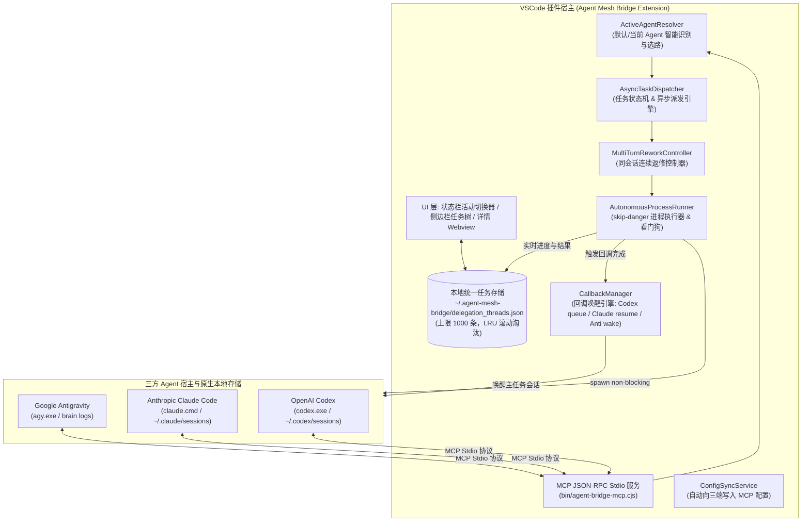
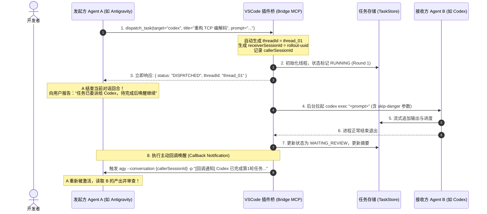
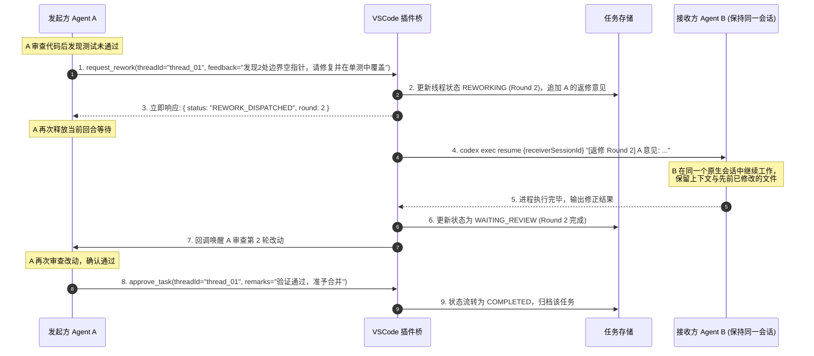

# 🌉 多 Agent 协同桥接 VSCode 插件设计与架构规范 (Agent Mesh Bridge)

> **版本**：1.0.0  
> **状态**：已评审 (Approved)  
> **适用范围**：VSCode 扩展、本地 Agent 协同网格 (Antigravity ⟷ OpenAI Codex ⟷ Anthropic Claude Code)

---

## 1. 系统定位与核心价值

本项目旨在构建一个高可靠的 Visual Studio Code 插件（**Agent Mesh Bridge**），将本地运行的三大主流 AI Agent——**Google Antigravity (`agy`)**、**OpenAI Codex (`codex`)** 与 **Anthropic Claude Code (`claude`)**——无缝打通为对等协作网络（Peer-to-Peer Agent Mesh）。

### 核心能力与关键特性

1. **默认 Agent 智能选路**：若有多款 Agent 可用，默认自动使用当前 VSCode 插件环境正在使用的 Agent，亦支持状态栏快速手动锁定。
2. **全向互派任务**：任意 Agent 均可作为发起方（Caller/A），通过插件内置 MCP 桥向任意接收方（Receiver/B）派发复杂开发任务。
3. **接收方原生会话留痕**：任务严格注入到接收方自身的原生会话存储中（Codex `rollout`、Claude `sessions`、Antigravity `brain`），接收方历史完全可见且可查。
4. **异步非阻塞回调 (Reactive Callback)**：A 下发任务后**立即释放当前对话**（无需长轮询等待），B 在后台无人值守运行；任务完成后，插件通过回调机制**主动唤醒 A 的原对话继续**。
5. **同会话多次返修直至认可 (Multi-Turn Rework)**：若 A 对 B 的产出不满意，可在**同一个原生会话中多次要求其返修**（保留上下文、修改历史与中间思考），直至 A 验收通过。
6. **1000 条任务中心与对话看板**：VSCode 侧边栏提供实时任务列表，以 `A -> B 标题` 格式呈现，显示对话摘要与轮次进度，支持点开查看全量多轮对话与 Diff 详情，持久化保留最新 1,000 条。
7. **全自动无人值守运行 (`skip-danger`)**：严格封装非交互与权限旁路参数，避免后台进程因权限询问、终端等待或 Git 安全检查而挂起卡死。

---

## 2. 整体系统架构与模块分解



### 核心模块职责说明

1. **`ActiveAgentResolver`（默认 Agent 判定）**：
   - 侦测当前 VSCode 前台宿主（Antigravity IDE 识别）；
   - 侦测前台活动扩展（`openai.chatgpt-*` 活跃状态）；
   - 侦测最近 5 分钟内会话文件（`mtime`）活跃度；
   - 响应状态栏手动切换事件。
2. **`AsyncTaskDispatcher`（异步派发引擎）**：
   - 负责解析 A 的下发意向，生成全局唯一 `threadId` 与接收方原生 `receiverSessionId`；
   - 立即向发起方返回 `DISPATCHED` 确认报文，断开长连接等待，允许 A 结束当前 Turn。
3. **`MultiTurnReworkController`（多轮返修控制器）**：
   - 维系 `threadId` ↔ `receiverSessionId` 强绑定；
   - 处理 A 的 `request_rework` 指令，递增轮次并在接收方原有原生会话中触发续聊命令。
4. **`AutonomousProcessRunner`（无人值守执行器）**：
   - 适配 Windows/macOS/Linux 跨平台进程拉起；
   - 注入各 Agent 专属的免交互与权限旁路标志（`--dangerously-skip-permissions` 等）；
   - 关闭 `stdin` 并配置 `CI=1` 环境变量；
   - 内置输出静默看门狗与最大超时保护。
5. **`CallbackManager`（回调唤醒引擎）**：
   - 监听任务各轮次完成状态；
   - 根据发起方类型调用各 Agent 原生唤醒信道（`codex queue`、`claude --resume`、`agy --conversation`），触发 A 的下一轮推理。
6. **`TaskStore`（1,000 条任务中心）**：
   - 单文件/轻量存储 `~/.agent-mesh-bridge/delegation_threads.json`；
   - 保证最多 1,000 条任务历史，超出部分自动截断清理；
   - 跨进程文件监听与原子写入。

---

## 3. 核心业务流程与交互时序

### 3.1 初始下发与异步回调流程 (Initial Dispatch & Callback)



### 3.2 同会话多轮返修流程 (Multi-Turn Rework Loop)



---

## 四、数据契约与存储规格 (保留 1000 条)

### 4.1 数据模型定义 (`DelegationThread`)

```typescript
export type AgentId = 'antigravity' | 'claude_code' | 'codex' | 'vscode_chat';
export type ThreadStatus = 'running' | 'waiting_review' | 'reworking' | 'completed' | 'failed';

export interface DelegationThread {
  threadId: string; // 唯一任务线程ID, e.g. "thread_20261016_163000_a7f9"
  title: string; // 任务简短标题, e.g. "修复 TCP 游标错位"
  initiatorAgent: AgentId; // 发起方 A
  targetAgent: AgentId; // 执行方 B
  status: ThreadStatus; // 线程生命周期状态
  currentRound: number; // 当前轮次 (1: 初次, 2+: 返修第N轮)
  createdAt: string; // ISO8601 创建时间戳
  updatedAt: string; // ISO8601 最近更新时间戳

  // 原生会话标识绑定 (关键: 支持在同一会话中持续 resume)
  receiverSessionId: string; // 目标 Agent 原生会话 ID
  callerSessionId?: string; // 发起方会话 ID (用于回调定位)
  workspacePath: string; // 执行工作区绝对路径

  // 列表快速摘要 (用于侧边栏直接展示)
  summary: {
    lastPromptSnippet: string; // A 最近一次发言简述 (前 100 字符)
    lastOutputSnippet: string; // B 最近一次回复简述 (前 150 字符)
    totalDurationMs: number; // 累计耗时 (毫秒)
  };

  // 完整多轮交互历史 (点开详情时展示)
  rounds: DelegationRound[];
}

export interface DelegationRound {
  round: number; // 轮次编号: 1, 2, 3...
  type: 'initial' | 'rework' | 'approval';
  prompt: string; // A 在此轮下发的任务说明或返修意见
  output?: string; // B 在此轮产出的回复正文与修改描述
  error?: string; // 若执行失败，记录错误信息
  durationMs: number; // 该单轮执行耗时
  status: 'running' | 'completed' | 'failed';
  timestamp: string; // 该轮触发时间
}
```

### 4.2 1000 条容量控制与磁盘持久化规则

1. **物理路径**：`~/.agent-mesh-bridge/delegation_threads.json`。
2. **截断策略**：每次更新或新增任务后，按 `updatedAt` 降序排序，超出 1,000 条的记录从尾部自动剔除，确保文件大小维持在可控范围内（通常约 10–20 MB）。
3. **原子写入**：使用 `fs.writeFileSync` 写入临时文件后执行原子重命名，防止多进程或多窗口写入竞争。
4. **变动监听**：VSCode 扩展宿主采用 `fs.watchFile`（1秒防抖轮询），一旦磁盘数据变化即触发侧边栏 UI 响应刷新。

---

## 五、全自动无人值守执行规范 (`skip-danger`)

针对三端 Agent，制定统一的免交互、提权与防挂起命令行矩阵：

| 目标 Agent                 | 命令行执行模板                                                                                                                                               | 关键安全与免交互参数说明                                                                                                                                                                                 |
| :------------------------- | :----------------------------------------------------------------------------------------------------------------------------------------------------------- | :------------------------------------------------------------------------------------------------------------------------------------------------------------------------------------------------------- |
| **OpenAI Codex**           | `codex.exe exec "<prompt>" --dangerously-bypass-approvals-and-sandbox --dangerously-bypass-hook-trust --skip-git-repo-check --ask-for-approval never --json` | • `--dangerously-bypass-approvals-and-sandbox`：绕过命令执行确认<br/>• `--ask-for-approval never`：禁止请求交互确认<br/>• `--skip-git-repo-check`：允许非 Git 或有未提交改动的目录                       |
| **Codex (返修续聊)**       | `codex.exe exec resume <receiverSessionId> "<feedback>" --dangerously-bypass-approvals-and-sandbox --json`                                                   | 继承上一次的 thread/session 会话上下文继续执行                                                                                                                                                           |
| **Claude Code**            | `cmd.exe /c "claude.cmd" -p "<prompt>" --session-id <uuid> -n "<title>" --permission-mode bypassPermissions --output-format json`                            | • `--permission-mode bypassPermissions`：跳过所有权限确认<br/>• `-p`：非交互式管道模式<br/>• `--session-id`：指定会话以供后续 resume                                                                     |
| **Claude (返修续聊)**      | `cmd.exe /c "claude.cmd" -p "<feedback>" --resume <receiverSessionId> --permission-mode bypassPermissions --output-format json`                              | 利用 `--resume` 原生参数在原对话中执行返修                                                                                                                                                               |
| **Antigravity**            | `agy.exe -p "<prompt>" --dangerously-skip-permissions --mode accept-edits --output-format stream-json`                                                       | • `--output-format stream-json`：流式输出防止看门狗误杀，并在首行获取原生 conversation_id<br/>• `--dangerously-skip-permissions`：自动同意所有工具调用<br/>• `--mode accept-edits`：自动接受代码编辑改动 |
| **Antigravity (返修续聊)** | `agy.exe --conversation <receiverSessionId> -p "<feedback>" --dangerously-skip-permissions --mode accept-edits --output-format stream-json`                  | 自动在原有 conversation 中追加回合，流式传输防止 180s 静默看门狗误杀                                                                                                                                     |

### 进程防护机制：

- **`child.stdin.end()`**：进程启动后立即关闭标准输入流，若 CLI 尝试等待用户交互键盘输入将立即退回或报错，防止永久假死。
- **环境变量注入**：
  `CI=1`, `NON_INTERACTIVE=true`, `FORCE_COLOR=0`, `TERM=dumb`, `DEBIAN_FRONTEND=noninteractive`。
- **静默看门狗**：若子进程连续 180 秒无任何 stdout/stderr 输出且仍在运行，触发告警或强制 kill，避免死循环。
- **单轮总超时**：默认放宽至 2 小时（120 分钟 / 7,200 秒），支持配置项 `agentMeshBridge.taskTimeoutMinutes` 自定义，充分满足超大型代码重构与多文件自动化开发需求。

---

## 六、对外提供的标准 MCP 工具清单

插件随附的 Stdio MCP 服务器（`bin/agent-bridge-mcp.cjs`）向三方 Agent 暴露以下核心能力：

### 1. `dispatch_task`（异步下发初始任务）

- **功能**：由 A 向 B 发起全新任务，创建任务线程并立即返回。
- **参数**：
  - `targetAgent` (string, 可选): `'default' | 'codex' | 'claude_code' | 'antigravity'`（默认 `'default'`）
  - `title` (string, 必填): 任务名称简述（10–30字）
  - `prompt` (string, 必填): 具体任务要求、目标与约束
  - `callerSessionId` (string, 可选): A 当前会话 ID（用于完成时唤醒）
  - `workspacePath` (string, 可选): 工作区路径
- **返回值**：`{ threadId, status: "DISPATCHED", message: "Task started in background. Conclude your turn and await callback." }`

### 2. `request_rework`（要求在同一会话中返修）

- **功能**：A 对 B 的某轮结果不满意，向同一个会话下发返修意见。
- **参数**：
  - `threadId` (string, 必填): 原任务线程 ID
  - `feedback` (string, 必填): 具体的返修意见、缺陷描述或补充要求
- **返回值**：`{ threadId, round, status: "REWORK_DISPATCHED", message: "Rework dispatched to the same session. Await callback." }`

### 3. `approve_task`（验收通过，终结任务）

- **功能**：A 确认 B 的工作已达到验收标准，关闭任务线程。
- **参数**：
  - `threadId` (string, 必填): 任务线程 ID
  - `remarks` (string, 可选): 最终总结或确认信息
- **返回值**：`{ threadId, status: "COMPLETED", message: "Task approved and archived." }`

### 4. `list_recent_tasks`（查询历史任务列表）

- **功能**：检索最近的委派任务列表（上限 1000 条）。
- **参数**：
  - `limit` (number, 可选): 默认 20，最大 1000
  - `statusFilter` (string, 可选): `'all' | 'running' | 'waiting_review' | 'completed'`
- **返回值**：包含 `threadId, title, initiatorAgent, targetAgent, status, currentRound, summary` 的对象数组。

### 5. `get_thread_details`（查看单条任务完整交互历史）

- **功能**：拉取某任务全部轮次的详细 Prompt 与 Output。
- **参数**：
  - `threadId` (string, 必填): 任务线程 ID
- **返回值**：完整的 `DelegationThread` 对象。

### 6. `invoke_agent`（同步阻塞调用，保留轻量级即时使用）

- **功能**：适合 30 秒内的即时问答或小型代码片段审查。

---

## 七、VSCode 插件 UI 呈现与用户体验

### 1. 侧边栏任务中心 (`Agent Mesh Hub`)

VSCode 左侧活动栏新增专属图标，展开后显示两组视图：

- **活跃与待验收任务 (Active & In-Review)**：
  - 以徽章显示发起方与接收方：`[Anti ➔ Codex]`
  - 显示轮次与状态：`🟡 修复 TCP 游标错位 (第 2 轮返修中)`
  - 两者对话最近一条摘要：
    - _A: "第48行断言在重连时仍会触发空指针，请补充边界判断"_
    - _B: "正在运行回归测试并重新构建..."_
- **历史归档列表 (Recent 1,000 Tasks)**：
  - 支持关键字搜索（支持按标题、发起方、接收方检索）
  - 显示完成时间与总轮次（例如：`🟢 共 3 轮返修完成 · 耗时 2m15s`）

### 2. 详情交互抽屉 (Task Detail Webview)

双击任务列表中的任意一项，在编辑器区域打开丰富的交互面板：

- **顶部信息条**：展示 `Thread ID`、双方 Agent 标识、原生会话 ID、当前轮次。
- **操作快捷键**：
  - 【在终端中接管原生会话】（自动拼接 `codex resume` 或 `claude -r` 指令）
  - 【人工介入追加返修意见】（允许人工在 UI 界面输入 prompt 直接唤醒 B）
  - 【一键标记通过 (Approve)】
- **多轮交互时间轴**：按 Round 1、Round 2、Round 3 分卡片渲染，支持 Markdown 渲染、语法高亮与 Git Diff 视图。

### 3. 状态栏活动 Agent 切换器 (Status Bar)

右下角常驻状态栏按钮：

- `$(hubot) Agent Bridge: Codex (Auto)`
- 点击弹出快速选择框：
  - `Auto-Detect (Current: OpenAI Codex)`
  - `Force: Google Antigravity`
  - `Force: Anthropic Claude Code`
  - `Force: OpenAI Codex`

---

## 八、目录结构与工程落地蓝图

```text
D:\agent_bridge\
├── package.json                   # VSCode 扩展配置 (含 commands, views, settings)
├── tsconfig.json                  # TypeScript 编译配置
├── DESIGN.md                      # 本设计架构规范全文
├── AGENTS.md                      # Agent 运行与开发指南 (开发本插件的规则)
├── bin\
│   └── agent-bridge-mcp.cjs       # 独立的 Stdio MCP 服务入口
├── src\
│   ├── extension.ts               # VSCode 扩展组合根与生命周期管理
│   ├── bridge\
│   │   ├── types.ts               # DelegationThread, AgentId, Round 等类型定义
│   │   ├── active-agent-resolver.ts# 默认 Agent 探测与选路算法
│   │   ├── async-dispatcher.ts    # 异步非阻塞任务派发器
│   │   ├── rework-controller.ts   # 同会话多轮返修控制器
│   │   ├── autonomous-runner.ts   # 跨平台 skip-danger 进程执行器
│   │   ├── callback-manager.ts    # 回调唤醒引擎 (Codex/Claude/Anti 适配)
│   │   ├── task-store.ts          # 1000 条任务持久化与 LRU 管理
│   │   ├── agent-detector.ts      # 本地可执行文件与环境探测
│   │   └── mcp-server.ts          # MCP JSON-RPC 协议解析与工具分发
│   ├── config\
│   │   └── config-sync.ts         # 自动向 ~/.gemini, ~/.claude, ~/.codex 注入配置
│   └── ui\
│       ├── task-tree-provider.ts  # 侧边栏 1000 条任务树视图
│       ├── detail-panel.ts        # 任务详情与多轮时间轴 Webview
│       └── status-bar.ts          # 状态栏当前 Agent 切换器
└── resources\
    └── bridge-icon.svg            # 插件品牌图标
```
