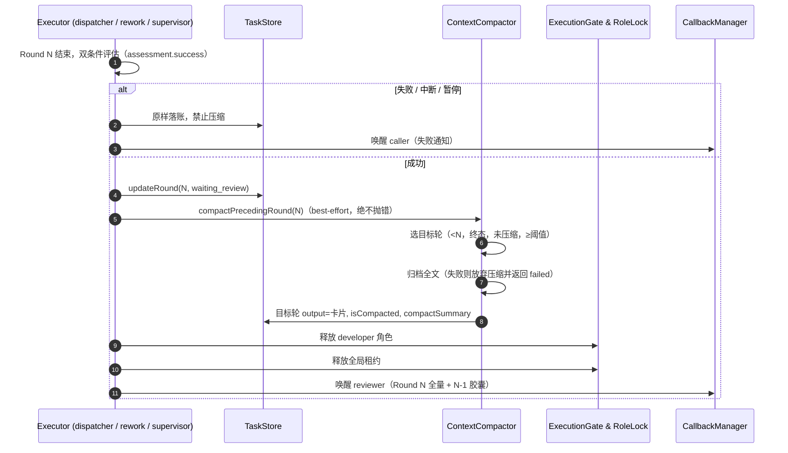

# 🧠 多 Agent 协同网格：上下文滞后压缩机制设计规范 (Lagged Context Compaction)

> **版本**：1.1.0（修订自 1.0.0 草案）
> **状态**：已评审并落地（v1：投影式压缩 + 冷存可分页）
> **适用范围**：Agent Mesh Bridge (VSCode 插件)、Google Antigravity (`agy`)、Anthropic Claude Code (`claude`)、OpenAI Codex (`codex`)、DeepSeek Harness (`dsh`)

---

## 0. 修订摘要（1.0.0 → 1.1.0）

1.0.0 草案的核心方向（账本与检视方上下文卫生、压缩必须可追溯、失败不压缩）成立，但有 5 处会导致错误实现或系统退化，本版据此改写：

| # | 1.0.0 的问题 | 1.1.0 的结论 |
| :-- | :--- | :--- |
| 1 | 认为“尾部协议包络”能瘦身 **Agent 原生会话** | 不能。桥接从不把历轮 `output` 注入下一轮 prompt，协议包络只影响账本，反而增加每轮 token。原生会话只受 CLI 自身或额外进程影响。 |
| 2 | 把原生 `/compact` 与“只压 N-1”当作等价 | 不等价。`/compact` 是**整会话**压缩，会连带压掉当前轮（N+1 正要用的那份）。且 `claude --help` 无相关开关，headless 支持未证实。v1 不调用。 |
| 3 | 压缩失败没有隔离 | 压缩发生在 `updateRound(waiting_review)` 与唤醒 reviewer 之间；任何抛错都会让任务级 FIFO 队头永久卡死。压缩必须 best-effort、绝不阻断回调。 |
| 4 | 直接改写 `round.output` | 多进程账本合并会“复活”旧数据（每个进程各持副本，`upsertTask` 以传入 rounds 覆盖）。必须加合并保护，否则压缩率不可持久。 |
| 5 | 冷存“永不删除” | 实测 248 轮已 16.1MB（均 65KB，峰 1.6MB），无界增长不可接受。冷存必须可定位、可清理，且读取必须分页。 |

另外补两项工程约束：胶囊是不可信模型产出（只展示，不驱动控制流）；`touchedFiles` 只认 git probe 的 `round.touchedFiles`，不另立来源。

---

## 1. 问题与目标

多轮返修下，两类上下文会膨胀：

1. **账本/热存储**：`delegation_threads.json` 保存每轮最终输出与指令。实测 26 个任务 / 134 轮 = 1.06MB，轮均输出 4.4K 字符、峰值 109K；1000 任务×10 轮的外推量级远高于 UI 与读取工具能舒适处理的范围。
2. **检视方上下文**：`get_thread_details` 过去无条件返回整条 thread（全部轮次 output）＋最近 1000 行日志，13 轮任务单次读取接近 200KB；reviewer 每轮都可能读。

**目标**：

- 当前轮（Round N）对 reviewer 永远 100% 保真；
- 被后续轮次取代的历史轮（≤ N-1）在热存储中变为有界摘要/摘录，并可一键回溯全文；
- 检视方默认只拿到有界视图，需要深挖时按轮、分页取用；
- 任何压缩动作都不能影响任务推进、角色交接或全局串行不变量。

**非目标**（v1 明确不做）：

- 不主动改写 Agent 原生会话（不跑 `/compact`、不注入额外压缩进程）；
- 不压缩 reviewer 自己的原生会话；
- 不删除任何轮次的原始数据（清理策略见 §7，另行配置）。

---

## 2. 核心模型：滞后一层（N-1）

```
Round N-1 执行 → 输出保持原样
Round N   执行 → 依赖 N-1 的完整上下文，产出新结果
Round N   成功落账后：
    ├─ Round N   ：保持 100% 原始（reviewer 的一手凭据）
    └─ Round N-1 ：归档全文 → 热存储替换为“提纯胶囊/确定性摘录”
```

- 压缩目标是**严格早于当前轮**、且已经进入终态（`completed`/`failed`）的轮次。
- `failed` 轮也允许压缩其 `output`，但 `error`、`status`、`interruption` 一律保持原样。
- 合成的 `approval` 轮不参与压缩。
- 若 N-1 太短（默认 < 1500 字符）则跳过，并允许压缩更早的、满足阈值的轮次；这样小轮次不会永久堵住大轮次。
- **无收益不压缩**：卡片（含约 400 字符头部）若不小于原文，则保留原样并返回 `no_size_benefit`，绝不把可读输出换成更大的卡片，也不留下无用归档。

---

## 3. 压缩来源：Agent 胶囊优先，确定性截断兜底

### 3.1 Agent 胶囊（语义，优先）

在**执行期**（不是账本里）给续聊/返修轮追加一段系统协约，要求 Agent 在最终回复末尾附带：

```markdown
<context_compaction>
- 核心决策: ...
- 涉及文件: ...
- 已消解问题: ...
- 长效约束: ...
</context_compaction>
```

约束：

- 只追加到**实际执行的 prompt**（`runner.execute` 的入参），不写回 `round.prompt`。账本保留调用者的原话，`repeatOfRound` 检测与 UI 不受影响。
- 仅对 `isRework === true && round >= 2` 注入；首轮无历史，重新开始的原生会话（改派换 Agent）也不注入。
- 必须从 `extractAnswerOnly()` 之后的**最终文本**解析标签，不能对原始 stdout 正则：Codex/DSH 是 JSONL，换行被转义。
- 胶囊正文上限 4,000 字符；解析失败 ≠ 压缩失败，直接退回确定性截断。

### 3.2 确定性截断（永远可用）

Agent 未产出胶囊时，卡片由桥接自己生成：原文头 900 字符 + 尾 500 字符 + 归档路径与执行日志路径，总长上限 2,400 字符。**不丢弃任何数据**，也不假装这是语义总结。

### 3.3 明确不做的原生 `/compact`

`claude -p "/compact" --resume <id>` 与 `agy` 的等价调用不进入 v1：

- `/compact` 压缩整个会话，无法只压 N-1，会与“当前轮保真”冲突；
- `claude --help` 没有任何 compact 开关，headless 行为未证实（本机探测未得到可用结论）；
- 额外进程会占用全局串行槽、需要权限旁路（有改工作区风险），当前收益不足以抵消风险。

如未来要启用，必须：能力探测失败即跳过、只读工具权限、硬超时、默认关闭、绝不因失败阻断交接。

---

## 4. 数据契约

```typescript
export type CompactionSource = 'agent_protocol_envelope' | 'deterministic_truncation';

export interface CompactedContextSummary {
  headline: string;
  /** 只取 git probe 的 round.touchedFiles，不采信 Agent 自述。 */
  touchedFiles: string[];
  resolvedIssues: string[];
  longTermConstraints: string[];
  rawOutputPath?: string;      // 压缩前全文归档（绝对路径）
  executionLogPath?: string;   // 该轮原始 stdio 日志（若存在）
  metrics: {
    originalChars: number;
    compactedChars: number;
    compressionRatio: number;  // compactedChars / originalChars，0..1
    compactedAt: string;
    source: CompactionSource;
  };
}

export interface DelegationRound {
  // ...既有字段...
  isCompacted?: boolean;
  compactSummary?: CompactedContextSummary;
  rawOutputFilePath?: string;
  outputBytes?: number;
}
```

设计取舍：

- 只保留 `isCompacted` 作为布尔快捷位，结构化信息只有 `compactSummary` 一个来源；
- `metrics.compressionRatio` 用数值（0..1），展示层再格式化为百分比；
- 投影视图（MCP 返回的 `outputTruncated`/`fullOutputChars`/`recallHint`）是**临时字段**，不落账本。

---

## 5. 执行时序与失败隔离



**失败隔离是硬约束**：三个执行器（`async-dispatcher` / `rework-controller` / `task-supervisor`）都在 `finally` 里释放租约，若压缩抛错且发生在 `notifyCaller` 之前，reviewer 永不唤醒，`waiting_review` 队头会阻塞整个网格。因此：

- `compactPrecedingRound()` 内部捕获所有异常并返回 `CompactionOutcome`；
- 调用点统一走 `compactRoundBestEffort()`，忽略返回值；
- 压缩先写归档、后改账本；归档失败即放弃压缩（宁可不压，不可丢数据）。

---

## 6. 存储分层与读取

### 6.1 热存储（`delegation_threads.json`）

- Round N（最新）：全量 `output`；
- 历史轮：`output` 为胶囊卡片（≤ 2,400 字符），并附 `compactSummary`；
- 未达到阈值或尚未被取代的历史轮：保持原样，由读取层做投影截断。

### 6.2 冷存储（`~/.agent-mesh-bridge/logs/`）

| 文件 | 内容 | 写入方 |
| :--- | :--- | :--- |
| `<threadId>_round_<n>.log` | 原始 stdout/stderr 字节流 | 三个执行器（rework 本次补齐） |
| `<threadId>_round_<n>.output.md` | 压缩前 `round.output` 全文 | `ContextCompactor` |

文件名统一由 `src/bridge/round-log.ts` 生成，避免三处手写路径漂移；`findLatestExecutionLog()` 按**轮号数值**取最新（修复了旧实现按文件名排序导致 10 轮以上取到 round_9 的缺陷）。

### 6.3 读取面

| 入口 | 默认行为 | 深挖方式 |
| :--- | :--- | :--- |
| `get_thread_details` | 最新轮全量；已压缩轮直接给卡片；其他超长历史轮截断到 4,000 字符并附 `recallHint`；**不返回 1,000 行日志** | `includeRawLogs: true` 返回完整历史 + 日志 |
| `get_round_raw_log` | 单轮、默认 20KB、上限 200KB、分页 | 传 `offsetBytes=nextOffset` 继续；`source:"execution"` 读原始 stdio |
| 详情面板 | 历史轮渲染为“🧠 Agent 上下文提纯胶囊”卡片，显示原文/摘要/压缩率/来源 | “查看原始全文”按钮直接打开归档文件 |

冷存读取一律分页：把 1.6MB 日志一次性灌进 caller 上下文，正是本机制要解决的问题。

---

## 7. 保留与清理

- 当前实现**不自动删除**冷存文件（便于排障），但所有入口都已支持按轮定位与分页，为后续清理留好边界。
- 后续可加策略（不在 v1 范围）：按任务删除时同步清理 `logs/<threadId>_*`、按总容量 LRU 淘汰已 `completed` 且超过 N 天的归档。
- 1000 条任务上限仍由 `TaskStore` 负责；压缩只影响单条任务内部体积。

---

## 8. 与核心铁律的关系

| 铁律 | 落实方式 |
| :--- | :--- |
| 响应成功双条件（15） | 只有 `assessment.success === true` 才触发压缩；`NONZERO_EXIT` / `EMPTY_OUTPUT` / `STREAM_STALLED` / 暂停 / 超时一律不压。 |
| 单任务单一角色（12） | 压缩在 developer 释放角色锁之前完成；任何失败都不影响随后的 reviewer 唤醒。 |
| 可暂停、可删除、可追溯（11） | 压缩前先归档全文；`get_round_raw_log` 与详情面板都能回溯；删除任务仍走墓碑日志。 |
| 全局串行执行（8） | 压缩不启动任何子进程，只做本地文件与账本写入，因此不新增租约占用与排队延迟。 |
| 派发即结束 Turn（19） | 读取投影不改动轮询指纹；reviewer 仍通过回调被唤醒，不需要轮询。 |
| 文件归属互斥（17） | 胶囊的 `touchedFiles` 直接复用 git probe 结果，不引入第二事实来源。 |
| 模型两端留痕（18） | 压缩不改变 `targetModel` / `initiatorModel`，改派仍走显式入口。 |

---

## 9. 代码落点

| 文件 | 职责 |
| :--- | :--- |
| `src/bridge/types.ts` | `CompactionSource`、`CompactedContextSummary`、三个轮次可选字段。 |
| `src/bridge/round-log.ts`（新） | 日志/归档路径、安全 threadId、数值取最新轮、分页读取。 |
| `src/bridge/bridge-policy.ts`（新） | `bridge-policy.json` 策略镜像（`contextCompaction`、阈值），供 MCP 进程读取。 |
| `src/bridge/context-compactor.ts`（新） | 协议注入、胶囊解析、目标轮选择、归档、卡片渲染、幂等与失败隔离。 |
| `src/bridge/task-store.ts` | 合并保护：已压缩轮不被旧的未压缩副本覆盖。 |
| `src/bridge/async-dispatcher.ts` / `rework-controller.ts` / `task-supervisor.ts` | 注入协议（仅续聊轮）、成功后 best-effort 压缩；rework 补齐每轮 stdio 日志。 |
| `src/bridge/mcp-server.ts` | `get_thread_details` 有界投影 + `includeRawLogs`；新增 `get_round_raw_log`。 |
| `src/ui/detail-panel.ts` | 胶囊卡片、指标与“查看原始全文”。 |
| `src/extension.ts` / `package.json` | `agentMeshBridge.contextCompaction` 开关与镜像。 |

---

## 10. 验收与测试

`src/test/context-compactor.test.ts` 覆盖：

- 协议只对 `round >= 2` 注入，且不改写调用者 prompt；
- 中文胶囊解析、未闭合标签、无结构键的兜底；
- 历史轮被压缩、当前轮逐字不变、全文归档逐字一致；
- Agent 不配合时的确定性头尾卡片；
- `failed` 轮可压且 `error` 保留；`approval` 轮与过短轮跳过；
- 卡片不比原文小时保留原样（`no_size_benefit`），且不产生归档；
- 幂等、策略关闭、归档失败返回 `failed` 且不丢数据；
- 旧副本回写不能复活已压缩轮；
- 最新日志按轮号数值选择、分页读写边界。

`src/test/mcp-server.test.ts` 覆盖：默认视图截断/最新轮全量/日志不默认下发、`includeRawLogs` 全量、`get_round_raw_log` 分页与上限钳制。
