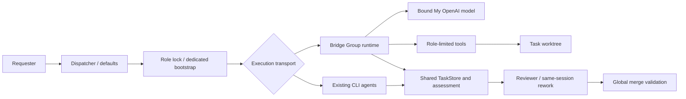

# Copilot 模型分组作为 Bridge Agent：My OpenAI 双角色设计

> 日期：2026-11-06（Asia/Shanghai）
> 状态：已实现并通过专用 Codex reviewer 验收；真实 GUI 与收费模型调用尚未验收。
> 基线：master `bafd1498277189211ba8ecc148496404e534d7fa`；已验收分组功能 `ac082a16215781909a6f339d5d379197a546a7ba`。

## 1. 产品目标与身份

用户可将已有 `My OpenAI` 分组启用为独立 Agent，组成员模型可执行开发任务，也可作为任务发送方/专用 reviewer。每个已启用分组使用稳定 ID `copilot_group:<groupUuid>`，拥有独立发送模型、接收模型及双侧默认选择。实现是 Bridge 托管的模型 Agent：Bridge 负责工具循环、worktree、会话、角色和任务控制；模型来自用户绑定的 VS Code 宿主模型或兼容 API。`vscode_chat` 仍是原生 Copilot requester，绝不伪装成后台执行器。Agent 会话由 Bridge 保存、可分页追溯，并明确展示 owner 与 transport。

本任务必须完成 A–D 全闭环：注册与默认、真实开发工具循环、专用 reviewer/同会话返修、恢复与生命周期。枚举、开关、单轮问答、receiver-only 或 PoC 不算完成。

## 2. 用户配置与能力门槛

现有组菜单提供启停 Agent、接收/发送模型、默认接收/发送 Agent、授权和会话历史。Agent 选择器与详情展示组名、来源、完整实际模型引用。启用需要用户选择具体模型，并在当前可信本地 Git 工作区授权无人值守工具及续跑；调用来源和可能费用须明确，授权不得每轮重复弹出。

就绪按角色分别检查宿主在线、workspace/执行环境匹配、精确模型可访问且有结构化 tool calling、后续无人值守授权有效、会话可写、工具可取消以及所需角色服务。优先读取公开能力元数据，否则仅在用户显式触发时运行固定、无副作用的 tool-call 探测。探测绑定完整 vendor/id、组绑定版本和宿主代际。不能从 vendor、模型名、登录态或纯文本回复推断就绪。未知、过期、需要交互认证、宿主离线均拒绝 admission；不得静默回退 CLI/其他模型。仅支持本地 desktop、可信单一本地 Git workspace；Remote/WSL/Web 显式不可用。

## 3. 稳定 Agent 与模型绑定

动态组 ID 由注册表校验，任意匹配前缀的字符串不可自动注册。四端 CLI 静态列表和可执行注册表分开；CLI 可执行文件探测只遍历 CLI，admission 按 transport/角色检查。宿主模型引用为 `{source:'vscode-lm',vendor,id}`；兼容模型为 `{source:'openai-compatible',id}`，并绑定组、origin 和 revision；opaque ID 不拆分拼接。

任务创建固定 Agent/组非秘密快照、modelRef 和 binding revision。默认变更只影响新任务；已有任务模型不得漂移。重命名只变展示名。变更 origin/source 或删除被未终态/未合入任务引用的组须拒绝并说明任务。停用阻止新 admission，但不删除旧会话；中断使用统一 pause/cancellation。密钥仅在 SecretStorage，同 origin 绑定、禁止 redirect，密钥不进入快照、日志或工具结果。

## 4. 双侧默认和默认模型

`defaultAgent` 作为默认接收 Agent 扩展为可选择已注册组；新增 `defaultReviewer`（UI“默认发送方 / 检视 Agent”），缺省 caller 以维持既有行为。Dedicated 新任务的真实 requester 保留，实际 initiator/reviewer 可由用户默认选择，不得伪造 CLI caller/session。非 caller sender 仅 dedicated 可用；legacy 冲突应在创建前给出修正建议，不静默改策略。bootstrap 不能递归应用默认 sender。

CLI `models`/`initiatorModels` 保持原格式。新增版本化 `groupAgents[groupUuid].receiverModel`/`initiatorModel`，由用户配置服务维护，并镜像为 MCP 只读快照。保存或清空任一侧不抹另一侧、CLI 或其他组配置。不传模型使用对应侧默认；指定非默认模型必须经现有用户确认闸门。同组自派发仅 dedicated，双方都须已就绪且完整 modelRef 不同；sender 不可从 receiver 默认回退。配置无效/禁用不得静默退回 Codex。旧任务不迁移；retarget 换组必须重置 receiver session 并审计。

## 5. 单一状态机与多 transport

继续复用 `AsyncDispatcher`、`ReviewerBootstrapService`、`ReworkController`、`TaskSupervisor`、`QueueDrainer`、`CallbackManager`、`TaskStore`、`MergeCoordinator`。只新增按注册 Agent 选择 CLI 或 Bridge runtime 的 adapter 和宿主 mailbox，不复制 queued/running/waiting_review/approval 状态机。所有 dispatch/invoke、默认选路、bootstrap、初始开发、rework/retry/resume、callback、retarget、queue/supervisor、手动 reviewer 入口均覆盖 transport 分支。invoke 可用轻量问答，但不得嵌套启动完整自身 Agent。

## 6. Extension host 与 mailbox

API/SecretStorage 在 extension host；MCP/supervisor 不直接依赖 vscode。Host 发布非秘密注册表、hostInstanceId/generation、workspace URI/authority、Git commonDir、能力和 heartbeat。每次运行有唯一 runId；request 固定 thread/round/role/Agent/modelRef/binding revision/worktree/session/request sequence/host generation。不可由客户端传任意 cwd。

Mailbox 用 `getBridgeHome()` 版本化目录、结构与尺寸校验、独占创建/原子 rename、runId 幂等认领及有界扫描修复漏事件。accepted、状态、取消、最终结果均含序号与代际。接收结果前校验 tombstone、当前轮、角色锁、批准 SHA、取消和 host generation；旧/迟到/重复结果不能复活任务。Host 离线只中断归属它的运行并保留原 thread/session/worktree；无 host 时拒绝 admission。OS 同账号是既有信任边界；不能声称 mailbox 隔离恶意同账号进程。工具身份由已登记运行上下文推导，不信任 prompt/模型自报 role、Agent 或 session。

## 7. 模型工具循环与控制边界

执行规范消息序列：输入、assistant 文本/结构化 tool calls、各自 tool result、后续模型请求，直到真实 final 文本或明确失败。宿主模型从 response stream 读取结构化 tool-call parts，并按完整 vendor/id 选择对象；兼容端点支持 Chat Completions `tools`/`tool_calls`/tool result，校验 finish reason/参数。不要求 Responses、图像、任意 vscode 工具或私有 Copilot 接口。

Bridge 校验工具调用，绝不 eval 模型文本。最小工具集：worktree 内读/列/搜索、校验前提的写入/apply_patch、固定 cwd 的命令执行。限制输入输出体积；realpath 校验路径；记录每个 callId 的 intent/result；非法/未知/冲突调用受控失败。命令 stdin 关闭、超时、windowsHide、输出限量、真实 PID 登记、进程树取消；普通命令不是 OS 沙箱。Receiver 工具集中不得有 dispatch/invoke、approve/request_rework/record_merge_request；子进程标记 receiver。Reviewer 仅获得当前阶段所需只读工具及既有控制服务；控制服务验证 reviewer 原生会话和 thread 租约。Bootstrap 仅允许一次确认既有 prepared task，token 一次性；控制面成功交接后停止本轮。

## 8. 自有会话与生命周期

Agent 会话使用独立 Bridge namespace，记录 ownerAgentId、role、thread、workspace、source。消息及工具事件 append-only、有序、持久化，可分页查看。开发初轮、返修、重试、恢复及 reviewer 唤醒复用各自原会话；不复制/改写/删除用户 Copilot 原生会话。

工具执行前持久化 intent，完成后保存 result。崩溃留有未完成 intent 时标记副作用未知，先检查 worktree/子进程再恢复，命令等副作用不可盲重放；已完成 callId 只返回历史结果。暂停/删除先写统一任务状态与 CancellationRegistry，再取消模型流和真实 child，等确认停止后释放角色并记录 interruption。不能杀 extension host PID。继续用统一 retry/review_failed/round/role 规则。归档/删除清理 task-owned developer/reviewer 会话，但保护 legacy callerSessionId 与用户顶层会话。

## 9. 结果和计量

结果/assessment 为兼容判别分支：老记录缺 transport 按 CLI；CLI 原 exitCode/stdout 判定不变；Bridge runtime 不伪造 exitCode=0/stdout，持久化真实 run/session/final-event 证据。Bridge 成功要求模型请求和工具循环完整结束、非空 final、事件序列合法、无未结束工具、无截断，且当前 run 未暂停/删除、host generation 合法。只有 tool calls、reasoning、空正文、HTTP status 或模型自报成功均不足以成功。

新分支将错误、警告、实际模型、完整性、真实事件时间落 round.assessment；不适用的 CLI stdout 指标不得伪造。调用点更新摘要/日志/压缩以支持两种分支。模型请求/工具等待/总时限使用单调时钟并由 HostSuspensionGuard 扣除挂起；未知副作用结果不作为可自动重放的网络失败。token 只落 `round.tokenUsage`；真实 usage 累计重试，无 usage 时输入未知、输出按既有规则标 partial/estimated 或 unavailable，不用字符数/countTokens/价目表；成本只展示模型原生成本。实际 executorAgent/model/modelRef 留痕，TaskStore 合并保护新字段，不存 thread 聚合。

## 10. AGENTS/DESIGN transport 契约

正式说明：CLI 原生会话、参数、免交互和 exitCode+stdout 判定保持现状；Bridge Group Agent 的自有持久会话库是其 runtime native history；原生 Copilot requester 会话不托管。新 runtime 不伪造 CLI 参数或退出码。单任务单角色、receiver 禁转发、专用 reviewer、非默认模型审批、固定 SHA/worktree、全局合并验证、token 和生命周期规则同样约束新 Agent。不能满足自有历史、角色隔离和可靠取消时，不得标为完整 Agent。

## 11. MCP 与模型选择兼容

既有 CLI 字符串参数保持；Agent 字段通过 schema+动态注册表校验 group ID，并覆盖 dispatch/invoke/list/retarget/rework/retry/resume/控制结果。MCP 静态 enum 不得拒绝合法动态组。modelRef 结构化且同 ID 不同 vendor 不可混淆；非默认沿用 `modelRequestedByUser` 审批。调用者传参不能伪造 trusted requester/reviewer identity。组模型列表优先返回 configuredModel/ref，再给独立 initiator model/ref/source/capability；未知在线/能力状态明确 unknown。换模型默认保持 Bridge 会话；换 Agent/组按 retarget 规则重置 session。source/transport 变化须显式重新绑定。

## 12. 改动范围

涉及 `src/copilot/model-groups.ts`、命令/树、Agent 注册和 capability、runtime/tool executor/session store、extension-host broker/mailbox、types/model catalog/model approval/active resolver、dispatcher/supervisor/queue/rework/bootstrap/callback/registry、task store/assessment/token/compaction/summary/archive/cleanup、package/config sync、AGENTS/DESIGN 和真实闭环测试。允许按现有层次合并职责，不新增无用通用框架。不要硬编码组名、Luna 型号、当前用户路径、凭据或供应商地址。

## 13. 阶段与验收

- **A：** 动态组注册、双侧模型/Agent 默认、schema、审批、宿主能力 admission、规范、自有 session。验证模型/host 不可用及同组同模型拒绝。
- **B：** 假结构化 tool-call 模型驱动真实 worktree 工具和命令，产真实交付提交/assessment；覆盖暂停、超时、挂起、崩溃 unknown、续跑、retarget、迟到结果。
- **C：** Dedicated bootstrap → developer → reviewer → request_rework 同 reviewer/developer session → approve；覆盖 Group→CLI、CLI→Group、Group→Group 与同组不同模型。调用方集中 MR，receiver 不推送/评自己。
- **D：** UI 默认 sender/receiver 正常选路且记录真实 requester 与实际模型；默认变更不改已有任务；覆盖 archive/delete/summary/token/log/session 分页、旧副本合并。

测试隔离 bridge home、假的 host LM 和本地假 HTTP 模型，但保留真实 child 工具、Git worktree、role lock、dispatcher/supervisor/callback 状态服务。覆盖双侧保存/清空、CLI 兼容、vendor/id 冲突、审批、schema、receiver 控制面拒绝、重复 mailbox/final、取消/tombstone、路径/进程/session/组变更、空输出、CLI failure 和 native usage 缺失。至少一个默认 sender+receiver 完整返修闭环和宿主失联后原任务恢复。不得仅断言字符串或全 mock 状态服务。跑编译、相关测试、完整串行测试、diff 和 VSIX 模块检查；旧失败保留证据并修复/定位，不删除测试。GUI 与用户真实模型不可后台验证时明示，不把 mock 说成真实 Luna 调用。

## 14. 官方接口和未验证边界

- [VS Code Language Model API](https://code.visualstudio.com/api/extension-guides/ai/language-model)
- [VS Code API reference](https://code.visualstudio.com/api/references/vscode-api)
- [VS Code Language Model Tool API](https://code.visualstudio.com/api/extension-guides/ai/tools)

公开接口允许扩展构建自有模型执行循环，不保证接管原生 Copilot 对话。My OpenAI 中具体模型的工具调用与后台授权仍须启用时逐模型验证；组名、可见性或已有登录不替代此检查。
