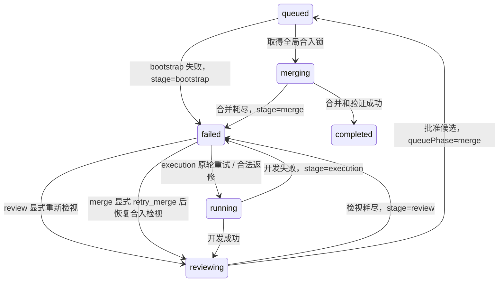

# 将 review_failed 和 merge_failed 合入 failed 的设计

状态：设计完成，待 GPT-6.1 Terra 实现。

本次把任务主状态从 10 个收敛为 8 个，使用 `failure.stage` 区分失败阶段。恢复入口、原生会话、角色交接、重试预算和未合入成果保留规则继续独立生效。此文是本次实现的需求依据；涉及旧状态字符串的既有文档在实现时同步更新。

## 1. 范围与现状

当前 `ThreadStatus` 同时包含 `failed`、`review_failed` 和 `merge_failed`。前者还承载 bootstrap 失败和开发执行失败；后两者分别表达检视未取得结论、合并重试预算耗尽。它们共同表示一个阶段失败，但恢复行为不同。

当前实现中还有以下耦合，必须一起处理：

- `CallbackManager.notifyReviewerOfFailure()` 用 `failed` 选择开发失败通知；直接合并字符串会误把检视、合并失败当作开发失败。
- `retryFailedRound()`、`retryMerge()`、重新检视、改派、暂停和 MCP 控制权限依赖旧状态区分恢复路径。
- `isTerminalThreadStatus()`、归档入口、1000 条容量淘汰和 `isMergePending()` 对旧状态采用不同规则。
- `finalSummary.kind`、缓存刷新、活动筛选、侧栏上下文和按钮依赖旧状态。
- `TaskStore.upsertTask()` 合并跨进程副本，不能让旧失败覆盖恢复，也不能让旧成功覆盖新失败。

本次不引入状态机框架、不增加依赖、不重构 Git 合并事务或模型路由。上次分析发现的普通 Reviewer 暂停能力、合并首次唤醒恢复窗口属于另一个修复范围，不借此扩展功能。

## 2. 数据模型

```ts
export type ThreadStatus =
  | 'queued'
  | 'running'
  | 'reviewing'
  | 'merging'
  | 'wait_decision'
  | 'paused'
  | 'completed'
  | 'failed';

export type FailureStage = 'bootstrap' | 'execution' | 'review' | 'merge';

export interface TaskFailure {
  stage: FailureStage;
  reason: string;
  at: string;
  round?: number;
  by?: string;
  code?: string;
}

// DelegationThread 新增
failure?: TaskFailure;
failureRevision?: number;
```

`failure` 描述当前失败，仅在 `status === 'failed'` 时作为控制面依据。`reason` 必须是非空错误原因；时间取已有失败事件或该次失败落账的时间，不在读取时生成。`round` 关联真实开发轮，不为检视/合并失败创建新开发轮次。

`failureRevision` 是失败进入/退出的局部版本号，旧任务缺失视为 0。进入新失败或成功提交显式恢复时递增；清除 `failure` 时仍保留新版本号，作为防止旧副本恢复失败字段的标记。相同失败事件重复落账应幂等，不重复递增。

保留现有详细记录：`reviewFailure`、`reviewWake`、`mergeControl`、`mergeHistory`、`round.error`、`assessment`、`interruptions[]`。`failure` 是当前失败的统一入口，具体证据仍取上述记录，不新增通用失败历史数组或重复保存完整日志。

成功恢复后清除当前 `failure`，保留既有审计历史。恢复失败、权限检查失败、模型确认拒绝等未实际完成转换的操作，不得清除失败或推进版本号。非失败态遗留的历史 `reviewFailure` 不代表任务当前仍失败。

## 3. 阶段与恢复契约

| 阶段 | 进入条件 | 允许的恢复 | 禁止的默认行为 |
|---|---|---|---|
| `bootstrap` | 专用 Reviewer 初始化失败，尚未完成可靠会话交接 | 沿用既有显式同任务恢复能力；无安全凭证时维持失败并说明原因；可删除 | 创建替代任务、token 或原生会话；按开发失败重跑 |
| `execution` | 开发轮次的响应评估失败或非用户中断 | `retry_task` 原地重试最新失败开发轮；Reviewer 根据现有规则返修或验收 | 将旧历史失败轮当最新轮重跑 |
| `review` | 已交付，检视重试耗尽或不可恢复挂起 | 显式重新检视原 Reviewer；按现有权限返修或验收 | 普通 retry 重跑已成功开发轮；自动再次唤醒耗尽的检视 |
| `merge` | 合并问题相同 fingerprint 连续第六次 retry 失败 | `retry_merge` 开启新一代预算；删除仍受未合入保护 | 普通 retry、rework、approve、retarget、pause 或定时器隐式恢复 |

暂停是用户控制，继续使用 `paused`，不得归入 `failed`。`wait_decision` 继续使用原状态；认证/权限问题进入等待决定的现有行为保留。只有 gap warning 且有实际最终输出的成功轮次不得进入任何失败阶段。

`failed` 表示当前阶段失败，不等于所有成果均可丢弃，也不保证没有正在执行恢复决策的 Reviewer。例如开发失败通知仍可在 `failed/execution` 下启动原 Reviewer。

### 主流程



图中从 `failed` 出发的动作都必须校验失败阶段。原有角色锁、单轮在飞、bootstrap、会话身份和归档不可恢复约束继续优先执行。

### 恢复入口的具体调整

1. `retryFailedRound()` 只接受 `failed/execution`，且仍要求最新工作轮为失败；`failed/review` 返回“使用重新检视”，`failed/merge` 返回“使用 retry_merge”，bootstrap 返回既有安全交接错误。不追加轮次。
2. `reopenFailedReview()` 只接受 `failed/review`，回到 `reviewing`、清理旧唤醒计划和当前失败，保留 `reviewFailure`。`notifyReviewer()` 只能从这个阶段走重新检视分支；不能把普通 `failed` 全部重开。
3. `retryMerge()` 只接受 `failed/merge`，保留 thread、批准快照、合并工作区和两端 session，增加 `retryGeneration`、清理当前失败，并按恢复阶段回到 `reviewing` 或 `queued`（merge）。工具名不改。
4. rework/approve/retarget 在 `failed/merge` 继续拒绝；execution/review 沿用原有准入，bootstrap 不得绕过 `assertDedicatedReviewerReady()`。所有入口都保留 `archivedAt` 拒绝恢复。
5. `pause_task` 继续拒绝失败态；恢复暂停任务仍使用 `resume_task`，不能把失败状态当暂停恢复。
6. 用户决定提交是 `wait_decision -> reviewing`，恢复原检视阶段；不得因为统一失败字段而调用 `retryMerge()` 或重置合并预算。

## 4. 写入、回调与并发副本

在现有 types/失败处理模块内增加少量阶段判断和进入/清除失败的共享函数即可，不建立通用转换引擎。所有现存失败写入点都要改造，不能只修改枚举和 UI。

- Dispatcher、Supervisor、ReworkController 的开发结果分支写 `failed/execution`；bootstrap token 写入失败、服务失败、恢复时凭证缺失写 `failed/bootstrap`，同时结束对应占位轮。
- `applyReviewFailure()` 写 `failed/review`，reason 取该次 `ReviewFailure.reason`；仍只允许从当前有效 `reviewing` 转换。
- `noteMergeFailure()` 保留 fingerprint、初次失败不算 retry、连续第六次 retry 失败的算法；达到阈值时写 `failed/merge`，reason/code 取触发阈值的失败，而非旧开发轮错误。低于阈值时合入问题交回 `reviewing`。
- 合并失败落账后，停止该任务自动合并和 Reviewer 唤醒，按既有取消/退出机制释放进程、角色和会话租约。不能仅改成 `failed` 后仍被开发失败通知重新激活。
- `notifyReviewerOfFailure()`、失败唤醒队列重放只处理 `failed/execution`；review/merge/bootstrap 走自己的路径。旧 pending failure wake 重放时重新读取任务并检查阶段，拒绝错阶段重放。
- `ReviewWakeScheduler` 的普通检视耗尽和合并 Reviewer 重试分支分别落账到 review/merge；候选仍由 `isReviewerWakeEligible()`、预算、角色和会话锁决定，不把所有 `failed` 纳入定时调度。

### 跨进程与延迟结果

1. 每次执行/检视回调捕获启动时的 `failureRevision` 和原有 round/attempt 标识。提交结果前重读任务；已归档/删除、角色交接或失败版本已变化时，不得用旧结果更改当前失败和生命周期。
2. 进入失败或恢复在现有角色/控制面保护下，基于新鲜任务副本推进版本；不得从陈旧对象计算新版本。继续使用 mergeControl.revision 保护合并决策，两者职责不互相替代。
3. `TaskStore.upsertTask()` 以最新持久化失败版本保护 `failure` 及关联状态：旧版本不得清掉新失败，也不得把已恢复任务重新写成失败。清除失败后的版本标记不能被字段缺失的旧副本抹掉。
4. 相同版本的不同状态不能凭“incoming 最后写入”推翻持久化的失败/恢复结果。合法新转换必须先推进版本；对无法判定的同版本冲突保留持久化状态并拒绝/丢弃陈旧转换。角色锁和新鲜副本是前提，版本比较不宣称提供跨进程原子计数器。
5. 已完成的本地 Git 集成继续保持单调：真实 `integration.phase === 'merged'` 的完成证据不被任何失败旧副本降级。实现必须验证此规则与现有 integration 时间戳、mergeControl 版本保护的优先级。
6. `progressSignature()` 纳入失败阶段及版本，避免 failed 内阶段/恢复代次变化被重复轮询守卫误认为没有进展。

## 5. 终态、摘要与成果保留

生命周期终态判断统一为 `completed | failed`。它用于结果展示和未完成统计，不直接授权归档或淘汰。`isTaskUnfinished()` 可据此收敛；运行时继续候选独立调度，不恢复全局 FIFO。

### 归档与容量

- `failed/merge` 不自动归档、不容量淘汰；即便旧数据缺少 worktree 或 merge 元数据，也不能据此判为安全。
- `failed/review` 的容量淘汰继续保留旧 review_failed 的保护，不因归并为 failed 而进入普通失败淘汰分支。归档仅在现有安全条件满足、没有未合入成果时允许。
- bootstrap/execution 失败和 completed 沿用既有安全保留策略，不放宽 Git 交付证据要求。worktree 缺失、证据不完整不能当成已合入。
- `isMergePending()` 的旧 review_failed 特例改成阶段判断；已批准快照、未合入改动、冲突/验证现场的保护不因状态归并而消失。
- 提取/复用一个任务级归档准入谓词，至少同时用于 `selectTasksToArchive()`、`TaskStore.archiveTask()` 和 `archiveThreadData()`。直接调用底层归档也必须拒绝 failed/merge 和未合入成果；租约准入、先完整写归档再清活动文件的顺序保留。
- 普通删除和 force 删除继续按实际本地集成证据判断，不根据 failed 放行。MR 元数据不替代本地集成证明。

### 终态摘要

`TaskFinalSummary.kind` 对新摘要只写 `completed | failed`，增加可选 `failureStage`、`failureRevision`。合并失败现在也生成确定性摘要，但生成摘要不表示可归档。

failed 的 verdict/error 首先使用当前 `failure.reason`；review 阶段必须使用当前 reviewFailure 的原因，merge 阶段必须使用本次预算耗尽的合并原因，不能被早先开发轮 error 盖掉。tokens、MR、交付记录继续从既有事实派生。

`ensureFinalSummary()` 不能仅比较 kind：失败阶段/版本变化、恢复后再次失败需要刷新；恢复离开 failed 后不得把旧摘要作为当前终态输出。保留原有显式记录 MR 后刷新摘要的行为。归档任务只投影已有摘要，不依赖空 rounds 重建历史，不改写归档压缩包。

## 6. 旧账本与 API 兼容

采用现有 `normalizeThread()` 的读时规范化，不做启动时批量写盘，不启动恢复动作。

| 旧记录 | 规范化结果 |
|---|---|
| `status=review_failed` | `status=failed`，stage=review |
| `status=merge_failed` | `status=failed`，stage=merge |
| 旧 `status=failed` 且 bootstrap.phase=failed | stage=bootstrap |
| 其他旧 `status=failed` | stage=execution |
| 已有合法 `failure.stage` | 保留，禁止被历史 reviewFailure/mergeHistory 重新推断 |
| `status=reworking` | 继续按现有规则转为 running |

旧 failed 携带的 `reviewFailure` 或 `mergeHistory` 可能只是历史，不能仅凭它们将 execution 失败改判为 review/merge。旧明确状态与失败字段冲突时，明确旧状态决定其阶段，保留详细历史并采用对应阶段的可靠失败原因。

补齐描述所需字段从已有 reviewFailure、mergeHistory/mergeControl、bootstrap、最新开发轮及 interruption 取值；无可靠原因时使用明确的“旧任务失败，原因未记录”，时间回退到记录的 updatedAt/createdAt。缺失失败版本视为 0，不伪造执行、时间或重试次数。原始轮次、session、worktree、SHA、token 和中断历史全部保留。

旧 `finalSummary.kind=review_failed` 在读取投影中转为 `kind=failed, failureStage=review`，保留摘要正文及原时间。旧 archived 任务保持 archived、空 rounds，不能被规范化重新激活；不重写磁盘归档。旧记录下一次正常持久化时才写新状态。

### MCP 和 UI

- 正式状态枚举只剩 8 个；新账本、新任务返回值、details 和 summary 不再输出旧生命周期字符串。
- `statusFilter=failed` 返回所有阶段失败；兼容输入别名 `review_failed` / `merge_failed` 分别筛选 `failed + 对应 stage`。schema 将它们标为 deprecated 输入别名，不作为独立状态宣传。原 reworking 别名继续保留。
- 列表和详情暴露有界的 `failure`、`failureRevision`，摘要返回 `failureStage`；repeatPoll 短载荷也提供失败阶段，保持可操作含义。
- `active` 筛选保留旧行为：failed/merge 仍显示在待处理列表；failed/execution、failed/review 不因归并而全部进入活动列表。检视失败继续可从最近任务查看和恢复。
- 侧栏和详情用 stage 派生“初始化失败 / 开发失败 / 检视失败 / 合并失败”，保留 merge 失败只显示“重试合并 / 删除”的操作面。上下文菜单、命令 handler、Webview 消息和 MCP 权限必须使用一致的阶段检查，不能只隐藏按钮。
- `retry_merge`、`retry_task`、重新检视等现有工具/命令名称保持不变；不新增统一 retry 工具。更新工具说明中的状态、错误提示和恢复建议。
- 生命周期失败统计涵盖所有 failed，检视/合并专属统计按 stage 派生；依赖任务终态判断继续涵盖 failed，唤醒表示依赖已结束而非依赖已成功交付。

兼容范围是旧账本/旧筛选输入可被新版本读取。升级需要重启扩展宿主和 MCP 写入进程，不承诺新旧版本并发写同一账本。

## 7. 实施文件范围

按实际调用链搜索补齐，至少覆盖：

| 范围 | 文件与工作 |
|---|---|
| 类型与兼容 | `src/bridge/types.ts`、`task-store.ts`：8 状态、failure、版本保护、规范化、筛选和归档入口 |
| 失败写入 | `async-dispatcher.ts`、`task-supervisor.ts`、`rework-controller.ts`、`reviewer-bootstrap.ts`、`review-wake.ts`、`merge-recovery.ts`；检查 native compaction 和其它动态失败分支 |
| 恢复/回调 | `callback-manager.ts`、`review-wake-scheduler.ts`、`task-retarget.ts`、`task-control.ts`、`caller-poll-guard.ts`；失败队列重放和旧轮回调 |
| 集成/保留 | `merge-coordinator.ts`、`task-summary.ts`、`task-archive.ts`；完成单调性、摘要、合并预算和安全归档 |
| 控制面/展示 | `mcp-server.ts`、`src/extension.ts`、`src/ui/task-status-formatter.ts`、`task-tree-provider.ts`、`detail-panel.ts`；schema、payload、消息处理、命令和按钮 |
| 文档 | `AGENTS.md`、`DESIGN.md`、`docs/MERGE_REVIEW_DESIGN.md`、`docs/TASK_RUNNING_REWORKING_MERGE_DESIGN.md` 等仍声明旧状态的规范段落；历史说明明确标注旧值 |
| 测试 | 类型迁移、TaskStore、生命周期、bootstrap、review wake、merge recovery、摘要/归档、MCP、UI、poll guard 及现有 Git merge 测试 |

不要求机械删除所有包含旧字符串的注释、兼容输入或历史测试；禁止新生产路径继续把它们当生命周期状态写出。

## 8. 验收与验证

必须增加或调整以下有行为意义的用例：

1. 四种失败来源均写 `status=failed` 和正确 stage/reason，RoundStatus 不变；主状态枚举恰为 8 项。
2. 新鲜和旧账本加载矩阵完整：两种旧状态、普通旧 failed、bootstrap、带历史 reviewFailure 的 execution、旧摘要、已归档任务、reworking 兼容；加载不改时间、不跑任务、不丢数据。
3. execution retry 原轮续跑；review 失败重新检视原会话且不重跑开发；merge 只能 retry_merge/删除；bootstrap 无凭证仍失败。正向恢复和跨阶段拒绝都要覆盖。
4. 旧 pending 开发失败通知不能唤醒 review/merge/bootstrap 失败；自动调度不能重开耗尽的失败；仅 warning 的成功响应不误判。
5. 合并初次失败不算 retry，同 fingerprint 连续第六次 retry 才进入 failed/merge；换 fingerprint 或显式新一代预算规则不变；quota 等待不计 retry。
6. 跨进程旧副本不能清除新失败、恢复旧失败、覆盖新阶段；旧 attempt/旧 round 的迟到回调不能重新停止已恢复任务；merged 完成证据不降级。
7. stage=merge 的任务通过自动选择、直接 archiveTask、archiveThreadData 和容量检查都无法被清理；review 任务不因字符串合并意外可淘汰；未合入成果仍受保护。
8. `failed -> 恢复 -> failed`，以及同为 failed 但 stage/版本改变时，摘要、UI 和 progressSignature 均更新；错误来自正确阶段，token/MR/轮次不被覆盖。
9. UI、上下文菜单、MCP handler 对四阶段使用一致恢复限制；两个旧筛选别名返回新状态和正确阶段；active 保留合并失败任务。
10. 现有暂停、角色互斥、会话写租约、Git 合并/验证/CAS、stash 恢复与任务归档测试继续通过。

验证先运行 TypeScript 编译和上述相关测试，再运行项目完整单测。接收方交付修改、验证结果和限制，不提交、不推送、不建 MR、不转派、不自行驱动 review。由桥接专用 Reviewer 验收并按现有批次交付流程收口。

当前机器 Node 不在默认 PATH；已确认 `D:/node/node.exe` 和 `D:/node/npm.cmd` 可用。测试命令可在进程内将 `D:/node` 加入 PATH，Git 路径按项目实际探测或 `MESH_GIT_PATH` 使用，不修改用户全局环境。
