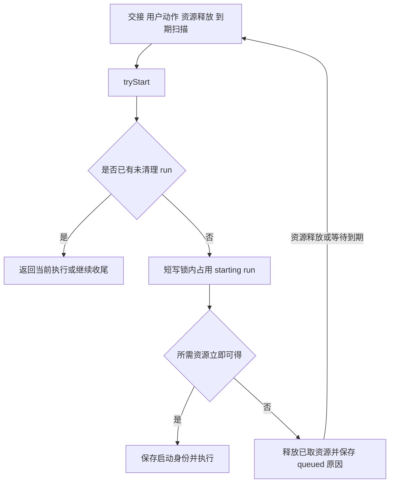

# 锁与队列精简设计

状态：设计修订完成，尚未完成全部生产接线。修订日期：2026 年 11 月 20 日。本次源码对照基线：`01da18f`（1.2.36）；原设计检视基线为 `3830923`，统一执行实现来自 `940a993`。本次新增“唯一 run 替代独立原生会话锁”设计，不把已交付的 v2 基础能力误记为全部上线。

本方案在[统一执行设计](UNIFIED_EXECUTION_LIFECYCLE_DESIGN.md)之上继续收敛：最终只保留全局合入锁与按任务短写锁，独立角色锁和 Bridge 原生会话锁均由唯一 run 及固定会话归属替代，所有待执行工作从同一份账本派生。开发、检视和合并共用入口；阶段交接立即启动，实际受阻才排队。

生效边界：本设计是下一版停机切换后的目标，不要求修改当前运行任务。2026-11-20 已完成的 legacy 清理仅移除旧审阅、日志及 Git 执行回退，当前 dedicated/v1 仍可正常收尾。只有下面的会话归属、run、维护和清理保障全部通过验收后，才删除生产会话锁；不得只删除 `NativeSessionLock` 调用或把新任务的 version 改成 2 就宣布完成。

采用一次性停机切换：**旧任务全部安全结束 → 停止旧宿主、Supervisor、MCP 及其后台进程 → 更新全部启动路径 → 只运行新机制**。不迁移旧任务，不保留 legacy/v1 执行器与 v2 并行工作的能力。旧任务继续可查询、归档和删除；新版拒绝对其执行 retry、resume、rework、retarget、review、merge 或原生会话维护。

`execution.version=2` 用于标识新版可执行记录，保留旧数据格式的读取能力。版本检查只区分“新版可执行 / 旧版历史 / 未知格式”，不再路由到三套执行路径。旧任务需求快照、原生会话、工作树和 Git 交付记录不改写。

## 零 当前实现与本次检视结论

统一执行控制器、v2 短写/CAS 与清理标记、v2 唯一 run 启动及进程绑定已有实现和专项测试；生产派发仍创建 `execution.version=1`，`scanAndDrain` 仍跳过 v2，其他入口尚未完全收口。新版上线前由旧版完成所有无 execution 或使用 v1 的任务，新版仅将它们作为历史记录读取。

| 当前代码事实 | 实际作用与仍需处理的内容 |
| --- | --- |
| `AsyncDispatcher` 创建 v1，扩展宿主与独立 MCP 都创建 `ExecutionController` | 不再新建一个调度器；沿用 `startExecution` / `scanAndDrain` 收口。多个进程仍可能同时扫描 |
| `ExecutionController.startExecution` 先取 role/session/merge 资源，后 CAS 创建 run | v1 仍依赖角色锁防重；v2 改为先 CAS 占用 run，再获取资源，不能先删除角色锁 |
| `startExecutionV2` 已先 CAS 占 run，检查 starting/active/stopping，绑定 pid+birthId，并确认子树与合入锁释放 | 复用已交付能力；补齐 next、全部生产入口和维护/清理后再移除 sessionLease，而非重写启动器 |
| `TaskStore.transitionExecution` 每次创建 `MeshFileLock`，重读任务、比较 revision 并落盘 | 短写入口已存在，但每次写入会启动 OS 锁 helper；“短”描述临界区，不表示当前获取成本低 |
| develop/review 取 `TaskRoleLock`，merge adapter 内仍取 reviewer 角色锁 | 角色文件及其心跳仍是实际准入，不是只读兼容层 |
| `TaskExecutionRegistry` 仍登记 PID、心跳、统计 capacity，并参与 receiver 身份识别和停止进程 | 不能只删登记文件；必须先替换身份、计数、停止和恢复调用者 |
| `CallerWakeQueue.tryAcquire` 已是兼容空壳，但 pending 文件仍读写 | active 文件不再是准入锁；新版唤醒意图改存账本，旧 pending 在切换前由旧版处理完 |
| review scheduler、bootstrap、legacy merge worker 与控制器各自仍有扫描/定时路径 | 把有效业务逻辑接入统一控制器后，删除独立扫描与重试路径，不保留旧版执行分支 |
| v2 已限制普通 upsert/updateRound 控制写入，并提供 markTaskCleanup/commitTaskCleanup；生产 v1 仍使用旧清理入口 | 复用已有保护，补齐 UI/MCP/自动归档的实际调用链与退出核对，不能只验证 TaskStore 单元入口 |
| `NativeSessionLock` 仍由控制器、runner、callback、compactor、rework 恢复与 archive 调用 | 会话不共享并不足以立即删锁；这些路径必须统一验证 run 或清理标记，真实退出前不得重入 |

主要源码：[控制器](../src/bridge/execution-controller.ts)、[任务存储](../src/bridge/task-store.ts)、[角色锁](../src/bridge/task-role-lock.ts)、[执行登记](../src/bridge/task-execution-registry.ts)、[唤醒队列](../src/bridge/caller-wake-queue.ts)、[检视调度](../src/bridge/review-wake-scheduler.ts)、[合入协调](../src/bridge/merge-coordinator.ts)。

实施要求补齐五个前提：所有控制写入受保护；会话只属于一个任务及角色；真正的非阻塞合入资源获取；持久交接与真实退出之间的恢复规则；停机切换前旧执行彻底收尾。满足这些前提后，只保留下述两类互斥，不新增调度 leader、workspace 队列或全局运行锁。

## 一 最终保留的互斥

| 互斥 | key 与持有时间 | 为什么需要 |
| --- | --- | --- |
| 全局合入锁 | 整个 Bridge；持有到本次合并、验证、CAS、落地及必要恢复安全结束 | 满足同一时刻只允许一个任务合入的产品规则 |
| 任务控制写锁 | threadId；只覆盖读取、版本检查和原子写入 | 两个进程不能同时占用同一任务的 run 或覆盖其决定、取消和重试次数 |

唯一 run 是持久状态，不是第三把长时 OS 锁。固定会话归属保证两个任务不会操作同一原生会话；唯一 run 保证一个任务内的业务、维护和阶段交接不重叠。只有 merge 持有全局长锁，无关任务的开发与检视仍可并发。短写锁不覆盖 Agent、Git、测试、等待用户或等待合入锁。

完成替代后删除 Bridge `native-sessions/` 的租约、`.reaper`、pending owner、心跳/回收及 session 等待逻辑。Git 自己的 ref/index 锁、stash 恢复保护、CLI 自带的原生写锁/数据库并发控制继续保留；不能因已有 Bridge 合入锁或唯一 run 就删除其他程序的原生保护。

## 二 用唯一 run 替代独立角色锁与原生会话锁

新策略不再创建 `roles/<threadId>.json`。保留 reviewer/developer 的角色语义，但其当前身份来自统一运行记录。替换全部调用者后删除 `TaskRoleLock` 的准入、心跳与过期回收逻辑，不为旧任务保留可执行门面；旧文件仅允许被切换预检、诊断及定向清理读取。

新版执行控制只接受 `ExecutionControl.version=2`，`execution.run` 补充 `role: 'developer' | 'reviewer'`。合并控制仍归 reviewer；原生 reviewer 会话绑定和控制面身份校验继续保留。旧结构可供历史反序列化，但不得补成 v2、生成新预算或传给执行器。所有会启动 Agent、Git 合入或原生维护的公共入口均校验新版执行资格，不能只在 UI 隐藏按钮。

占用 run 必须经过唯一的 `TaskStore.transitionExecution()`：

1. 取得本任务短写锁，读取最新记录并检查 operation、generation、revision 和取消状态。
2. 只有不存在未清理 run 时，才能写入新的 `run.id`、owner 身份及 `starting`。
3. 原子持久化后释放短写锁，再尝试资源和启动进程。子进程启动回调必须确认 `pid + birthId` 持久化及所需资源租约绑定完成；不能用当前 `void updateRunChild(...)` 式异步写入当作已完成登记。
4. 退出、停止或交接后，只有持有匹配 run.id 的控制器能提交结果、释放自身资源并清空 run。

存活和恢复复用统一执行机制，不给 run 再增加一套心跳租约。owner 消失、child 存活或进程身份未知时，不能通过“删除 run 再试”抢占；先停止并确认子树或保留恢复失败。PID 复用与旧回调保护继续生效。

同任务重复启动请求返回当前执行或已有交接，不再排入“角色等待队列”。合法下一阶段的交接先保存为业务证据；旧子进程仍在时保留原 operation/run，标为 `stopping`，界面显示原阶段收尾。确认退出后再创建下一阶段 operation 并立即启动。收尾不复制成第二个待执行任务，也不靠 queued 清空旧运行记录。

交接使用同一 execution 上最多一个 `next: { phase, round, purpose?, sourceRunId }`，与 approval、返修轮或 decision 在同一次受保护提交中写入；不建立第二份队列。旧 run 的 phase/operation/round 身份保持不变，待确认退出后消费 next 并创建目标阶段 operation。若已保存合法裁决，即使旧 CLI 尾部非零退出，也不撤销裁决；暂停、删除或新 generation 会使旧 next 失效。没有 next 且没有可核对的业务证据时，不猜测重放。

消费 next 与占用目标 starting run 必须是同一次 CAS。补偿扫描也读取有效 next，不只扫描 queued，否则在旧 run 退出后、目标阶段启动前宿主崩溃，交接仍会丢失。用户决策尚未回答时不消费 next；回答和恢复动作同样核对当前身份。

`starting/active/stopping` 全部是未清理 run。尤其不能照搬当前启动 CAS 只针对 starting/active 做身份检查的条件，也不能仅凭 owner 宿主存活就认定某个 run 正常：共享 MCP/宿主可能仍活着，但该 run 已退出、处于未确认收尾或失去本地 worker。owner 存活不足以清理，也不足以无限隐藏恢复异常；结合该 run 的 child、结果和停止证据显示状态，身份未知时显式失败并保留 run 防重。

PID 只能在 spawn 后获得，故“登记完成”不能掩盖 spawn 到登记之间的崩溃窗口。启动协议必须保留可关联本次 run 的进程证据；若无法证明是否已启动，进入可见恢复失败，不自动创建替代执行。复用可确认的现有启动/资源握手；本次不引入常驻启动代理。

### 2.1 固定会话归属，拒绝跨任务共享

新机制不支持不同任务共享原生会话，也不支持导入 requester/用户会话作为 worker 或 reviewer。每个会话只归属一个 `{ threadId, role, sessionEpoch }`；同 Agent 自派发仍必须创建独立 worker/reviewer 会话并保留模型不等校验。`callerSessionId` 在 dedicated 任务中只是 reviewerSessionId 的兼容别名，不算第二个所有者。

会话键复用 `callerSessionKey()` 的规范化规则，由 Agent、固定原生存储命名空间及真实 session ID 组成；同一存储的 bare UUID、rollout 文件名等别名必须映射到同一个键。原生存储根/执行环境在创建时固定，禁止恢复时随全局设置漂移到另一份原生存储。不能仅用字符串不相等证明会话不同。

会话归属需要跨进程唯一性约束，不能用“扫描账本没重复”代替原子认领。使用共享 Bridge 协调根下最小静态 `session-bindings/<hash>.json` 记录，内容只有键、threadId、role、sessionEpoch 和创建/注销事实；完整内容先耐久写入临时文件，再通过不覆盖已有记录的原子排他发布建立归属，已有同归属记录可幂等使用。它不是运行租约：没有 owner PID、心跳、TTL、抢占、执行后释放或等待队列，不回答谁在运行。相同原生存储的所有 Bridge 启动路径必须使用同一归属目录；无法证明共享权威根时拒绝写入，测试使用隔离命名空间。

两任务并发认领同一键时，只允许一个归属成立；另一任务返回明确 `SESSION_OWNERSHIP_CONFLICT`，不排队、不改写原记录、不杀对方进程、不另建会话重试。空白、损坏、归属不明或写入失败记 `SESSION_OWNERSHIP_UNVERIFIED` 并阻止启动/清理，不能按 busy 等待或当作不存在。失去账本的认领保留为待核对记录，不能通过 TTL 回收；静态记录不引入第二套运行所有权账本。

预分配 ID 的新会话在 spawn 前认领。DSH 等首轮未知 ID 的 Agent 只按“创建全新原生会话”协议启动，先由唯一 run 防止重复创建；仅接受本 run 可信事件中的实际 ID，捕获时先建立归属再提交受保护账本绑定。冲突时停止并确认本 run 子树、保留双方证据，不覆盖旧归属，也不允许后续 resume、维护或清理。禁止为未知 ID 强传 resume 参数；bootstrap 的四通道凭证机制不变。

认领与账本不能假装跨文件事务：先写静态归属，再在任务短写锁内核对 run/operation/generation/取消状态并绑定。认领后崩溃允许留下安全的孤立归属；重启只由匹配任务和 epoch 核对后补交，不能因此重放不确定的新会话创建。账本先有 ID 但没有可验证归属时禁止执行，禁止运行中反向扫描后自动认领历史会话。

同 Agent 换模型保持 session 和 epoch；换 Agent 按既有 retarget 协议建立新的未捕获 ID/epoch，旧会话的归属和 retarget 审计保留。retarget 必须在无未清理 run、无待消费 next、无 cleanup 的短写提交中完成，即使任务显示 paused 也不能绕过。归档或删除会话后保留最小注销记录，禁止把旧 session 分配给其他任务；不复活已归档任务，不接管 legacy caller。历史清理只验证既有任务及会话引用，不把旧任务补成新版可执行归属。

### 2.2 run 覆盖到真实退出

run 保存当前合法阶段/角色及会话绑定版本；所有 Agent、原生维护、Git 和验证子进程关联同一 run 身份。任何一次 resume、spawn、维护 RPC 或清理都要核对绑定与当前控制记录，不能仅凭调用方传来的 session ID。一个阶段串行使用多个子进程时，上一子树退出并持久化证据后才能绑定下一子进程；owner 存活、角色释放、收到工具裁决或任务变成 paused 都不等于子进程退出。

request_rework/approve/用户裁决只持久化 next 和业务证据，旧 reviewer 尾进程仍受原 run 保护；只有确认全部已捕获子树退出后才清 run 并消费 next。暂停、超时、崩溃、注册失败或子树身份不明时保留 stopping/unconfirmed，阻止同任务业务、维护、retarget 和物理清理；允许匹配身份的停止与只读恢复。旧 callback 不得清理新 generation/run。全局合入锁仍需 helper 释放 ACK，不能把删除会话锁理解为删除退出确认。

### 归档与维护也要经过占用

不能只让开发启动遵守短写锁：决定、重试、retarget、删除、归档以及原生维护中会改变当前任务控制状态的动作，也必须经同一受保护入口校验。短写锁只保护状态提交，不持有到整个清理或归档结束。

v2 禁止普通 `upsertTask` / `updateRound` 回写 execution、status、决定或清理控制字段，即使传入 revision 等于盘上值也不例外；当前仅阻止旧 revision 的合并规则不能替代此约束。轮次报告和业务证据按字段更新，并绑定 operation/generation/run，不能整份陈旧 thread 覆盖。归档、删除先经短写锁设置带操作身份的清理标记；最终落账/墓碑及重试也要核对该标记，防止归档副本复活已恢复或已删除任务。

沿用现有独立任务文件作为 CAS 的权威记录；聚合账本和查询索引是可重建视图，不用于绕过任务锁批准执行。不同任务的聚合刷新不另加全局运行锁。

会话维护是现有角色内的受控工作。自动维护作为当前 run 的串行 step，维护进程、只读恢复 probe、紧随其后的业务进程共用同一 run，逐一确认子树退出；不创建额外维护所有者。paused 任务显式维护必须在短写锁内确认不存在未清理 run、next 和 cleanup，再占用同一角色/phase 的 run，purpose 标记为 `native_maintenance`；业务状态仍为 paused，结束后不自动恢复开发/检视。维护复用既有活动预算及更短的维护上限，不重置 generation、预算、重试计数或模型路由。原生完成事件、同 turn 的持久恢复证据、只读权限及 token 组件规则不放宽。

归档仅在终态可归档、没有 run/next/待裁决/未完成 Git 恢复时设置 cleanup。删除可先在短写锁内发布清理意图以阻止新启动，但物理清理必须等待匹配 run 的全部子树确认退出；force 仅授权丢弃未合入成果，不能跳过退出或归属检查。维护 run 与 cleanup 的准入在同一任务短写锁内互斥，不额外创建“清理 run”或 session 锁。cleanup 自带 token、owner 身份和待清理 session/epoch 快照；每个原生清理动作前核对当前记录、归属及注销状态，不能只在最后写墓碑时校验。

完整归档先落盘，再提交归档账本并移除活动散落日志；删除墓碑和可恢复的资产清单先耐久落盘，账本移除后的清理失败追加未清理项且可按相同 token 幂等继续。清理期间崩溃不能恢复业务，不能因为 owner 宿主退出就让另一清理进程抢占：原清理者和受控子树退出必须可证明，身份未知返回明确受阻。旧 token、旧 generation 或陈旧副本不能复活任务或删除新会话。历史记录也使用短写锁与 cleanup，不生成 v2、不调用旧执行器，未知存活证据阻止物理删除。

上述保证只约束 Bridge 管理的进程。CLI 自带原生写保护必须保留；用户从外部手动续聊任务会话不受 Bridge run 控制，适配器发现原生占用或无法确认空闲时拒绝维护/清理，不能删除原生锁、杀外部进程或宣称已排除外部写入。

不同 session 的清理可能更新同一份原生索引；此类共享文件的更新必须使用适配器已有事务或文件级短写保护，不能仅凭会话归属就做无保护的读改写。没有可证明安全的更新方式时保留对应索引并报告未清理项，不以新的长期会话锁弥补。

## 三 一份持久等待记录

不新增队列文件或消息系统。待执行集合就是账本中 `status=queued` 的任务，每个任务只有一个待执行阶段和一份等待原因，复用 `execution.phase` 与 `execution.queue`。

只有未清理 run 已释放的任务才进入该待执行集合。仍在收尾的 run 即使业务状态为 paused、wait_decision 或 failed，也继续由统一恢复扫描观察，不纳入启动候选。这样既不会把停止保护误当成排队，也不会让终态状态掩盖仍存活的进程。

| 等待原因 | 解除条件 | 是否占用长时执行锁 |
| --- | --- | --- |
| `merge_lock` | 全局合入权可取得 | 否 |
| `capacity` | 用户明确启用的并发名额可用 | 否 |
| `backoff` | `notBefore` 到期 | 否 |
| `quota` | 已知的配额恢复时间到达 | 否 |
| `dependency` | 明确的依赖任务到达所要求的结果 | 否 |

保留现有 `reviewBlocked.waitingForThreadId` 作为依赖目标，不再复制一份依赖对象；`dependency` 只标明该 queued 任务为何等待。依赖失败后唤醒检视以评估结果，不等于依赖要求已经满足。依赖被删、不可观测或形成等待环时，应给出明确失败或请求用户决定，不能永久等待。

移除 `role` 与 `session` 队列原因：同任务未清理 run 属于本次执行的重复请求或收尾状态，按上一节处理；跨任务会话绑定冲突属于错误，不是可等待资源。旧记录中的 role/session 等待必须在停机切换前由旧版处理完；新版不解释或恢复旧排队意图。

`wait_decision`、`paused`、`failed` 不进入自动执行集合。未知 quota 恢复时间、空输出、未裁决、冲突或恢复证据不明也不能伪装成资源等待。用户回答、显式恢复或重试后立即尝试启动，真正遇到表中条件才写 queued。

同一任务的重复完成通知、唤醒请求与到期事件合并为同一个启动意图。事件必须绑定 operation、generation、run 和轮次；只处理当前合法转换，不保存一列相互竞争的下一步指令。原始报告、裁决和审计历史仍完整保留。

## 四 一个调度入口

所有调用者使用同一个 `tryStart(threadId)`。成功交接、用户动作和资源释放事件立即调用；Supervisor 的周期扫描只负责补偿遗漏事件和到期等待，不是每次阶段转换的必经步骤。

`tryStart` 是职责名称，实施沿用现有 `ExecutionController.startExecution`，不新增一个功能相同的类或门面。入口必须自行校验 queue.notBefore、依赖、bootstrap purpose、取消和合法阶段；不能只依赖扫描器预先过滤，因为用户动作与资源释放也会直接调用入口。定时器只负责提醒重读账本，不能授予启动权或额外重试次数。

启动步骤如下：

1. 在短写锁内拒绝旧身份、用户停止、cleanup、不合法状态及已捕获会话的未验证归属，并占用本次 starting run。首轮未知真实 ID 仅可走 2.1 的全新会话创建流程，不能放宽续聊检查。不要持着短写锁去等待 merge 锁或执行归属记录 I/O 之外的长操作。
2. 所有实际需要的资源只做立即获取；无法凑齐时释放本次已取得的资源。资源繁忙写 queued，身份不明、锁元数据损坏或不可证明恢复安全则保存恢复失败。
3. 写 queued 与释放 starting 占用也必须检查 run.id。若同时收到暂停或删除，保留用户控制状态，不能覆盖回 queued；若资源释放未确认，则保留停止保护，不能声称排队且资源已释放。
4. 资源齐备后，重读并校验取消、归属及版本，保存执行身份，进入对应活动状态并启动。取得合入锁或先前认领会话都不代表仍有权启动，取消可能发生在两者之间。
5. 执行结束后先保存业务证据并确认必要子树退出，再释放资源和启动下一阶段。重试和活动预算完全复用统一执行设计，不增加队列专用重试计数。

合入权只做立即获取，拿不到就释放临时资源并返回。合并修复沿用同任务 reviewer 的会话归属和合法 run；需要让出合入权时，只能在可恢复的事务检查点、确认旧子树退出且锁释放 ACK 后进行阶段交接。无法安全让出的事务保留恢复保护，不能释放锁后假装普通 queued；会话冲突直接报告归属错误，不转成资源等待。

全局合入锁提供非阻塞获取能力：POSIX 用非阻塞 flock 或等价 OS 语义，Windows 用零等待 mutex 获取；保留 helper 对已启动验证子进程的保护。等待任务不各自留下一个长期阻塞的锁 helper。一次补偿扫描只让当前最早可执行的 merge 候选竞争合入权；它若因自己的 session 或依赖受阻，继续检查其他候选。

当前 `MeshFileLock.acquire()` 没有该能力：它先启动 helper，Windows helper 循环 `WaitOne(100)`，POSIX 使用阻塞 flock。不能传 `timeoutMs=0` 伪装 try-acquire，这可能在 helper 启动前就取消。应在现有锁协议增加一次 OS 获取尝试，完成握手后返回 `acquired / busy / error`；busy helper 随即退出。启动握手允许有界耗时，但不能等待锁持有者释放。`.owner.json` 当前不含 birthId，且释放回调删文件并不等于 OS 锁已经释放；它只能诊断，不能据此批准启动。

不再为 `NativeSessionLock.acquire()` 增加新版 busy 分类或 `.reaper` 回收协议；完成替代后直接删除该执行准入模块。归属冲突、损坏/未知绑定、run 占用、合入权繁忙分别处理：前两者明确失败/受阻，run 占用返回当前执行或停止状态，只有确认 merge busy 才进入 queued(merge_lock)。pid+birthId 与无法证明退出的恢复失败规则继续保留。

合入候选按首次实际等待的时间排序，同一等待过程不反复刷新顺序。当前 execution.queue 只有 reason/notBefore，补充 `enteredAt` 并在同一 operation 的连续等待中保留；不能用会被 checkpoint/upsert 刷新的 updatedAt。该排序仅提供稳定选择，不是全局 FIFO 屏障。一个任务等待依赖、容量或人工决定，不能挡住其他任务。可选并发计数仍是既有 best-effort 策略，从有效 run 派生，不因为精简引入新的全局限流锁。

新建/续聊会话统一遵守 2.1 的静态归属协议和 2.2 的真实退出边界。没有真实 ID 时只允许同 run 的新建流程；捕获 ID 后必须完成固定归属校验才能进入后续 resume、维护及清理。

## 五 现有机制的去留

| 当前机制 | 新策略中的处理 |
| --- | --- |
| `TaskRoleLock` 文件、心跳与回收 | 由短写锁保护的唯一 run 替代，角色校验仍保留 |
| `NativeSessionLock`、native-sessions 租约与 `.reaper` | 全部执行/维护/清理接线后删除；固定会话归属排除跨任务共享，唯一 run 排除同任务重叠；不换名保留运行租约 |
| `TaskExecutionRegistry` 的独立判活 | v2 移除心跳回收与杀进程权；receiver 身份、capacity 与诊断改查有效 run。merge 内部短命 Git/验证子进程登记保留为观测，不得作为第二套任务所有者 |
| `CallerWakeQueue` 的 pending 文件 | 新版只在账本保存待执行意图；移除业务执行中的 pending 读写和空壳 tryAcquire。旧 pending 不导入，未消费意图会阻止切换 |
| `ReviewWakeScheduler` 的候选与计时器 | 由统一入口与 queue.notBefore 管理；删除独立 runDue/runWatchdog 启动和重试路径。配额解析保留，不沿用独立重试次数 |
| bootstrap 的独立 pending 扫描与重试计划 | 作为 review 阶段的 purpose 进入同一入口；token 确认协议保留 |
| merge 的独立 worker 排队和重试计时器 | 合入统一入口；Git 事务、验证及恢复证据保留 |
| Supervisor 与 QueueDrainer | 复用同一候选扫描函数；扩展宿主是常驻驱动，独立 MCP 的 fallback 只调用同一入口 |
| activeTasks、launching、mergeWorkers 等内存集合 | 仅允许作为进程内回调去重或 Promise 缓存，不再作为持久所有权、配额或跨进程准入依据 |
| `executions/`、`wakes/active.json`、旧 leases/execution.lock | 停机预检确认无在飞执行后，旧记录仅保留诊断/清理能力；不作为新版准入依据。真实残留进程或未知身份必须阻止首次切换 |
| 静态会话归属记录 | 仅作跨进程唯一性约束和清理审计，不存运行 PID/心跳，不按退出释放，不建立队列 |
| Git stash/ref/index 与 CLI 自带原生写保护 | 保留各自数据保护；不新增 Bridge 原生会话运行锁 |

接线范围必须包含 `MergeCoordinator.mergeApprovedAttempt` 内部 reviewer 角色获取、`TaskControlService` 的暂停/删除与 waitForThreadChildren、MCP 的 receiver 父 PID 识别、ReviewerBootstrapService、ReviewWakeScheduler，以及归档清理。仅改控制器构造参数或删除几个文件，不构成完成。

合入 run 可以先后启动多个 Git/验证子进程。`run.child` 不可简单覆盖掉仍未确认退出的前一个进程；串行时须先确认退出再更新，并保留全局锁 helper 的子进程 ACK 保护。确有并行子进程时以同 run 关联观测集合，不能因移除 registry 失去真实子树退出证据；不另建所有权账本。

不另建调度 leader 锁：两个宿主同时扫描时，任务短写锁与唯一 run 防止同任务启动两次；静态归属禁止跨任务共享会话，全局合入锁保护 Git 收口。一个扫描函数允许多个进程调用，不等于多个持久队列。

## 六 无法进一步删除的边界

| 想删除的保护 | 会出现的具体问题 |
| --- | --- |
| 删除任务短写锁，只检查 run 是否为空 | 两个进程同时读到空值并各自启动；atomic rename 不能解决读取修改竞争 |
| 未建立固定归属/统一维护清理就删除会话锁 | 跨任务误绑或同任务维护、归档与 CLI 尾进程重叠；必须先完成第 2 节全部前提 |
| 删除全局合入锁，只用 Git CAS | 两个任务仍可能同时运行落地、验证、checkout 与 stash；不满足全局单任务合入规则 |
| 子进程未退出就清 run 或允许物理清理 | 旧进程仍能写文件或会话，新执行/清理与它重叠 |
| 把未知锁状态当成繁忙 | 永久排队，用户看不到需要恢复的真实问题 |
| 删除待执行记录，只依赖进程内事件 | 宿主重启、事件遗漏后无法继续已经交接的工作 |

删除 Bridge 会话锁后，恢复判断仍须核对匹配 run/cleanup、child 身份、归属及退出证据。共享 owner 宿主仍活着不能证明任务正常，owner 消失也不能证明子树已退出；无法证明时显式报告恢复失败，保留 run 或 cleanup 防重。不能杀共享 owner、按年龄清 run，或删除静态归属后重放。

## 七 停机切换与历史数据边界

### 7.1 只保留一个可执行机制

新版新任务固定 `execution.version=2`。无 execution、version=1 的记录均为旧版历史，只保留读取和资产清理；未知版本拒绝解释和执行，不自动修复。旧任务不能在新版 retry、resume、rework、retarget、重新检视、合入或运行原生会话维护。需要继续的旧工作必须在切换前由旧版收尾，不能通过修改版本、重建 session 或自动另建任务绕过。

保留任务列表、详情、终态摘要、任务目录内日志分页、token 读时汇总、MR 记录查看以及归档/删除能力。历史归档和删除使用新版通用的短写锁、清理标记、归属核对及墓碑机制，不能调用旧 runner、角色锁、会话运行锁或唤醒器；清理标记不得为了获得 revision 而把历史 execution 改成 v2。无 execution 的历史记录可使用既有 revision 基线和清理操作身份校验，不增加另一套执行状态机。legacy caller/requester 会话始终不得清理；缺少原生归属/退出证明时保留相应会话并报告未清理项，不能猜测认领。

`reviewFlow` 与 execution.version 是不同维度；新任务只允许 dedicated，不恢复 legacy/caller-resume 设置或缺省回退。无 reviewFlow/legacy 记录始终仅供历史读取和安全清理，dedicated/v1 在切换前继续由现版收尾。模型审批、reviewer 身份、bootstrap 四通道凭证、真实 deliveryTarget 及任务目录边界沿用既有规则。

### 7.2 “旧任务全部结束”的判定

切换预检只读报告阻塞项，不替用户结束、删除任务或改写状态。必须同时满足：

1. 不存在旧任务处于 queued、running、reviewing、merging、wait_decision 或 paused；状态别名按现有读取规则归一化后检查。暂停与失败不能被当作方便升级的捷径。
2. completed 符合既有交付完成条件；failed 仅在成果去向已经明确、没有待交付成果或未完成 Git 恢复事务时视为收尾完成。有未合入成果时，先由旧版处理或由用户明确放弃并按既有流程处置，预检不得自动丢弃。
3. 没有在飞轮次、有效待确认 bootstrap、未消费的业务 wake/交接/重试意图、待回答决定或待收尾合入事务。即使 status 为终态，也不能掩盖这些事项。
4. 旧宿主、Supervisor、MCP、Agent、Git/验证子进程及锁 helper 均已退出；结合线程关联、pid+birthId 和退出证据检查，不能仅看 PID、心跳年龄或锁文件是否存在。身份未知时停止切换，不误杀共享宿主或其他任务。

切换前旧版正常消费剩余唤醒意图。终态任务对应的陈旧协调文件与有效业务意图区分处理：只有确认不再对应活进程和未完成工作，才可备份后定向清理；不批量删除原生会话、日志、工作树或 Git 恢复资料。

### 7.3 切换步骤

1. 停止接收新任务，保持旧版可用，让既有任务和待唤醒工作完成。采用现有入口控制和运维步骤，不为此次升级新建常驻 drain 服务。
2. 先检查任务及交付是否收尾，再停止所有相关旧宿主、Supervisor、MCP 和后台启动源；确认子树与 helper 真实退出后做最终预检。任一阻塞项存在则保持旧版，不能强制跳过。
3. 无写入者后备份权威任务文件、聚合账本、策略配置和协调/恢复资料，记录版本与进程退出证据；历史日志和工作树保持原路径。备份与预检输出使用现有运维方式；除 2.1 的最小静态会话归属约束外，不新增运行所有权数据库或全局升级锁，不批量为旧会话建立新版可执行归属。
4. 更新扩展宿主、独立 MCP、Supervisor 及其 CLI/后台启动路径，确认实际加载的包版本/路径一致；只更新 VSIX 不足以证明 MCP 已更新。旧进程不得在新任务运行后重新接入同一数据根。
5. 新版以预检方式读取数据，拒绝任何未收尾的旧记录或身份不明的旧执行。检查通过后启用派发，只创建 v2；不导入旧 pending、不续跑旧会话、不批量转换账本。
6. 用受控任务验证 bootstrap → develop → review → merge、历史查询/归档/删除和暂停恢复后开放正常使用。v2 自身重启恢复继续使用统一控制器。

扩展宿主、Supervisor 和独立 MCP 初始化时，必须在启用调度、恢复扫描和派发前完成预检；预检不能与后台自动恢复同时运行。新版每个入口仍需拒绝旧任务执行，后台扫描也只选择 v2；这是执行资格校验，不是旧版路由。发现未完成旧任务时，返回具体 threadId 和需要回旧版处理的事项，禁止静默跳过后继续派发。日常重启遇到合法 v2 在飞记录走正常恢复，不要求所有 v2 任务再次清空。

### 7.4 开发与回退

开发按“控制写入 → run/next/登记确认 → 非阻塞资源与统一扫描 → 全部业务接线及删除旧路径 → 联合验收”的依赖顺序进行。分步提交用于评审，不把半成品部署到生产，不需要为各中间提交维持双执行机制；生产在完整版本就绪前继续使用旧版。

尚未创建首个 v2 任务时，可停止新版并在确认无新版写入者后恢复切换前备份和旧安装。创建 v2 后，禁止直接用旧二进制打开正在使用的数据根，禁止把 v2 改回 v1；先停止新派发，由支持 v2 的版本收尾或修复。确需退回旧版，须再次完成全部任务收尾和停机确认，并使用不含 v2 执行记录的独立旧版数据集；不能恢复旧账本却忽略此后已发生的 Git 交付，也不能为回退删除新版成果。本文不建设反向迁移器。

实施时同步 AGENTS.md、统一执行与原生压缩文档中 roles、会话运行租约、registry 准入/停止和旧 reviewer 交接释放规则，明确已实现与待停机启用的区别；本设计在用户授权的下一版切换范围内取代旧存储实现约束。单任务单角色、可靠交接、会话连续性及接收方权限限制不变。此次只修改控制和调度路径及必需 UI、MCP、文档和测试；Git 快照、模型审批、session ID、worktree、目标分支、token、摘要与归档内容不借机重构。开发与验收不安装、重载或停止生产进程；尤其不得升级实施任务自身的 v1 账本来绕过切换前置条件。

## 八 验收标准

1. 两个进程同时启动同一任务，仅一个写入 starting run 并 spawn；旧回调不能释放新 run。新策略不创建独立角色锁文件。
2. 两个进程代表不同任务原子认领同一规范化 session，仅一个固定归属成立，另一个明确 SESSION_OWNERSHIP_CONFLICT；不同 session 的开发与检视可并发，不创建 Bridge 会话运行锁。
3. 两任务同时请求合入，仅一个 merging；另一个账本记录 merge_lock 等待，没有长期阻塞 helper，也不长期占任务控制写锁。
4. 无冲突的交接、用户回答与暂停恢复立即启动，不先写 queued、不等待固定扫描周期；旧子进程尚未退出时保留收尾 run，不重复启动。
5. 所有排队只有一份账本记录；重复 wake、bootstrap 与重试到期事件不增加待执行项或重置预算。
6. 认领/绑定 session、获取 merge 或提交启动记录的任一步与暂停/删除并发时，不复活任务；保留不可抢占的静态归属，退出或合入锁释放无法证明时保留 run/cleanup 保护。
7. 一个候选等待依赖、合入权或容量，不挡住其他可执行候选；会话冲突、人工决定、失败和未明确的恢复问题不被无限扫描重试。
8. v2 宿主重启仍能恢复待执行意图，已落地合并和已提交裁决不重做；旧 pending、bootstrap 与重试意图不被导入或执行，未收尾时预检明确阻止切换。
9. 原生维护、归档、删除和 retarget 不绕过唯一 run/cleanup 与固定归属；未知进程身份和残留文件不会触发抢占或无限静默等待。
10. 进程内缓存被清空、两个扫描器同时工作或某一驱动暂时不运行，都不能改变任务所有权或丢失待执行意图；必要编译、并发与恢复测试通过。
11. 同 revision 的普通 upsert、报告、归档或删除与 CAS 并发，不能绕过控制字段保护；清理标记提交后不能被恢复或陈旧副本复活。
12. next 已持久化但旧 reviewer 尚未退出、退出后尚未消费 next、spawn 后尚未登记 child、释放信号已发但 OS 锁未释放，分别验证崩溃恢复；不重复开发、检视或落地。
13. 直接调用 startExecution 也遵守 notBefore；不明锁状态不会成为无限 queued；busy helper 及时退出，helper 启动失败不被误报为 busy。
14. 新版只执行 v2，不含旧角色锁、旧 watchdog 或 legacy/v1 启动回退；旧任务通过 UI、MCP 或后台入口发起 retry/resume/rework/retarget/review/merge/原生维护均被拒绝，未知版本拒绝执行。
15. 切换预检分别覆盖 paused、wait_decision、失败但未交付成果、终态但进程未退出、有效 pending wake、身份未知与宿主/MCP 版本未更新，均阻止启用；备份和历史读取不修改旧 execution/version、session、轮次与成果。
16. 历史终态任务可查询、读取任务目录日志和摘要、归档及删除；清理有短写保护、退出与会话归属校验，不能唤醒旧 Agent、重建预算、复活旧任务或清理 legacy caller 会话。证据不足明确报告未清理项，陈旧文件不得造成新版无限等待。
17. 新版启用后完成一个受控完整闭环；再启动旧二进制属于禁止操作，不以版本字段防御已在运行的旧程序。分别验证首个 v2 创建前的备份回退，以及创建后的阻止降级与 v2 修复收尾流程。
18. 同任务 reviewer 已提交 rework/approve 但尾进程仍活着时，developer、再次 reviewer、显式维护、retarget 和物理清理均不得越过原 run；确认退出后只消费一次 next，尾部非零退出不撤销已持久裁决。
19. 自动维护与业务执行共享一个 run；paused 显式维护与 resume、archive、delete 的真实双进程竞争只允许合法一方进入，维护结束不启动业务、不重置预算，不放宽结构化完成/持久恢复证据。
20. session 认领后账本提交前崩溃、CLI 首轮捕获真实 ID 冲突、bare UUID/rollout 别名、同 Agent 换模型、换 Agent 重置 epoch、归档/删除后旧 ID 被误用均有测试；损坏/孤立归属不变成 queued(session) 或自动重新创建会话。
21. 删除/归档在 cleanup 发布前后、子树退出前后、归档落盘与账本提交之间、墓碑提交与原生清理之间分别崩溃，重启按同 token 继续或明确受阻；重复清理不删除新归属或外部进程资源。
22. 生产入口不再依赖 NativeSessionLock/NativeSessionLease、`.reaper`、pending owner 或 queued(session)，也不以改名的 session mutex 替代。CLI 自带写保护保留，未知外部占用不被当作安全空闲。

验证按[测试分层设计](TEST_LAYERING_DESIGN.md)进行：策略测试用可控依赖，互斥/退出/崩溃边界使用两个真实控制进程、受控子进程和临时 Git 仓库；分别提供 Windows 与 POSIX 证据。已有统一生命周期场景 19、21、22、25、28～31 的锁、CAS、交接和恢复承诺必须保留。未运行的平台不得声称已验证。

记录锁 helper 启动/退出数、控制写入数、阶段交接延迟和完整四并发测试耗时。删除角色心跳可能减少协调写入，但当前每次 CAS 仍使用重型 helper，不能据锁数量减少直接承诺提速。本次不重写生产短写锁协议，相关性能改进另以实测决定。

## 九 实施拆分（每项不超过 4 人天）

以下是基于现有控制器、CAS、进程探测与测试设施的初步估算。每项包含实现、相关策略/边界测试与一次检视返修；第 09 项承担跨模块、跨平台联合验收，不替前面任务补全部测试。无需新增跨版本执行器、迁移器、独立调度器或通用工作流框架。

| 编号 | 任务与交付边界 | 主要验收 | 人天 | 前置 |
| --- | --- | --- | ---: | --- |
| 01 | v2 结构、TaskStore 控制写入、清理标记与历史执行禁入 | 普通 upsert/updateRound 不能覆盖控制字段；清理操作身份可靠；旧记录不自动变成 v2 | 4 | — |
| 02 | 唯一 run 占用、启动身份登记与资源绑定确认 | 复用现有 v2 防重/绑定实现；补齐会话 epoch、真实退出及维护 run 身份，spawn/登记间证据不足不重放 | 4 | 01 |
| 03 | next、裁决交接与崩溃恢复 | 裁决与 next 同次提交；退出后消费 next 和占 run 同次 CAS；旧回调失效 | 4 | 02 |
| 04 | 固定会话归属及 MeshFileLock 非阻塞协议 | 静态原子认领/冲突分类与崩溃窗口可靠；合入 acquired/busy/error 可区分；busy helper 退出；释放 ACK 保留，不扩展旧 session 租约 | 3 | 01 |
| 05 | 统一资源准入与候选扫描 | 拿不齐就释放；取消不复活；notBefore、依赖、enteredAt 生效；不堵队头；预算不重置 | 3 | 03、04 |
| 06 | develop、bootstrap、review 唤醒接线并删除对应旧调度 | bootstrap 凭证及 session 捕获不变；即时交接；不再写 pending 或独立角色文件 | 3 | 05 |
| 07 | merge 接线并删除独立 worker/角色锁准入 | 全局单合入；Git/验证子树退出证据及 helper ACK 不丢；修复只能在安全检查点让出资源 | 3 | 05 |
| 08 | 控制与清理接线、MCP 身份、并发统计及剩余旧机制退出 | pause/resume/retry/retarget 不绕过 run；维护 run 与 cleanup 互斥；归属/退出安全；移除 NativeSessionLock、角色/会话等待及旧回收杀进程权。暂停、强制停止与删除须通过下列验收 | 4 | 06、07 |
| 09 | Windows/POSIX 联合回归与故障窗口验收 | 双真实控制进程、受控子进程、临时 Git；覆盖第八节；全量测试及 helper/写入/延迟记录齐全 | 4 | 08 |
| 10 | 只读切换预检、安装 smoke、文档与停机启用流程 | 阻塞项可复核；全部启动路径更新；历史能力、完整闭环和回退边界验证；AGENTS 同步 | 2 | 09 |
| 合计 | 10 个任务；并行只用于无依赖的实现与平台验收 | 各票不超过 4 人天 | 34 | |

04 的底层协议可与 02/03 并行准备，资源接入仍在 05 完成；06 和 07 可分工，但核心控制器共享改动按依赖集成。实施代码任务遵循既有独立 worktree、固定真实交付目标和调用者批次 MR 收口规则，接收方不自行提交/推送/建 MR。

34 人天是原完整精简方案的历史工作量估计，不是本次派发的剩余工期，也不能把已交付的 01/02 基础能力再计一遍。前次 73 人天拆分不作为本设计基准。预检复用现有部署/进程探测设施，平台验收复用现有测试夹具；并发安全、真实退出和崩溃恢复不会因停机切换而省略。

### 本次派发：唯一 run 替代 Bridge 原生会话锁

这是一个完整实施任务，内部按以下顺序提交可检视的改动；接收方不能二次派发。复用已交付的 v2 CAS/进程绑定和测试设施，只补齐本设计所需的生产入口、next、会话归属、维护清理及旧锁移除，不顺带重写 Git、模型审批或做额外性能框架。必要的角色锁/等待和旧执行入口必须一起收口，否则无法以唯一 run 证明安全；尚未接线的路径不能靠禁用功能、skip 测试或保留运行租约宣称完成。

| 顺序 | 本次剩余交付 | 估算 |
| --- | --- | ---: |
| A | 固定原生命名空间、session/role/epoch，静态原子归属及冲突/孤立记录核对 | 0.5～1 人天 |
| B | 生产 develop/bootstrap/review/merge 的 v2 run/next 接线、尾进程交接和统一候选恢复 | 3～4 人天 |
| C | 维护 step/paused 维护 run、归档删除 cleanup、retarget 与真实退出及归属核对 | 1～2 人天 |
| D | 移除 NativeSessionLock/独立角色准入及 session/role 等待，补齐故障竞争回归和文档 | 1.5～2 人天 |
| 合计 | 以当前基础实现可复用为前提的剩余工程工作量，非模型运行时间或交付承诺 | 6～9 人天 |

代码和测试交付到固定 master 目标，由专用 reviewer 独立验收。生产启用仍须完成第七节预检；本任务不得自行安装 VSIX、重载窗口、停止现有任务、改写其 execution.version 或批量删除用户数据。若平台证据缺失或预检受阻，明确列出阻塞项，保留当前生产机制，不能把未启用等同于实现失败或把未测试等同于通过。

### 六工作日计划 06「控制与清理收口」验收补充

本节对应上表四人天计划的 08。UI、MCP 和后台收尾使用同一套持久结果。下表描述操作反馈，沿用现有任务状态和 `run.state=stopping`。

| 验收项 | 可观察结果 |
| --- | --- |
| 接受暂停或删除 | 在短写锁内持久化操作意图、操作者和原因，同时阻止新的启动、自动重试和阶段交接。UI 与 MCP 区分已受理、停止中、受阻、已完成。有未清理 run 时显示停止中或受阻，暂停完成后才允许恢复同一任务、轮次和会话。 |
| 定向强制停止 | 核对当前 run、`PID + birthId` 和受控子树，只停止该任务的进程与等待。PID 被复用时，复用该 PID 的进程不受影响，仍须确认原有进程树是否退出。复用统一执行设计的有界退出确认窗口。进程身份不明或退出无法确认时，保留 run 和相关资源保护，返回 `PROCESS_STOP_UNCONFIRMED` 及具体原因，例如权限不足或确认超时。迟到回调不能推进任务或清掉新 run。 |
| 删除受阻与强制删除 | 等待进程退出和获取全局合入锁都有明确的返回边界。UI 与 MCP 能区分进程退出未确认、合入锁繁忙、stash 待恢复和成果未合入，并指明可采取的下一步。`force: true` 只授权丢弃未合入成果，仍须确认子树退出、保护解除及 Git 事务可安全清理。短写锁不跨资源等待。 |
| 重试同一次删除 | 删除意图持久化后，重复请求或宿主重启按相同操作身份继续收尾。前置条件仍不满足时返回受阻原因并保留记录。在删除提交前核对清理标记，重试可识别同一操作已经提交的账本删除和墓碑，旧回调与陈旧副本不能复活任务。 |
| 删除完成与清理结果 | 账本移除及墓碑持久化后报告已删除。日志或原生会话清理失败时，在结果和墓碑中单独记录未清理项及原因。历史任务同样走受保护清理，始终保留 legacy caller/requester 会话。 |

至少验证这些场景：排队中暂停、取消与 spawn 竞争、根进程退出但子进程仍存活、PID 复用或终止权限不足、其他任务持有合入锁、stash 待恢复、普通删除拒绝丢弃未合入成果、强制删除仍等待安全退出、删除过程中宿主重启、账本已删除但部分资产清理失败。退出确认与合入锁竞争场景使用真实受控进程和锁，并检查 UI/MCP 的反馈与持久记录一致。

当前文档交付为唯一 run 替代角色锁/原生会话锁的设计与实施验收边界；生产仍为 1.2.36 的 dedicated/v1 接线，未执行下一版停机切换或删除生产租约。后续实施必须附实际提交、测试与未覆盖平台证据，不以本设计文本作为已实现证明。
