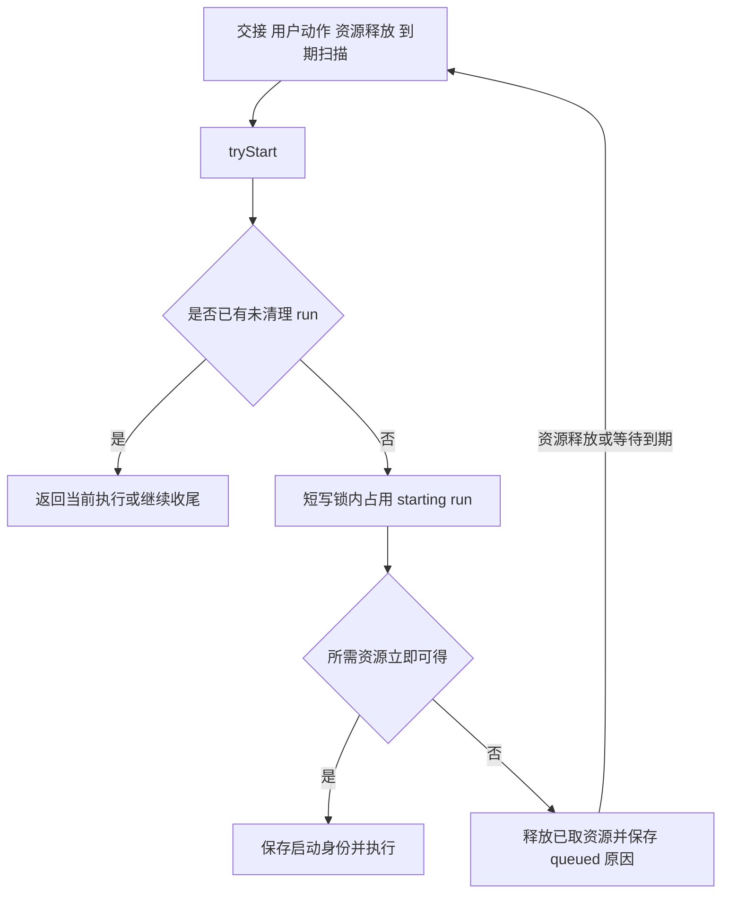

# 锁与队列精简设计

状态：设计方案，待实现。日期：2026 年 11 月 17 日。

本方案在[统一执行设计](UNIFIED_EXECUTION_LIFECYCLE_DESIGN.md)之上继续收敛：保留两类执行期间的资源锁和一类短时写锁，以账本中的唯一 run 记录承担任务所有权，所有待执行工作从同一份账本派生。开发、检视和合并共用入口；阶段交接立即启动，实际受阻才排队。

这是统一执行机制之后的精简方案，不修改已派发任务的需求快照。实施必须按任务固定策略切换，不能一边使用新记录判定所有权，一边允许旧角色锁路径继续启动同一任务。

## 一 最终保留的互斥

| 互斥 | key 与持有时间 | 为什么需要 |
| --- | --- | --- |
| 原生会话写锁 | Agent 与规范化 session ID；持有到真实子进程退出 | 两个不同任务可能续聊同一会话，任务自己的记录保护不了共享会话 |
| 全局合入锁 | 整个 Bridge；持有到本次合并、验证、CAS、落地及必要恢复安全结束 | 满足同一时刻只允许一个任务合入的产品规则 |
| 任务控制写锁 | threadId；只覆盖读取、版本检查和原子写入 | 两个进程不能同时占用同一任务的 run 或覆盖其决定、取消和重试次数 |

两类长时资源锁不合并：会话和合入保护不同资源，把它们合成全局锁会让无关检视与开发串行。短写锁不覆盖 Agent、Git、测试、等待用户或等待其他锁。

会话租约发布与回收的内部 gate、Git 自己的 ref/index 锁以及当前 stash 恢复保护仍保留。它们是实现原子更新和保护用户文件的内部临界区，不是新增的任务调度锁，也不各自建立持久等待队列。尤其不能因已有 Bridge 合入锁而删除 Git 锁：用户和其他程序仍可能直接操作 Git。

## 二 用唯一 run 替代独立任务角色锁

新策略不再创建 `roles/<threadId>.json`。保留 reviewer/developer 的角色语义，但其当前身份来自统一运行记录；`TaskRoleLock` 对新任务最多作为读取兼容门面，不再独立写文件、发心跳或判定过期。

在统一执行设计的 `execution.run` 中补充 `role: 'developer' | 'reviewer'`。合并控制仍归 reviewer；旧任务的 reviewer 原生会话绑定和控制面身份校验继续保留。

占用 run 必须经过唯一的 `TaskStore.transitionExecution()`：

1. 取得本任务短写锁，读取最新记录并检查 operation、generation、revision 和取消状态。
2. 只有不存在未清理 run 时，才能写入新的 `run.id`、owner 身份及 `starting`。
3. 原子持久化后释放短写锁，再尝试资源和启动进程。真实执行前登记 child 身份。
4. 退出、停止或交接后，只有持有匹配 run.id 的控制器能提交结果、释放自身资源并清空 run。

存活和恢复复用统一执行机制，不给 run 再增加一套心跳租约。owner 消失、child 存活或进程身份未知时，不能通过“删除 run 再试”抢占；先停止并确认子树或保留恢复失败。PID 复用与旧回调保护继续生效。

同任务重复启动请求返回当前执行或已有交接，不再排入“角色等待队列”。合法下一阶段的交接先保存为业务证据；旧子进程仍在时保留原 operation/run，标为 `stopping`，界面显示原阶段收尾。确认退出后再创建下一阶段 operation 并立即启动。收尾不复制成第二个待执行任务，也不靠 queued 清空旧运行记录。

不同任务共享同一个原生会话时，仍需要独立会话锁。例如两个 legacy 任务的 threadId 不同，只有 session 锁能防止它们同时 resume。相反，同一任务的 developer 与 reviewer 即使 session 不同，也会被唯一 run 阻止重叠。

### 归档与维护也要经过占用

不能只让开发启动遵守短写锁：决定、重试、retarget、删除、归档以及原生维护中会改变当前任务控制状态的动作，也必须经同一受保护入口校验。短写锁只保护状态提交，不持有到整个清理或归档结束。

会话维护是现有角色内的受控工作，沿用 run 和会话写锁；不得额外打开一个独立维护所有者。对没有业务 run 的终态任务，归档/删除先在短写锁内设置清理标记，禁止并发恢复，再取得允许清理的 native-session 租约。清理标记、完整归档落盘与删除墓碑沿用既有资产生命周期，不另建调度队列。

## 三 一份持久等待记录

不新增队列文件或消息系统。待执行集合就是账本中 `status=queued` 的任务，每个任务只有一个待执行阶段和一份等待原因，复用 `execution.phase` 与 `execution.queue`。

| 等待原因 | 解除条件 | 是否占用长时执行锁 |
| --- | --- | --- |
| `session` | 指定原生会话不再有合法写入者 | 否 |
| `merge_lock` | 全局合入权可取得 | 否 |
| `capacity` | 用户明确启用的并发名额可用 | 否 |
| `backoff` | `notBefore` 到期 | 否 |
| `quota` | 已知的配额恢复时间到达 | 否 |
| `dependency` | 明确的依赖任务到达所要求的结果 | 否 |

保留现有 `reviewBlocked.waitingForThreadId` 作为依赖目标，不再复制一份依赖对象；`dependency` 只标明该 queued 任务为何等待。依赖失败后唤醒检视以评估结果，不等于依赖要求已经满足。依赖被删、不可观测或形成等待环时，应给出明确失败或请求用户决定，不能永久等待。

移除新策略的 `role` 队列原因：同任务未清理 run 属于本次执行的重复请求或收尾状态，按上一节处理。旧记录中的 role 原因由兼容入口结合真实 run 与已提交交接解释，不能直接再启动一个角色。

`wait_decision`、`paused`、`failed` 不进入自动执行集合。未知 quota 恢复时间、空输出、未裁决、冲突或恢复证据不明也不能伪装成资源等待。用户回答、显式恢复或重试后立即尝试启动，真正遇到表中条件才写 queued。

同一任务的重复完成通知、唤醒请求与到期事件合并为同一个启动意图。事件必须绑定 operation、generation、run 和轮次；只处理当前合法转换，不保存一列相互竞争的下一步指令。原始报告、裁决和审计历史仍完整保留。

## 四 一个调度入口

所有调用者使用同一个 `tryStart(threadId)`。成功交接、用户动作和资源释放事件立即调用；Supervisor 的周期扫描只负责补偿遗漏事件和到期等待，不是每次阶段转换的必经步骤。

启动步骤如下：

1. 在短写锁内拒绝旧身份、用户停止和不合法状态，并占用本次 starting run。不要持着短写锁去等待 session 或 merge 锁。
2. 所有实际需要的资源只做立即获取；无法凑齐时释放本次已取得的资源。资源繁忙写 queued，身份不明、锁元数据损坏或不可证明恢复安全则保存恢复失败。
3. 写 queued 与释放 starting 占用也必须检查 run.id。若同时收到暂停或删除，保留用户控制状态，不能覆盖回 queued；若资源释放未确认，则保留停止保护，不能声称排队且资源已释放。
4. 资源齐备后，重读并校验取消及版本，保存执行身份，进入对应活动状态并启动。会话锁或合入锁已取得不代表仍有权启动，取消可能发生在两者之间。
5. 执行结束后先保存业务证据并确认必要子树退出，再释放资源和启动下一阶段。重试和活动预算完全复用统一执行设计，不增加队列专用重试计数。

资源获取采用“拿不到就释放并返回”，不在持有另一把长锁时阻塞等待，因此不需要为各种阶段再维护一套锁等待顺序。合并修复需要新会话资源时，只能在可恢复的事务检查点让出合入权并排队；无法安全让出的事务保留恢复保护，不能释放锁后假装普通 queued。

全局合入锁提供非阻塞获取能力：POSIX 用非阻塞 flock 或等价 OS 语义，Windows 用零等待 mutex 获取；保留 helper 对已启动验证子进程的保护。等待任务不各自留下一个长期阻塞的锁 helper。一次补偿扫描只让当前最早可执行的 merge 候选竞争合入权；它若因自己的 session 或依赖受阻，继续检查其他候选。

合入候选按首次实际等待的时间排序，同一等待过程不反复刷新顺序；可复用已持久化的入队事件时间。该排序仅提供稳定选择，不是全局 FIFO 屏障。一个任务等 session、依赖或人工决定，不能挡住其他任务。可选并发计数仍是既有 best-effort 策略，不因为精简引入新的全局限流锁。

新建原生会话在不知道真实 session ID 时，先依靠唯一 run 阻止重复创建；捕获真实 ID 后按既有原生协议绑定会话写租约，再允许后续复用。不能给 DSH 新会话强塞未知 session ID；身份绑定冲突时停止并保留证据，不能覆盖其他写入者。

## 五 现有机制的去留

| 当前机制 | 新策略中的处理 |
| --- | --- |
| `TaskRoleLock` 文件、心跳与回收 | 由短写锁保护的唯一 run 替代，角色校验仍保留 |
| `TaskExecutionRegistry` 的独立判活 | 移除；如兼容 receiver 识别需要，仅提供从当前运行记录生成的查询索引 |
| `CallerWakeQueue` 的 pending 文件 | 合入账本待执行阶段，停止为新任务写入；其 tryAcquire 当前已是兼容入口，不再当作真实锁 |
| `ReviewWakeScheduler` 的候选与计时器 | 合入统一调度入口与 queue.notBefore；配额解析保留 |
| bootstrap 的独立 pending 扫描与重试计划 | 作为 review 阶段的 purpose 进入同一入口；token 确认协议保留 |
| merge 的独立 worker 排队和重试计时器 | 合入统一入口；Git 事务、验证及恢复证据保留 |
| Supervisor 与 QueueDrainer | 复用同一候选扫描函数；扩展宿主是常驻驱动，独立 MCP 的 fallback 只调用同一入口 |
| activeTasks、launching、mergeWorkers 等内存集合 | 仅允许作为进程内回调去重或 Promise 缓存，不再作为持久所有权、配额或跨进程准入依据 |
| `executions/`、`wakes/active.json`、旧 leases/execution.lock | 只作兼容和诊断，不得让新任务因残留文件被永久阻挡 |
| session 的 `.reaper` 与 Git stash/ref 锁 | 保留内部数据保护；共用进程身份探测，不新增独立任务排队逻辑 |

不另建调度 leader 锁：两个宿主同时扫描时，任务短写锁与唯一 run 防止同任务启动两次，会话锁与合入锁保护共享资源。一个扫描函数允许多个进程调用，不等于多个持久队列。

## 六 无法进一步删除的边界

| 想删除的保护 | 会出现的具体问题 |
| --- | --- |
| 删除任务短写锁，只检查 run 是否为空 | 两个进程同时读到空值并各自启动；atomic rename 不能解决读取修改竞争 |
| 删除会话锁，只依靠 run | 两个不同任务同时写同一 legacy caller 会话；归档与维护也可能和 CLI 写入重叠 |
| 删除全局合入锁，只用 Git CAS | 两个任务仍可能同时运行落地、验证、checkout 与 stash；不满足全局单任务合入规则 |
| 子进程未退出就清 run 或释放 session | 旧进程仍能写文件或会话，新执行与它重叠 |
| 把未知锁状态当成繁忙 | 永久排队，用户看不到需要恢复的真实问题 |
| 删除待执行记录，只依赖进程内事件 | 宿主重启、事件遗漏后无法继续已经交接的工作 |

原生会话锁也不能仅凭共享 owner 宿主还活着永久拒绝恢复。统一控制器应根据匹配 run、持有 token、child 身份及清理证据判断是否能够安全释放；无法证明时显式报告恢复失败。不能杀共享 owner，也不能仅根据超时删除租约。

## 七 兼容与实施边界

先完成统一执行机制，再为精简策略固定新的执行版本，例如 `execution.version=2`。不为此新增另一套策略文件或锁状态数据库。新版本任务只用唯一 run；旧任务继续读取其已固定策略和旧角色文件，不能在运行中自动抹掉角色锁。

切换前须停止旧二进制准入并完成必要宿主/MCP 版本更新。旧程序不认识新 run 所有权，单靠新字段无法阻止它绕开新规则启动。这里的版本门槛复用统一执行设计，不新增常驻升级锁。

旧 pending wake 导入由 task 短写锁保护：确认线程、轮次、failureRevision 及当前阶段仍有效，幂等更新同一个启动意图；重复记录合并，旧轮和已完成任务的唤醒丢弃。先落账成功再清理旧文件，失败则保留原文件。已经在运行的旧 reviewer 不导入为第二个执行。旧 failure 通知不能把 failed 自动改为活动态；只有原策略允许的待执行工作或用户已显式提交的恢复动作可以导入，不授予新的重试额度。

新记录的 role 查询、receiver 身份识别、reviewer 会话校验、原生维护、归档和删除全部接线完成后，才能停止为新任务写 roles/executions/wakes 兼容文件。保留旧任务的读取能力，待安全终态及进程退出后再按原保留规则清理；本次不批量删除历史协调文件。

实现只修改上述控制和调度路径，以及必需的 UI、MCP、文档和测试。Git 快照、模型审批、原生会话 ID、worktree、目标分支、token、摘要和归档内容不借机重构。需要变更的 AGENTS.md 规则是“角色锁固定在 roles 文件”的存储实现；单任务单角色、可靠交接和会话连续性仍是硬不变量。

## 八 验收标准

1. 两个进程同时启动同一任务，仅一个写入 starting run 并 spawn；旧回调不能释放新 run。新策略不创建独立角色锁文件。
2. 两个不同任务共享 session 时只有一个写入者；不同任务且不同 session 的开发与检视可并发。
3. 两任务同时请求合入，仅一个 merging；另一个账本记录 merge_lock 等待，没有长期阻塞 helper，也不占 native-session 或任务控制写锁。
4. 无冲突的交接、用户回答与暂停恢复立即启动，不先写 queued、不等待固定扫描周期；旧子进程尚未退出时保留收尾 run，不重复启动。
5. 所有排队只有一份账本记录；重复 wake、bootstrap 与重试到期事件不增加待执行项或重置预算。
6. 获取 session、merge 或提交启动记录的任一步与暂停/删除并发时，释放本次资源且不复活任务；无法证明退出或释放时保留恢复保护。
7. 一个候选等待依赖、session 或容量，不挡住其他可执行候选；人工决定、失败和未明确的恢复问题不被无限扫描重试。
8. 宿主重启仍能恢复待执行意图，已落地合并和已提交裁决不重做；旧队列导入重复执行也只产生一个有效意图。
9. 原生维护、归档、删除和 retarget 不绕过唯一 run 与会话锁；未知进程身份和残留文件不会触发抢占或无限静默等待。
10. 进程内缓存被清空、两个扫描器同时工作或某一驱动暂时不运行，都不能改变任务所有权或丢失待执行意图；必要编译、并发与恢复测试通过。

验证应使用两个真实控制进程、注入进程身份探测、受控子进程和临时 Git 仓库，分别覆盖 Windows 与 POSIX。当前交付为设计，尚未实施锁删除、队列迁移或运行验证。
