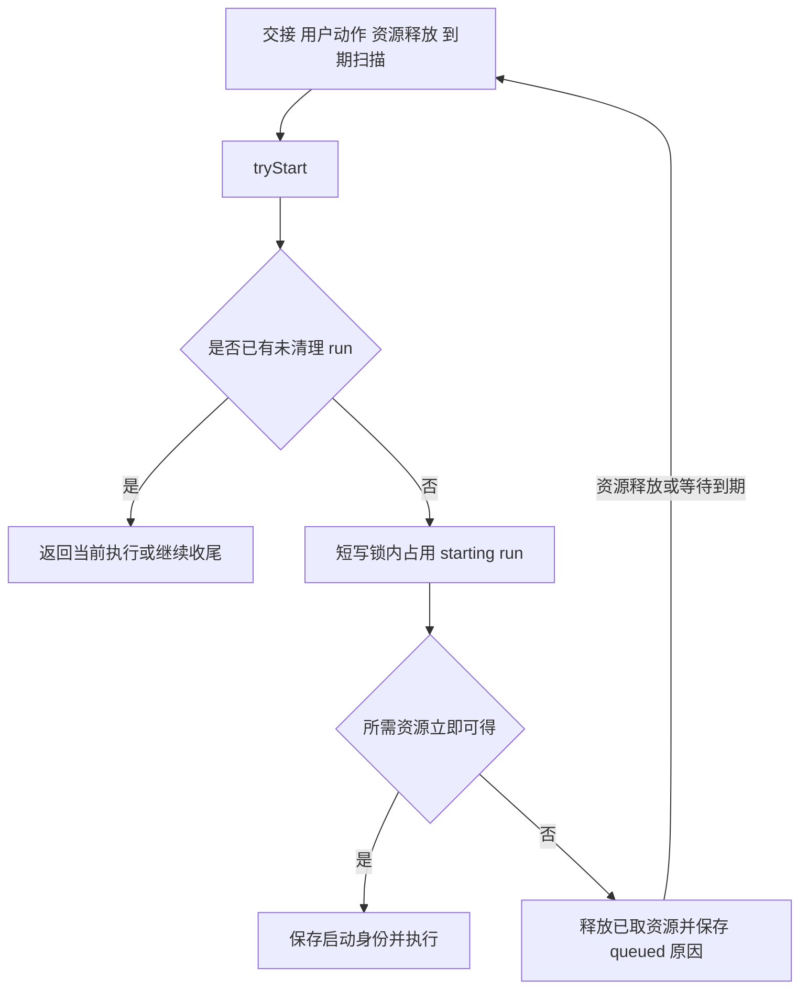

# 锁与队列精简设计

状态：基于当前代码修订，待用户检视，尚未实施。修订日期：2026 年 11 月 18 日。检视基线：本地 master `3830923`（统一执行实现来自 `940a993`，其后包含 stash 测试优化与发布变更）。

本方案在[统一执行设计](UNIFIED_EXECUTION_LIFECYCLE_DESIGN.md)之上继续收敛：保留两类执行期间的资源锁和一类短时写锁，以账本中的唯一 run 记录承担任务所有权，所有待执行工作从同一份账本派生。开发、检视和合并共用入口；阶段交接立即启动，实际受阻才排队。

这是统一执行机制之后的精简方案，不修改已派发任务的需求快照。实施必须按任务固定策略切换，不能一边使用新记录判定所有权，一边允许旧角色锁路径继续启动同一任务。

## 零 当前实现与本次检视结论

统一执行控制器已经落地，但唯一所有权与唯一等待入口尚未完成。当前新任务创建 `execution.version=1`；不能把“没有 execution 的旧任务”和“已使用 v1 的任务”混为一类，也不能把本方案描述成已经实现。

| 当前代码事实 | 实际作用与仍需处理的内容 |
| --- | --- |
| `AsyncDispatcher` 创建 v1，扩展宿主与独立 MCP 都创建 `ExecutionController` | 不再新建一个调度器；沿用 `startExecution` / `scanAndDrain` 收口。多个进程仍可能同时扫描 |
| `ExecutionController.startExecution` 先取 role/session/merge 资源，后 CAS 创建 run | v1 仍依赖角色锁防重；v2 改为先 CAS 占用 run，再获取资源，不能先删除角色锁 |
| `TaskStore.transitionExecution` 每次创建 `MeshFileLock`，重读任务、比较 revision 并落盘 | 短写入口已存在，但每次写入会启动 OS 锁 helper；“短”描述临界区，不表示当前获取成本低 |
| develop/review 取 `TaskRoleLock`，merge adapter 内仍取 reviewer 角色锁 | 角色文件及其心跳仍是实际准入，不是只读兼容层 |
| `TaskExecutionRegistry` 仍登记 PID、心跳、统计 capacity，并参与 receiver 身份识别和停止进程 | 不能只删登记文件；必须先替换身份、计数、停止和恢复调用者 |
| `CallerWakeQueue.tryAcquire` 已是兼容空壳，但 pending 文件仍读写 | active 文件不再是准入锁；真正待迁移的是持久唤醒意图 |
| review scheduler、bootstrap、legacy merge worker 与控制器各自仍有扫描/定时路径 | 部分入口已分流统一任务，不能因此假定所有入口都按 execution 版本隔离 |
| `upsertTask`、`archiveTask`、`deleteTask` 仍可直接持久化；旧版 revision 保护不等于统一写锁 | v2 若保留这些绕行写入，唯一 run 无法独自保证状态不被覆盖 |

主要源码：[控制器](../src/bridge/execution-controller.ts)、[任务存储](../src/bridge/task-store.ts)、[角色锁](../src/bridge/task-role-lock.ts)、[执行登记](../src/bridge/task-execution-registry.ts)、[唤醒队列](../src/bridge/caller-wake-queue.ts)、[检视调度](../src/bridge/review-wake-scheduler.ts)、[合入协调](../src/bridge/merge-coordinator.ts)。

本轮检视要求补齐四个实施前提：所有控制写入受保护；真正的非阻塞资源获取；持久交接与真实退出之间的恢复规则；三个版本路径明确分流。满足这些前提后，仍建议只保留原方案的三类互斥，不新增调度 leader、workspace 队列或全局运行锁。

## 一 最终保留的互斥

| 互斥 | key 与持有时间 | 为什么需要 |
| --- | --- | --- |
| 原生会话写锁 | Agent 与规范化 session ID；持有到真实子进程退出 | 两个不同任务可能续聊同一会话，任务自己的记录保护不了共享会话 |
| 全局合入锁 | 整个 Bridge；持有到本次合并、验证、CAS、落地及必要恢复安全结束 | 满足同一时刻只允许一个任务合入的产品规则 |
| 任务控制写锁 | threadId；只覆盖读取、版本检查和原子写入 | 两个进程不能同时占用同一任务的 run 或覆盖其决定、取消和重试次数 |

两类长时资源锁不合并：会话和合入保护不同资源，把它们合成全局锁会让无关检视与开发串行。短写锁不覆盖 Agent、Git、测试、等待用户或等待其他锁。

会话租约发布与回收的内部 gate、Git 自己的 ref/index 锁以及当前 stash 恢复保护仍保留。它们是实现原子更新和保护用户文件的内部临界区，不是新增的任务调度锁，也不各自建立持久等待队列。尤其不能因已有 Bridge 合入锁而删除 Git 锁：用户和其他程序仍可能直接操作 Git。

## 二 用唯一 run 替代独立任务角色锁

新策略不再创建 `roles/<threadId>.json`。保留 reviewer/developer 的角色语义，但其当前身份来自统一运行记录；`TaskRoleLock` 对新任务最多作为读取兼容门面，不再独立写文件、发心跳或判定过期。

在现有 `ExecutionControl` 上新增 v2 分支，`execution.run` 补充 `role: 'developer' | 'reviewer'`。合并控制仍归 reviewer；旧任务的 reviewer 原生会话绑定和控制面身份校验继续保留。不要仅把 TypeScript 的 `version: 1` 改成联合类型而不落实版本路由。

占用 run 必须经过唯一的 `TaskStore.transitionExecution()`：

1. 取得本任务短写锁，读取最新记录并检查 operation、generation、revision 和取消状态。
2. 只有不存在未清理 run 时，才能写入新的 `run.id`、owner 身份及 `starting`。
3. 原子持久化后释放短写锁，再尝试资源和启动进程。子进程启动回调必须确认 `pid + birthId` 持久化及所需资源租约绑定完成；不能用当前 `void updateRunChild(...)` 式异步写入当作已完成登记。
4. 退出、停止或交接后，只有持有匹配 run.id 的控制器能提交结果、释放自身资源并清空 run。

存活和恢复复用统一执行机制，不给 run 再增加一套心跳租约。owner 消失、child 存活或进程身份未知时，不能通过“删除 run 再试”抢占；先停止并确认子树或保留恢复失败。PID 复用与旧回调保护继续生效。

同任务重复启动请求返回当前执行或已有交接，不再排入“角色等待队列”。合法下一阶段的交接先保存为业务证据；旧子进程仍在时保留原 operation/run，标为 `stopping`，界面显示原阶段收尾。确认退出后再创建下一阶段 operation 并立即启动。收尾不复制成第二个待执行任务，也不靠 queued 清空旧运行记录。

交接使用同一 execution 上最多一个 `next: { phase, round, purpose?, sourceRunId }`，与 approval、返修轮或 decision 在同一次受保护提交中写入；不建立第二份队列。旧 run 的 phase/operation/round 身份保持不变，待确认退出后消费 next 并创建目标阶段 operation。若已保存合法裁决，即使旧 CLI 尾部非零退出，也不撤销裁决；暂停、删除或新 generation 会使旧 next 失效。没有 next 且没有可核对的业务证据时，不猜测重放。

消费 next 与占用目标 starting run 必须是同一次 CAS。补偿扫描也读取有效 next，不只扫描 queued，否则在旧 run 退出后、目标阶段启动前宿主崩溃，交接仍会丢失。用户决策尚未回答时不消费 next；回答和恢复动作同样核对当前身份。

`starting/active/stopping` 全部是未清理 run。尤其不能照搬当前启动 CAS 只针对 starting/active 做身份检查的条件，也不能仅凭 owner 宿主存活就认定某个 run 正常：共享 MCP/宿主可能仍活着，但该 run 已退出、处于未确认收尾或失去本地 worker。owner 存活不足以清理，也不足以无限隐藏恢复异常；结合该 run 的 child、结果和停止证据显示状态，身份未知时显式失败并保留 run 防重。

PID 只能在 spawn 后获得，故“登记完成”不能掩盖 spawn 到登记之间的崩溃窗口。启动协议必须保留可关联本次 run 的进程证据；若无法证明是否已启动，进入可见恢复失败，不自动创建替代执行。复用可确认的现有启动/资源握手；本次不引入常驻启动代理。

不同任务共享同一个原生会话时，仍需要独立会话锁。例如两个 legacy 任务的 threadId 不同，只有 session 锁能防止它们同时 resume。相反，同一任务的 developer 与 reviewer 即使 session 不同，也会被唯一 run 阻止重叠。

### 归档与维护也要经过占用

不能只让开发启动遵守短写锁：决定、重试、retarget、删除、归档以及原生维护中会改变当前任务控制状态的动作，也必须经同一受保护入口校验。短写锁只保护状态提交，不持有到整个清理或归档结束。

v2 禁止普通 `upsertTask` / `updateRound` 回写 execution、status、决定或清理控制字段，即使传入 revision 等于盘上值也不例外；当前仅阻止旧 revision 的合并规则不能替代此约束。轮次报告和业务证据按字段更新，并绑定 operation/generation/run，不能整份陈旧 thread 覆盖。归档、删除先经短写锁设置带操作身份的清理标记；最终落账/墓碑及重试也要核对该标记，防止归档副本复活已恢复或已删除任务。

沿用现有独立任务文件作为 CAS 的权威记录；聚合账本和查询索引是可重建视图，不用于绕过任务锁批准执行。不同任务的聚合刷新不另加全局运行锁。

会话维护是现有角色内的受控工作，沿用 run 和会话写锁；不得额外打开一个独立维护所有者。对没有业务 run 的终态任务，归档/删除先在短写锁内设置清理标记，禁止并发恢复，再取得允许清理的 native-session 租约。清理标记、完整归档落盘与删除墓碑沿用既有资产生命周期，不另建调度队列。

## 三 一份持久等待记录

不新增队列文件或消息系统。待执行集合就是账本中 `status=queued` 的任务，每个任务只有一个待执行阶段和一份等待原因，复用 `execution.phase` 与 `execution.queue`。

只有未清理 run 已释放的任务才进入该待执行集合。仍在收尾的 run 即使业务状态为 paused、wait_decision 或 failed，也继续由统一恢复扫描观察，不纳入启动候选。这样既不会把停止保护误当成排队，也不会让终态状态掩盖仍存活的进程。

| 等待原因 | 解除条件 | 是否占用长时执行锁 |
| --- | --- | --- |
| `session` | 指定原生会话不再有合法写入者 | 否 |
| `merge_lock` | 全局合入权可取得 | 否 |
| `capacity` | 用户明确启用的并发名额可用 | 否 |
| `backoff` | `notBefore` 到期 | 否 |
| `quota` | 已知的配额恢复时间到达 | 否 |
| `dependency` | 明确的依赖任务到达所要求的结果 | 否 |

保留现有 `reviewBlocked.waitingForThreadId` 作为依赖目标，不再复制一份依赖对象；`dependency` 只标明该 queued 任务为何等待。依赖失败后唤醒检视以评估结果，不等于依赖要求已经满足。依赖被删、不可观测或形成等待环时，应给出明确失败或请求用户决定，不能永久等待。

移除新策略的 `role` 队列原因：同任务未清理 run 属于本次执行的重复请求或收尾状态，按上一节处理。旧记录中的 role 原因由兼容入口结合真实 run 与已提交交接解释，不能直接再启动一个角色。

`wait_decision`、`paused`、`failed` 不进入自动执行集合。未知 quota 恢复时间、空输出、未裁决、冲突或恢复证据不明也不能伪装成资源等待。用户回答、显式恢复或重试后立即尝试启动，真正遇到表中条件才写 queued。

同一任务的重复完成通知、唤醒请求与到期事件合并为同一个启动意图。事件必须绑定 operation、generation、run 和轮次；只处理当前合法转换，不保存一列相互竞争的下一步指令。原始报告、裁决和审计历史仍完整保留。

## 四 一个调度入口

所有调用者使用同一个 `tryStart(threadId)`。成功交接、用户动作和资源释放事件立即调用；Supervisor 的周期扫描只负责补偿遗漏事件和到期等待，不是每次阶段转换的必经步骤。

`tryStart` 是职责名称，实施沿用现有 `ExecutionController.startExecution`，不新增一个功能相同的类或门面。入口必须自行校验 queue.notBefore、依赖、bootstrap purpose、取消和合法阶段；不能只依赖扫描器预先过滤，因为用户动作与资源释放也会直接调用入口。定时器只负责提醒重读账本，不能授予启动权或额外重试次数。

启动步骤如下：

1. 在短写锁内拒绝旧身份、用户停止和不合法状态，并占用本次 starting run。不要持着短写锁去等待 session 或 merge 锁。
2. 所有实际需要的资源只做立即获取；无法凑齐时释放本次已取得的资源。资源繁忙写 queued，身份不明、锁元数据损坏或不可证明恢复安全则保存恢复失败。
3. 写 queued 与释放 starting 占用也必须检查 run.id。若同时收到暂停或删除，保留用户控制状态，不能覆盖回 queued；若资源释放未确认，则保留停止保护，不能声称排队且资源已释放。
4. 资源齐备后，重读并校验取消及版本，保存执行身份，进入对应活动状态并启动。会话锁或合入锁已取得不代表仍有权启动，取消可能发生在两者之间。
5. 执行结束后先保存业务证据并确认必要子树退出，再释放资源和启动下一阶段。重试和活动预算完全复用统一执行设计，不增加队列专用重试计数。

资源获取采用“拿不到就释放并返回”，不在持有另一把长锁时阻塞等待，因此不需要为各种阶段再维护一套锁等待顺序。合并修复需要新会话资源时，只能在可恢复的事务检查点让出合入权并排队；无法安全让出的事务保留恢复保护，不能释放锁后假装普通 queued。

全局合入锁提供非阻塞获取能力：POSIX 用非阻塞 flock 或等价 OS 语义，Windows 用零等待 mutex 获取；保留 helper 对已启动验证子进程的保护。等待任务不各自留下一个长期阻塞的锁 helper。一次补偿扫描只让当前最早可执行的 merge 候选竞争合入权；它若因自己的 session 或依赖受阻，继续检查其他候选。

当前 `MeshFileLock.acquire()` 没有该能力：它先启动 helper，Windows helper 循环 `WaitOne(100)`，POSIX 使用阻塞 flock。不能传 `timeoutMs=0` 伪装 try-acquire，这可能在 helper 启动前就取消。应在现有锁协议增加一次 OS 获取尝试，完成握手后返回 `acquired / busy / error`；busy helper 随即退出。启动握手允许有界耗时，但不能等待锁持有者释放。`.owner.json` 当前不含 birthId，且释放回调删文件并不等于 OS 锁已经释放；它只能诊断，不能据此批准启动。

会话锁同样必须区分合法占用与元数据损坏/身份不明。当前 `NativeSessionLock.acquire()` 对多种情况统一返回 undefined，v2 需补足可判别结果；只有确认 busy 才进入 queued(session)，未知情况保存恢复失败。原有 `.reaper` 发布 gate 保留，身份探测逐步复用 pid+birthId，不以年龄代替退出证据。

合入候选按首次实际等待的时间排序，同一等待过程不反复刷新顺序。当前 execution.queue 只有 reason/notBefore，补充 `enteredAt` 并在同一 operation 的连续等待中保留；不能用会被 checkpoint/upsert 刷新的 updatedAt。该排序仅提供稳定选择，不是全局 FIFO 屏障。一个任务等 session、依赖或人工决定，不能挡住其他任务。可选并发计数仍是既有 best-effort 策略，从有效 run 派生，不因为精简引入新的全局限流锁。

新建原生会话在不知道真实 session ID 时，先依靠唯一 run 阻止重复创建；捕获真实 ID 后按既有原生协议绑定会话写租约，再允许后续复用。不能给 DSH 新会话强塞未知 session ID；身份绑定冲突时停止并保留证据，不能覆盖其他写入者。

## 五 现有机制的去留

| 当前机制 | 新策略中的处理 |
| --- | --- |
| `TaskRoleLock` 文件、心跳与回收 | 由短写锁保护的唯一 run 替代，角色校验仍保留 |
| `TaskExecutionRegistry` 的独立判活 | v2 移除心跳回收与杀进程权；receiver 身份、capacity 与诊断改查有效 run。merge 内部短命 Git/验证子进程登记保留为观测，不得作为第二套任务所有者 |
| `CallerWakeQueue` 的 pending 文件 | 合入账本待执行阶段，停止为新任务写入；其 tryAcquire 当前已是兼容入口，不再当作真实锁 |
| `ReviewWakeScheduler` 的候选与计时器 | v2 由统一入口与 queue.notBefore 管理；旧 runDue/runWatchdog 必须明确排除 v2。配额解析保留，不沿用独立重试次数 |
| bootstrap 的独立 pending 扫描与重试计划 | 作为 review 阶段的 purpose 进入同一入口；token 确认协议保留 |
| merge 的独立 worker 排队和重试计时器 | 合入统一入口；Git 事务、验证及恢复证据保留 |
| Supervisor 与 QueueDrainer | 复用同一候选扫描函数；扩展宿主是常驻驱动，独立 MCP 的 fallback 只调用同一入口 |
| activeTasks、launching、mergeWorkers 等内存集合 | 仅允许作为进程内回调去重或 Promise 缓存，不再作为持久所有权、配额或跨进程准入依据 |
| `executions/`、`wakes/active.json`、旧 leases/execution.lock | 只作兼容和诊断，不得让新任务因残留文件被永久阻挡 |
| session 的 `.reaper` 与 Git stash/ref 锁 | 保留内部数据保护；共用进程身份探测，不新增独立任务排队逻辑 |

接线范围必须包含 `MergeCoordinator.mergeApprovedAttempt` 内部 reviewer 角色获取、`TaskControlService` 的暂停/删除与 waitForThreadChildren、MCP 的 receiver 父 PID 识别、ReviewerBootstrapService、ReviewWakeScheduler，以及归档清理。仅改控制器构造参数或删除几个文件，不构成完成。

合入 run 可以先后启动多个 Git/验证子进程。`run.child` 不可简单覆盖掉仍未确认退出的前一个进程；串行时须先确认退出再更新，并保留全局锁 helper 的子进程 ACK 保护。确有并行子进程时以同 run 关联观测集合，不能因移除 registry 失去真实子树退出证据；不另建所有权账本。

不另建调度 leader 锁：两个宿主同时扫描时，任务短写锁与唯一 run 防止同任务启动两次，会话锁与合入锁保护共享资源。一个扫描函数允许多个进程调用，不等于多个持久队列。

## 六 无法进一步删除的边界

| 想删除的保护 | 会出现的具体问题 |
| --- | --- |
| 删除任务短写锁，只检查 run 是否为空 | 两个进程同时读到空值并各自启动；atomic rename 不能解决读取修改竞争 |
| 删除会话锁，只依靠 run | 两个不同任务同时写同一 legacy caller 会话；归档与维护也可能和 CLI 写入重叠 |
| 删除全局合入锁，只用 Git CAS | 两个任务仍可能同时运行落地、验证、checkout 与 stash；不满足全局单任务合入规则 |
| 子进程未退出就清 run 或释放 session | 旧进程仍能写文件或会话，新执行与它重叠 |
| 把未知锁状态当成繁忙 | 永久排队，用户看不到需要恢复的真实问题 |
| 删除待执行记录，只依赖进程内事件 | 宿主重启、事件遗漏后无法继续已经交接的工作 |

原生会话锁也不能仅凭共享 owner 宿主还活着永久拒绝恢复。统一控制器应根据匹配 run、持有 token、child 身份及清理证据判断是否能够安全释放；无法证明时显式报告恢复失败。不能杀共享 owner，也不能仅根据超时删除租约。

## 七 兼容与实施边界

统一执行机制已完成，下一步为精简策略固定 `execution.version=2`，不新增另一套策略文件或锁状态数据库。版本路由为：无 execution 保持 legacy；version=1 保持当前统一控制器和角色锁语义；version=2 才只用唯一 run。reviewFlow 的 dedicated/legacy 是另一维会话策略，不能用它替代执行版本。新任务在 v2 接线与验证完成后采用 v2，既有任务本次不自动迁移。

切换前须停止旧二进制准入并完成必要宿主/MCP 版本更新。旧程序不认识新 run 所有权，单靠新字段无法阻止它绕开新规则启动。这里的版本门槛复用统一执行设计，不新增常驻升级锁。

具体准入规则是所有能 spawn 的入口按已固定 execution.version 分流，未知版本拒绝执行并给出升级说明。启用 v2 前确认扩展宿主与其 MCP/后台启动路径已更新；仍在运行的旧进程须安全交接或等待其任务结束，不能只更新 VSIX 就假定所有子进程已换版。v2 的确认与裁决工具也不得回退到旧 notifyCaller/role 路径。

本次不把 legacy/v1 的 pending wake 导入 v2，不建设跨版本队列迁移器。既有任务及其待唤醒工作继续由原版本处理到安全终态，v2 新任务从创建起只写账本等待意图。若发现 v2 被旧路径写入 pending 文件，视为版本隔离缺陷，显式报告，不能依靠自动导入掩盖双写。旧 failure 通知也不能把 failed 自动改成活动态。

新记录的 role 查询、receiver 身份识别、reviewer 会话校验、原生维护、归档和删除全部接线完成后，才能停止为新任务写 roles/executions/wakes 兼容文件。保留旧任务的读取能力，待安全终态及进程退出后再按原保留规则清理；本次不批量删除历史协调文件。

实施顺序固定为四步：先收紧 v2 的控制写入与版本分流；再实现 run 占用、next 交接和子进程登记确认；随后接入非阻塞资源获取与统一等待扫描；最后才关闭 v2 的角色文件、pending wake 和独立调度/回收写入。每一步都保留 legacy/v1 路径，不能做一半就允许 v2 任务实际运行。

回滚只停止创建 v2 新任务；已经固定为 v2 的任务继续由兼容 v2 的二进制收尾。不能把运行中的 v2 改回 version=1 或重新启用角色锁路径接管。

实现只修改上述控制和调度路径，以及必需的 UI、MCP、文档和测试。Git 快照、模型审批、原生会话 ID、worktree、目标分支、token、摘要和归档内容不借机重构。需要变更的 AGENTS.md 规则是“角色锁固定在 roles 文件”的存储实现；单任务单角色、可靠交接和会话连续性仍是硬不变量。

## 八 验收标准

1. 两个进程同时启动同一任务，仅一个写入 starting run 并 spawn；旧回调不能释放新 run。新策略不创建独立角色锁文件。
2. 两个不同任务共享 session 时只有一个写入者；不同任务且不同 session 的开发与检视可并发。
3. 两任务同时请求合入，仅一个 merging；另一个账本记录 merge_lock 等待，没有长期阻塞 helper，也不占 native-session 或任务控制写锁。
4. 无冲突的交接、用户回答与暂停恢复立即启动，不先写 queued、不等待固定扫描周期；旧子进程尚未退出时保留收尾 run，不重复启动。
5. 所有排队只有一份账本记录；重复 wake、bootstrap 与重试到期事件不增加待执行项或重置预算。
6. 获取 session、merge 或提交启动记录的任一步与暂停/删除并发时，释放本次资源且不复活任务；无法证明退出或释放时保留恢复保护。
7. 一个候选等待依赖、session 或容量，不挡住其他可执行候选；人工决定、失败和未明确的恢复问题不被无限扫描重试。
8. 宿主重启仍能恢复待执行意图，已落地合并和已提交裁决不重做；legacy/v1 待唤醒工作保留原路径，不因 v2 上线而被丢弃或重复导入。
9. 原生维护、归档、删除和 retarget 不绕过唯一 run 与会话锁；未知进程身份和残留文件不会触发抢占或无限静默等待。
10. 进程内缓存被清空、两个扫描器同时工作或某一驱动暂时不运行，都不能改变任务所有权或丢失待执行意图；必要编译、并发与恢复测试通过。
11. 同 revision 的普通 upsert、报告、归档或删除与 CAS 并发，不能绕过控制字段保护；清理标记提交后不能被恢复或陈旧副本复活。
12. next 已持久化但旧 reviewer 尚未退出、退出后尚未消费 next、spawn 后尚未登记 child、释放信号已发但 OS 锁未释放，分别验证崩溃恢复；不重复开发、检视或落地。
13. 直接调用 startExecution 也遵守 notBefore；不明锁状态不会成为无限 queued；busy helper 及时退出，helper 启动失败不被误报为 busy。
14. legacy/v1/v2 并存时，各自只有一套启动和回收权；旧 watchdog 不写 v2，未知版本拒绝，降级不抢占已有 v2。

验证按[测试分层设计](TEST_LAYERING_DESIGN.md)进行：策略测试用可控依赖，互斥/退出/崩溃边界使用两个真实控制进程、受控子进程和临时 Git 仓库；分别提供 Windows 与 POSIX 证据。已有统一生命周期场景 19、21、22、25、28～31 的锁、CAS、交接和恢复承诺必须保留。未运行的平台不得声称已验证。

记录锁 helper 启动/退出数、控制写入数、阶段交接延迟和完整四并发测试耗时。删除角色心跳可能减少协调写入，但当前每次 CAS 仍使用重型 helper，不能据锁数量减少直接承诺提速。本次不重写生产短写锁协议，相关性能改进另以实测决定。

当前交付仅为代码对照后的设计修订，尚未实施锁删除、队列迁移或运行验证。
