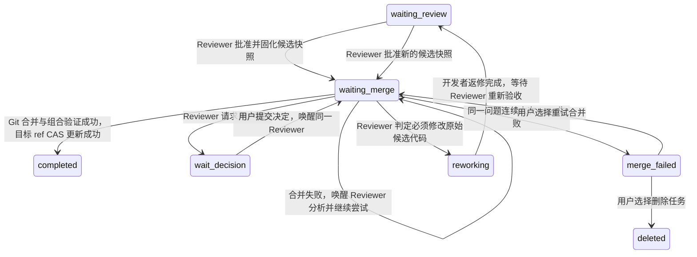

# 合并检视与决策流程设计

> 状态：待检视设计，尚未实现。

## 目标

- 不要求执行者提交 commit，也不要求任务 worktree 在验收时干净。
- Reviewer 验收的文件状态作为合入候选；验收后再发生的修改不得悄悄混入该候选。
- 先用标准 Git 合并流程尝试合入；合并或合并后验证失败时唤醒 Reviewer 分析和处理。
- 每次合并尝试都形成可追溯记录和可查看日志。
- Reviewer 遇到需要人判断的取舍时进入 `wait_decision`，用户可在任务详情中回复并唤醒同一 Reviewer 会话。
- 同一合并问题连续超过五次重试仍失败时进入 `merge_failed`；停止自动尝试与 Reviewer 唤醒，用户只能选择重试合并或删除任务。

## 核心概念

### 验收快照，不要求干净 commit

`approve_task` 不再以 `HEAD === headCommit` 且工作区干净为前置条件。它会把任务 worktree 当时的最终文件状态固化成不可变的合入快照，包含已跟踪文件的 staged/unstaged 改动、删除，以及 Git 默认不忽略的未跟踪文件。忽略文件不纳入快照。

快照由桥接用临时 Git index 生成；如 Git 需要 commit 对象表达该树，可创建仅供桥接内部使用的合成对象。它不要求执行者创建 commit，不改写执行者分支，也不把这个对象伪装成 Agent 提交。记录快照树 ID、原始 HEAD、基线 commit、纳入文件清单及生成时间。验收后 worktree 的继续变化不会改变这个快照；需要纳入新改动时，必须重新检视并生成新快照。

如果快照生成失败（例如索引损坏或文件无法读取），验收不得静默成功；将任务置于 `waiting_merge`，写入合并记录和错误日志，以合并修复角色唤醒 Reviewer 处理。

### 合并记录与日志

新增独立的 `thread.mergeHistory[]`，不把合并尝试伪装成开发 `rounds[]`，以免污染开发轮次、Token 统计和 `currentRound`。详情面板在开发轮次之后展示合并时间线；每次尝试追加一条记录，不覆盖历史。

每条记录至少包含：

- `attemptId`、序号、发起者/触发原因、开始和结束时间。
- 目标分支/ref、尝试开始时目标 SHA、合入快照 tree/source SHA、成功后的目标 SHA、最终合入 commit SHA。
- 相对 `targetOldCommit` 的合入文件清单，使用 Git name-status 格式保留新增、修改、删除和重命名信息。
- 阶段和结果：`preparing`、`merging`、`validating`、`merged`、`conflict`、`validation_failed`、`blocked`、`cancelled`。
- 问题分类、稳定的 `failureFingerprint`、连续失败计数、已尝试的恢复动作及是否属于 retry。
- Git 退出码、冲突文件、验证命令与结果、错误摘要。
- 标准输出/错误输出日志路径，以及关联的决策请求 ID。

每次尝试的完整命令输出写入任务数据目录的 `merge_log/<threadId>_merge_<n>.log`；账本记录日志路径和摘要。日志采用追加式保留。任务归档包必须包含 `merge_log/` 和 `mergeHistory`；任务删除时随其他任务数据一起清理。UI 提供查看、分页和复制日志的入口。成功记录必须持久化 `mergedCommit`、`targetOldCommit` 和从 `git diff --name-status <targetOldCommit> <mergedCommit>` 得到的 `changedFiles[]`。集成 commit 的第一父提交固定为合并前目标 SHA，便于安全回退；详情页可复制 `git revert -m 1 <mergedCommit>` 命令。回退通过新增 revert commit 完成，禁止用 reset 改写共享目标分支历史。

### Worker 失败与处理策略传递给 Reviewer

每次 worker 轮次失败时，Reviewer 检视上下文要包含 `round.assessment`、中断记录、可用的执行日志页和已尝试恢复动作。Reviewer 将 worker 报告与合并失败一起判断，不能只看 Agent 的自然语言总结。对应处理如下：

| Worker 失败/信号 | Reviewer 处理 |
| --- | --- |
| `NONZERO_EXIT` | 查看退出码和日志，区分代码/测试失败与 CLI/环境失败；前者返修，后者按可恢复原因重试或请求用户决策。 |
| `EMPTY_OUTPUT` | 不得按成功处理；查执行日志与会话状态，决定用同一会话重试或请求用户决策。 |
| `STREAM_STALLED` | 作为失败检查最后日志与中断原因；同一静默问题重复时累计同一 fingerprint。 |
| `STREAM_GAP_EXCEEDED` | 这是成功轮次的 warning，不触发重跑；Reviewer 可参考 `continuous/gapExceeded` 判断输出是否足以支撑验收。 |
| `timeout` / `watchdog` / `error` 中断 | 读取 `interruption{kind,reason,at,by}`；系统超时/看门狗可在预算内重试，用户 pause/stop/delete 不自动重试。 |
| `RATE_LIMITED` / quota | 尊重 `retryAfter`/quota 恢复信息，延后同会话唤醒；不在限流窗口内快速重试。耗尽预算后转入合并失败收口，不伪造代码返修。 |
| 认证失败、权限拒绝、CLI 缺失或启动失败 | 不重复执行必然失败的合并命令；附上日志与恢复要求，请求用户决定或等待用户处理环境后重启。 |
| Git 冲突、目标分支推进、dirty checkout、CAS 失败 | 保留冲突现场和目标 SHA；Reviewer 解决冲突、等待 checkout 清洁或基于最新目标重试，绝不覆盖用户改动或目标 ref。 |
| 组合测试/构建失败 | 记录失败命令与摘要；Reviewer 判断是候选代码缺陷（返修）还是集成环境/外部依赖（决定或等待），不得直接标记合并成功。 |

`assessment.success === false`、退出码非零、空输出或中断都必须传给 Reviewer；`success === true` 且只有 gap warning 则不能被误记为 worker 失败。挂起窗口仍按 worker 规则从活动时长和 timeout 预算中扣除。worker 的原始轮次、输出归档和 token 计量保持原样；合并 Reviewer 的处理记录写入 `mergeHistory`，不覆盖 worker 轮次。

### 人工决策

新增 `ThreadStatus = 'wait_decision' | 'merge_failed'` 和一项持久化 `decisionRequest`，内容包括请求 ID、关联合并尝试、Reviewer 的问题、背景、可选建议、创建时间及状态。决定提交后保留不可变的 `decision` 记录（答复内容、提交者、时间），再清除当前待处理标记。`merge_failed` 表示同一失败问题的重试预算耗尽，不再是活跃 Reviewer 流程。

Reviewer 通过专用 MCP 控制面工具请求决定。桥接校验它是该任务当前 Reviewer，保存请求及合并记录，然后将任务设为 `wait_decision`，释放 Reviewer 角色锁和执行登记。提交决定后，桥接把答复追加到同一任务的合并检视上下文，在原 Reviewer 原生会话中唤醒它；不得创建新任务或新会话。决定提交后状态恢复为 `waiting_merge`。Reviewer 根据答复继续分析和处理合并；只有确实需要改动原始候选代码时，才调用 `request_rework` 暂时交给开发者。

## 流程

### 自动合并尝试

1. Reviewer 验收后，桥接固化候选快照，任务进入 `waiting_merge`。快照 ID 成为本次审批对象。
2. 合并器取得现有全局合并锁，在锁内读取目标分支最新 commit；目标分支相较派发时变化是允许的。
3. 在临时验证 worktree 中从最新目标 commit 开始，调用标准 Git CLI 执行常规 `git merge --no-commit --no-ff <approved-snapshot>`。不自行模拟 Git 的三方合并算法。
4. Git 合并成功后运行仓库声明的组合验证。通过后创建桥接集成 commit，并用 `git update-ref <target> <new> <targetOld>` 做 CAS 更新；若 ref 已被锁外进程更改，CAS 失败并记为 `blocked`，不得覆盖新 ref。
5. 仅当目标 ref 更新、检查已检出的目标 checkout 可安全同步、账本结果均持久化成功后，才标记 `completed`。无改动快照也记录一次 `no_changes` 合并结果后完成。
6. 每个状态变化先持久化对应 merge record；日志文件先完整落盘，再更新账本，避免账本指向不存在的日志。

标准 Git 合并返回冲突或组合验证失败时，不标完成；保存临时合并 worktree、冲突文件和日志，任务状态继续保持 `waiting_merge`，并唤醒 Reviewer。Reviewer 在该任务专属的合并工作区（`mergeResolutionPath`）中读取目标分支差异、冲突和日志，可以编辑冲突文件并使用标准 Git 命令尝试解决；不能直接更新目标 ref。Reviewer 通过 `submit_merge_resolution` 提交当前合并树，桥接为它创建新的 merge attempt，重新运行组合验证并在全局锁下 CAS 更新目标 ref。提交失败时保留工作区和日志，仍在 `waiting_merge` 唤醒同一 Reviewer 继续分析；每次尝试新增记录，不覆盖前次结果。成功后才结束 Reviewer 角色并完成任务。

每次 retry 失败后，桥接按“失败阶段 + 规范化错误码/退出码 + 规范化错误摘要 + 冲突路径或失败验证项”生成 `failureFingerprint`。计数单位是同一 fingerprint 的连续 retry 失败：初次自动合并失败不算 retry；后续同一问题的 retry 失败计数达到 6（即超过五次）时，任务进入 `merge_failed`。问题解决、开始新的合并周期或 fingerprint 确实变化时，当前连续计数清零，但历史记录保留。Reviewer 启动失败也按 worker 的 assessment/interruption 分类；仅仅 wake 重试而未实际启动，不计合并 retry。

进入 `merge_failed` 时，先持久化最后一次 merge record 和日志，再终止/释放 Reviewer、合并工作区操作进程、角色锁、会话写租约及执行登记。此状态不自动重试、不自动唤醒，也不接受 Reviewer 工具调用。

合并工作区从该次尝试读取的 `targetOldCommit` 派生，持久记录路径、基线和状态，供 Reviewer 的原生会话以该目录作为工作目录。它与执行者 worktree 分离，不改变 `workspace.executionPath` 或已经批准的原始候选快照。Reviewer 对合并工作区的改动表示“解决目标分支集成冲突”，纳入最终 merge commit 和 `changedFiles[]`；不得把它们回写成开发者的轮次输出。下一次尝试可以复用 Reviewer 修复后的合并工作区，或在目标 ref 已前进时基于最新目标重建并重新应用已记录的解决方案。

目标 checkout 若有用户未提交改动，桥接不覆盖文件、不强制 reset/checkout；合并记录标为 `blocked`，任务保留 `waiting_merge`，在详情页给出阻塞原因和安全恢复操作。目标 ref 已成功更新但 checkout 同步失败时，明确记录“ref 已更新、checkout 未同步”，不得谎报未合入或重复创建合并 commit。

### Reviewer 处理失败并继续合入

桥接用原有专用 Reviewer 会话唤醒 Reviewer，并附上失败尝试摘要、冲突文件、目标 SHA、候选快照信息、合并工作区路径及日志读取工具路径。此时任务仍是 `waiting_merge`；Reviewer 是合并修复角色，直到成功合入或请求用户决策。自动合并失败本身不返回普通 `waiting_review`，也不要求 Reviewer 再次批准原始快照。

- 目标侧冲突可直接解决：Reviewer 在合并工作区修复冲突，通过 `submit_merge_resolution` 触发验证和 CAS 合入；失败后继续沿用同一会话和工作区分析、修复、再提交。
- 候选代码本身有缺陷、必须由执行者修改：Reviewer 调用 `request_rework`，任务进入 `reworking`；开发者基于同一 task/native session 修改。完成后 Reviewer 重新验收并固化新快照，随后状态回到 `waiting_merge`，继续合并闭环。
- 存在产品语义、取舍或其他需要用户裁决的问题：Reviewer 调用决策请求工具，任务进入 `wait_decision` 并释放角色锁。提交用户决定后状态回到 `waiting_merge`，同一 Reviewer 会话继续处理。
- Reviewer 能依据已有规则给出明确方向：记录结论并继续解决或重新尝试。每次重试生成新的 merge record，保留之前失败记录。

决策 UI 在合并记录区域下方显示 Reviewer 的问题、背景、建议选项、相关冲突文件和日志链接，提供多行对话框及“提交决定并唤醒 Reviewer”按钮。提交前允许编辑任意文本；提交后不可原地改写，只能追加新的决定/澄清记录。提交接口以 `requestId` 做幂等校验，防止双击创建重复唤醒。决策请求关闭后任务状态为 `waiting_merge`，页面继续显示 Reviewer 正在处理合并。

`merge_failed` 页面只显示最后错误、连续失败次数、历史 merge records/日志和两个用户操作：“重试合并”“删除任务”。不得显示 approve、rework、普通 retry 或再次提交 decision 的操作。重试合并沿用同一 `threadId`、批准快照、合并工作区和原生 Reviewer 会话，增加 `retryGeneration` 并清零新一代的 fingerprint 失败计数；已有修复进度不丢弃，继续从最近一次失败的合并阶段重试，必要时先按最新目标 SHA 更新合并工作区。过去记录不删除。删除任务需明确确认将丢弃未合入候选与合并工作区，然后按任务删除生命周期停止进程、清理数据并写墓碑。

## 状态、角色与调度约束

- `waiting_merge` 和 `wait_decision` 都不占 Agent 并发执行槽，但仍是未终态任务，不能归档淘汰。Reviewer 活跃处理合并时状态保持 `waiting_merge`，并由该任务唯一 Reviewer 角色锁保护。
- `merge_failed` 不占 Agent 并发执行槽、不持有任何角色/会话锁、不会自动调度，但仍保留未合入成果，因此不能自动归档或淘汰；只有用户显式重启或删除。
- 自动合并阶段登记为 merge execution，不占 reviewer/developer 角色锁；Reviewer 合并修复阶段作为 reviewer 角色执行并登记进程。merge log 与取消信号绑定 `threadId + attemptId`。
- 每次尝试之间先确认前一 Git/验证进程结束并记录结果，再允许 Reviewer 操作对应合并工作区；不得并行运行两个该任务的合并进程或 Reviewer。
- `wait_decision` 释放角色锁、原生会话写租约和进程登记；提交决定时状态恢复 `waiting_merge`，再重新获取 Reviewer 角色锁。若任务已暂停、删除或决策请求已失效，拒绝唤醒。
- `merge_failed` 只允许 UI 控制面执行 `retry_merge` 或 `delete_task`；MCP reviewer/developer 工具不得隐式恢复它。
- 暂停/删除必须取消正在进行的 Git/验证子进程并记录 `cancelled`；删除仍须遵循未合入成果保护规则。
- 分支、worktree、目标固定和全局合并锁继续沿用现有 Git 隔离模型；本设计只改变批准快照、合并失败闭环和历史展示。

## 账本、读取和兼容性

- 新任务写入 `mergeHistory`；最终摘要列出合并尝试数、最终合并 SHA、合入文件清单、验证状态和未解决阻塞。合并成功记录的第一父提交是 `targetOldCommit`，详情页展示目标前后 SHA、修改文件和可复制的 revert 命令，便于用新 commit 安全回退。
- `get_thread_details` 返回最近若干条合并摘要；新增 `get_merge_log(threadId, attemptId, offset, limit)` 分页读取，限制单页大小，并校验日志路径位于该任务目录。
- `wait_decision` 与 `merge_failed` 不属于可自动淘汰的安全终态。容量策略仍只淘汰安全终态。
- 旧账本缺少 `mergeHistory` 时不伪造完整历史。旧 `waiting_merge` 任务在首次恢复时可根据现有 integration/transaction 元数据生成一条 `legacy-import` 摘要，并以原批准 SHA 走兼容恢复路径；后续新尝试使用新记录格式。
- `record_merge_request` 仍是调用者的远端批次级动作；本地 `completed` 和远端 MR 记录继续是两件事，MR 不取代本地合并。

## 实施验收边界

1. staged、unstaged、删除和未跟踪改动无需 Agent commit 即可固化并被准确合入；验收后新增的改动不进入已批准快照。
2. 目标分支在任务运行期间前进时，桥接按最新目标做标准 Git 合并和组合验证；冲突会唤醒 Reviewer。
3. 自动合并冲突后任务仍为 `waiting_merge`，Reviewer 可在专用合并工作区多次尝试并逐次留档；只有成功合并和验证后任务才完成。
4. 验证失败、CAS 失败、dirty checkout 阻塞均留有 merge record 和可读日志；成功记录准确包含合入 commit、前后目标 SHA、修改文件清单及安全回退命令。
5. Reviewer 请求决定后任务进入 `wait_decision`、释放角色与并发资源；提交决定后任务回到 `waiting_merge`，同一 Reviewer 会话恢复，重复提交不会重复唤醒。
6. worker 的非零退出、空输出、流停滞、warning、限流、超时/看门狗、权限/认证/启动失败均按策略传给 Reviewer；用户中断不被自动重试，warning 不被当成失败。
7. 同一 fingerprint 连续第六次 retry 失败后进入 `merge_failed`、清空活跃锁并停止自动唤醒；界面只允许重试合并或删除。重试沿用快照和合并工作区，保留历史并开启新一代失败计数。其他 fingerprint 的失败不错误继承计数。
8. 多次合并尝试、返修和决定均按时间顺序保留；详情面板、分页日志、归档和删除生命周期一致。
