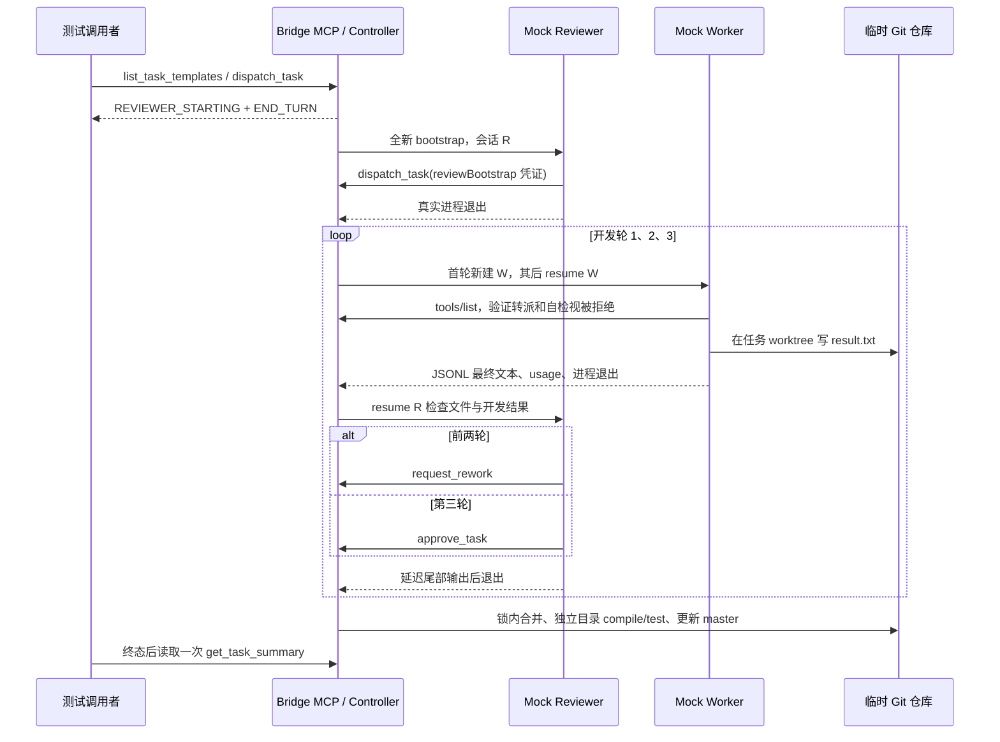

# Mock Reviewer / Worker 与任务派发端到端测试

日期：2026-11-20。源码基线：`e6ebd11`，当前生产执行路径为 dedicated / execution.version=1。本测试用于验证真实控制链，不代表下一版去锁设计已经实现，也不安装或重载扩展。

## 1. 验证边界

Mock Agent 是确定性的脚本程序，不是生产模型目录中的新型号。Reviewer 和 worker 分别作为真实 Node 子进程运行，拥有不同原生会话；脚本代替模型做决定，不访问模型服务，不消耗真实模型 token。

保留真实实现：MCP JSON-RPC stdio、任务模板解析、派发、bootstrap prompt/token 确认、账本与 OS 短写锁、执行控制器、角色/会话保护、stdout 解析与 assessment、receiver 权限限制、返修/审批、Git worktree、批准快照、合并验证及目标分支更新。

唯一替换边界是测试宿主里的外部 Codex 进程启动：保留生产构造的 argv/env，将可执行程序路由到 `mock-agent.js`。不替换 runner.execute、callback、approve/rework，不手写 reviewing/completed，不伪造 bootstrap confirmed。该替换仅存在于 `src/test/fixtures`，不提供生产开关，也不进入 VSIX；它不能认证真实 Codex/其他 CLI 的参数兼容性、认证或原生存储行为。

## 2. 组件

| 组件 | 职责 |
| --- | --- |
| `fixtures/mock-agent-protocol.ts` | 最小真实 stdio MCP 客户端、有界请求/退出等待、结构化进程事件与测试根校验 |
| `fixtures/mock-bridge-host.ts` | 在隔离 home 中装配真实 Bridge 服务；只替换 Agent 可执行程序；协议 stdout 与诊断 stderr 分离 |
| `fixtures/mock-agent.ts` | 按 bootstrap / reviewer / worker 环境身份运行脚本；输出兼容的 Codex JSONL；通过真实 MCP 子进程调用工具 |
| `mock-agents-e2e.test.ts` | 创建临时 Git 仓库、指定情景、下发一次任务、观察耐久账本并验证成果/进程/会话 |

每个 reviewer/worker 进程均连接自己的真实 MCP server 子进程，保留环境身份和父子 PID 关系。不能把 reviewer 调用直接替换为测试代码调用 controller 方法。

## 3. 默认三轮流程



Reviewer 依据实际工作树文件与 MCP 返回的 currentRound 作决定：前 N−1 轮给出不同返修要求，第 N 轮批准。Worker 按当前轮次写固定内容，不调用 Git 提交/推送。合入验证是真实受控 Node 程序，分别执行 compile/test 并核对最终文件，不能只用退出 0 的空命令。

Mock JSONL usage 是测试数据，仅写入临时账本用于验证解析；它不表示真实模型开销，不得写入生产任务或成本报告。

## 4. 可运行场景及断言

| 场景 | 关键断言 |
| --- | --- |
| 三轮成功闭环 | 只创建一个任务；bootstrap 一次；worker 1→2→3；两次 rework 后 approve；worker/reviewer 各自 session 稳定且互不相同；模型配置分别为 mock-worker/mock-reviewer |
| Reviewer 尾进程 | 工具裁决已经返回后仍保留短暂尾进程；从真实 child close 事件证明后续 worker 没有提前启动 |
| Receiver 权限 | tools/list 隐藏 dispatch_task；强行调用 dispatch_task、对自身 request_rework 均被真实 MCP 拒绝 |
| Worker 空输出 | 只有 thread/status 元数据且退出 0，assessment 为 EMPTY_OUTPUT；不启动普通 reviewer，不运行合入验证 |
| Worker 非零退出 | 有最终文本但退出 7，assessment 为 NONZERO_EXIT；不进入普通检视或更新目标 ref |
| Reviewer 无裁决 | 有合法输出且退出 0，未调用 rework/approve；明确失败，目标 ref 不变 |
| Bootstrap 错 token | 真实工具拒绝；worker 从未启动，目标 ref 不变 |

成功链路还核对：轮级 assessment、非 approval 开发轮数、终态摘要、真实 master SHA 变化、checkout 干净、validation 使用独立合成工作树，以及每个 mock Agent 的 start 都有实际 close。

进程事件使用每次 spawn 独有的 launchId 关联实际 ChildProcess 的 close，并记录单调时间；不单凭可复用的 PID 或 agent 自报“已退出”证明交接安全。生产 PID + birthId 与退出确认机制不被这个测试标识替代。

后续扩展情景应沿用同一设施：暂停/恢复同轮同会话、删除与启动竞争、合入锁繁忙、验证失败、宿主崩溃后恢复、归属认领冲突、维护与清理竞争。去锁实现改变内部所有权后，这些测试继续使用公开 MCP 流程；不得为了通过而在 fixture 内重写账本或回退成方法级 mock。现有跨进程 CAS/PID/恢复专项仍须保留，不能用本测试替代所有边界测试。

当前成功脚本每轮都有文件变更，`no_changes` 交付分支也属于后续扩展范围，不能由三轮成功用例推断已覆盖。

## 5. 隔离与收尾

每个情景使用独立 `amb-e2e-*` 临时根，包含 home、Bridge 数据、事件、任务目录与 Git 仓库。启动环境采用白名单：只继承必要平台变量和 PATH，显式覆盖 HOME/USERPROFILE、APPDATA、CODEX_HOME、Bridge 根及 caller 身份；不继承真实 provider 凭据、Agent 路径、receiver/bootstrap 身份。

测试宿主强制检查默认 home 与显式 Bridge 根一致，且只解析 mock Codex 可执行程序。全部业务 stdin 和权限参数仍由生产启动器决定；mock agent 到 MCP 的 stdio 是独立协议通道，不重新打开业务 stdin。

调用者收到 dispatch 后不轮询 MCP；测试通过文件事件观察隔离账本，终态后才读摘要。各 RPC、整条链路及退出等待均有上限。失败保留情景目录、每个 MCP 宿主 stderr 和按单调时间排序的进程/业务事件；不把超时重试成一个新任务。

成功链路的账本观察上限为 360 秒，整个用例为 420 秒；失败场景分别为 120/180 秒。Windows 上真实 OS 锁辅助进程与并行 Git 回归会增加耗时，限时覆盖这些开销，但始终要求完成交付且清空当前 run。

成功后先等待真实 MCP 与 mock Agent 退出，再验证临时路径位于系统临时目录，最后清理。失败时只对本测试 task 发暂停以收尾，不能枚举并终止真实用户 Agent。若进程退出无法确认则报告证据并保留目录，不能宣称清理成功。

## 6. 运行和测试分层

```powershell
# 一条命令：编译并运行 mock 端到端场景
npm run test:e2e:mock

# 已编译时直接执行，便于定位单个情景
node --test --test-reporter=spec out/test/mock-agents-e2e.test.js

# 同样包含在原有 integration 与全量测试中
npm run test:integration
```

文件在 `scripts/test.cjs` 显式映射到 integration 层，不新增脱离全量发现规则的测试集合。与本测试发现的 Windows 原子替换问题对应的故障注入回归位于 `task-store-atomic-write.test.ts`，属于 boundary 层。

当前测试只认证执行过的平台。VS Code UI/Extension Host、真实模型/CLI、MCP 配置同步、远端推送/MR 和下一版停机启用均不在本测试的通过声明内。

## 7. 真实链路暴露的修正

本设施没有用额外 mock 绕过发现的问题；相关最小运行时修正和独立边界回归随设施一起交付：

- Bootstrap 在工具确认前保持 queued，与确认协议一致；失败时记录 bootstrap failed 及占位轮次失败。
- 同进程并发 start 请求共享一次 admission Promise，防止旧 v1 先取资源再 CAS 时，失败调用释放胜者的可重入角色租约；跨进程所有权仍由持久 run/CAS 保护。
- 首轮占位 session ID 尚未捕获时，不预先持有其原生租约；实际 ID 的捕获和生命周期继续由真实 runner 管理，避免续轮被首轮留下的占用阻塞。
- 合入协调器已落账 completed 时，控制器允许在匹配 run 和已落地合入证据下完成自身收尾；旧 run 回调仍被拒绝。
- Windows 原子账本替换遇到短暂 EPERM/EACCES/EBUSY，最多尝试 20 次、间隔 10ms，只重试同一临时文件的发布，不重放业务、不先删除旧记录；持续失败保持报错并保留旧耐久记录。
