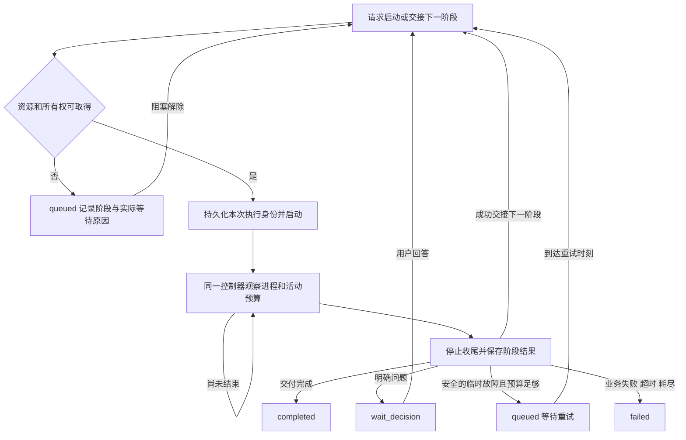

# 开发检视与合并的统一执行设计

状态：设计方案，待实现。日期：2026 年 11 月 17 日。

后续减少独立角色锁文件和重复持久队列的方案见[锁与队列精简设计](LOCK_AND_QUEUE_SIMPLIFICATION_DESIGN.md)。根据 2026 年 11 月 19 日用户确认，该后续方案采用旧任务全部安全结束、停止旧宿主和 MCP、更新后只运行新机制的停机切换方式；旧记录仅保留历史读取与归档/删除，不再保持旧版执行路径或迁移旧任务，不改写已派发任务的验收快照。本文保留统一执行 v1 的设计基线，后续切换边界以上述精简设计为准。

开发、检视、合并共用一个执行控制器、一份当前运行记录、一个活动时间预算和一套自动重试规则。进程身份回答是否存活，阶段结果回答是否成功，统一策略回答是否重试。任务锁、原生会话写锁和 Git 合入锁继续负责各自的互斥，不再独立判断业务进展。

目标状态采用 `queued / running / reviewing / merging / wait_decision / paused / completed / failed`。阶段交接时立即尝试启动下一阶段，只有实际受阻或尚未到达重试时刻才进入 `queued`，并携带待执行阶段与等待原因；取得相应执行权后，任务才显示为运行、检视或合并中。本方案衔接状态重命名与合入排队改动，不代表这些行为已经实现。

## 一 统一后的规则

| 问题 | 唯一规则 |
| --- | --- |
| 谁在执行 | 当前运行记录的执行标识和经过身份验证的进程树 |
| 是否卡住 | 同一个控制器检查阶段活动时间预算，输出不会续期 |
| 是否成功 | 阶段适配器提供完成证据，控制器统一提交结果 |
| 是否重试 | 可安全重放的临时故障最多自动重试两次 |
| 是否需要用户 | 存在具体问题和合法恢复点时进入 `wait_decision` |
| 为什么排队 | 等待阶段执行权、原生会话、合入锁、退避或已知配额恢复时间 |
| 何时停止 | 超时、业务失败、不可恢复错误、重试耗尽进入 `failed`；用户暂停进入 `paused` |

三阶段默认使用相同的 120 分钟活动预算。预算跨本阶段所有自动尝试累计，等待和用户暂停不计时。自动重试默认等待 5 秒、30 秒；总共是首次执行加两次自动重试，不能解释成额外三次。参数在阶段进入时固定，不因重启、切换子步骤或错误文本变化而重置。

## 二 当前实现需要收敛的部分

目前 `TaskExecutionRegistry`、`TaskRoleLock`、Supervisor 各自使用心跳和 PID 组合判断存活；执行器还有 Agent 专属静默阈值和后台等待特例。普通检视与合并检视的看门狗覆盖不同。执行器、bootstrap、检视唤醒、合并失败指纹分别维护预算，宿主恢复又可以重新启动开发轮。

相关实现入口：

- [执行登记](../src/bridge/task-execution-registry.ts)与[任务角色锁](../src/bridge/task-role-lock.ts)。
- [开发执行器](../src/bridge/autonomous-runner.ts)与[Supervisor](../src/bridge/task-supervisor.ts)。
- [Reviewer 唤醒](../src/bridge/callback-manager.ts)、[唤醒策略](../src/bridge/review-wake.ts)与[唤醒调度](../src/bridge/review-wake-scheduler.ts)。
- [Reviewer 初始化](../src/bridge/reviewer-bootstrap.ts)、[合入协调](../src/bridge/merge-coordinator.ts)与[合并预算](../src/bridge/merge-recovery.ts)。

收敛后，适配器保留业务能力，停止拥有独立的重试循环、静默杀进程逻辑或过期回收规则。控制器不是新的通用工作流框架，只封装现有任务的启动、观察、停止、结果提交和下一次调度。

## 三 运行记录与写入权

### 当前记录

在任务账本新增 `execution`，只保存当前阶段的控制信息；不在多个运行文件中保存可独立推进的副本。

```ts
type ExecutionPhase = 'develop' | 'review' | 'merge';

interface ExecutionControl {
  version: 1;
  revision: number;
  operationId: string;
  phase: ExecutionPhase;
  round: number;
  purpose?: 'bootstrap' | 'merge_resolution';
  generation: number;
  attempt: number;
  autoRetriesUsed: number;
  queue?: {
    reason: 'role' | 'session' | 'merge_lock' |
      'capacity' | 'backoff' | 'quota';
    notBefore?: string;
  };
  run?: {
    id: string;
    owner: ProcessIdentity;
    child?: ProcessIdentity;
    step: string;
    state: 'starting' | 'active' | 'stopping';
    startedAt: string;
  };
  budget: {
    limitMs: number;
    spentActiveMs: number;
    maxAutoRetries: number;
  };
  lastOutcome?: {
    code: string;
    reason: string;
    at: string;
    evidencePath?: string;
  };
}

interface ProcessIdentity {
  pid: number;
  birthId: string;
}
```

`operationId` 标识一次阶段工作：一次开发轮、对该轮的检视，或一个批准快照的合入。`run.id` 标识一次实际启动，暂停后恢复也必须使用新的 `run.id`。`attempt` 是实际启动序号，用于审计；`autoRetriesUsed` 只统计控制器发起的自动重试。用户暂停后的显式恢复可以增加启动序号，但不会清零或增加自动重试计数。

`birthId` 是平台进程创建身份，防止 PID 复用。Windows 使用进程创建时间或已持有的进程句柄，POSIX 使用可用的进程启动标识和受控进程组。`run.id` 是桥接的执行身份，不能代替 OS 创建身份。平台探测统一由 `platform.ts` 提供；无法验证时返回 `unknown`，不能按“进程不存在”处理。

队列记录、活动记录、待决定记录和失败记录属于不同生命周期位置。排队时 `run` 为空，执行时 `queue` 为空；停止过程允许任务已经为 `paused`、`failed` 或 `wait_decision` 而 `run.state=stopping`，此时新执行一律不得准入。

运行中每 5 秒随控制器扫描保存一次活动时间累计值，仅用于恢复与展示。该检查点不承担存活租约作用，没有“超过若干秒即可抢占”的含义。历史尝试写入已有执行日志、review 日志和 `mergeHistory`，不新增无限增长的通用尝试数组。

### 统一写入入口

`TaskStore.transitionExecution(threadId, expectedRevision, change)` 是更新当前运行记录、生命周期和决定的唯一入口。它在短时的按任务 OS 写锁内重新读取账本、检查版本和执行身份、写临时文件并原子替换。复用 `MeshFileLock` 的平台锁实现，锁路径按 thread 区分；临界区内不执行 Agent、Git 或验证命令。

版本校验和原子 rename 缺一不可：rename 只能防止半文件，不能使两个进程的“读取后修改”自动成为原子操作。普通 `upsertTask()` 不得覆盖受保护的 `execution`、决定或相应生命周期；日志、轮次输出和 token 的既有合并保护继续生效。

每次回调至少携带 `operationId + generation + run.id`。身份匹配后重读当前 revision 再提交；有合法控制操作改变 revision 时不得盲目重试旧转换。相同事件重复到达只返回已保存结果，旧执行不能清理新执行的角色、运行记录或会话租约。

### 三种互斥继续保留

| 互斥 | 保护范围 | 与统一存活判断的关系 |
| --- | --- | --- |
| 任务角色锁 | 同一个 thread 的 developer 与 reviewer 交接 | 只控制准入；存活委托统一进程探测 |
| 原生会话写锁 | 同 Agent 与规范化 session ID | 覆盖实际子进程退出，防止跨任务重复写会话 |
| 全局合入锁 | 合并、组合验证、CAS 更新与落地恢复 | 同时只有一个合入任务；等待者保持 `queued` |

角色仍只有 `developer / reviewer`，合并控制归 reviewer，不新增第三种任务角色。运行登记 `executions/` 只作为由当前记录生成的兼容索引，不再拥有独立的心跳、120 秒孤儿宽限或重新判活规则。Supervisor 自身服务发现可保留一个宿主心跳，但它不能代替任何任务的存活证据，也不能决定重放任务。

## 四 三阶段共用的执行流程



1. 新执行、成功交接和显式恢复直接调用统一启动入口；到期或解除阻塞的 `queued` 候选调用同一入口。按 `execution.phase` 选择适配器，不能从任务名、最新输出或末轮类型猜待执行阶段。
2. 立即检查并尝试取得任务、角色、会话和可选并发名额；merge 还需要全局合入锁。资源可用时继续启动，不必先写 queued 或等待下一次调度扫描。确实受阻时才持久化 `queued` 与具体原因；阻塞只影响本任务，继续扫描其他候选。
3. 资源取得后，校验任务未暂停、删除、决定等待或被新操作替代；在短写锁内提交 `run.id` 和启动意图。此时开始累计阶段活动时间，并转成对应活动状态。
4. 启动进程并立即登记经过验证的 child 身份。并发启动的第二个进程无法越过已提交的 `starting` 记录。启动意图已经落账但宿主崩溃的情况属于不确定启动，按恢复流程处理，不能假设没有 spawn。
5. 每 5 秒调用相同的观察函数。进程事件可以提前触发同一逻辑；stdout、stderr 仅更新日志和响应评估，不刷新截止时间。
6. 结果、交接或中断先写入持久证据，再提交当前记录。释放资源前，必须确认受控子进程树已退出，或已转入明确的停止处理中；不能清掉 PID 后继续让旧进程运行。
7. 统一分类器生成唯一后续动作：推进、重试排队、等待决定、失败或暂停。

全局合入锁先立即尝试获取，锁被占用时才进入 `queued(phase=merge)` 异步等待，不持有任务控制写锁。拿到合入锁后必须再检查任务身份；已经取消的候选立即归还锁。只有持锁任务能进入 `merging`，任何 Git 与验证子进程都受该次合入执行登记和锁 helper 保护。

### 进程存在与进程健康

`probeRun()` 只返回 `alive / exited / unknown`，所有阶段使用同一实现。

- child 身份存在且匹配时判为 `alive`，随后检查活动预算。
- `starting` 或合并命令切换期间没有 child 时，检查 owner 身份；owner 仍活着就等待事件或阶段预算，不把短暂空档当成退出。
- child 已退出时，先收集退出、最终输出和业务证据，再分类；不能仅因 PID 消失立即重试。
- owner 已死而 child 仍活着，进入恢复并停止已验证的遗留进程树；确认退出前不启动替代执行。
- 权限不足、创建身份不可读或子树状态不确定时判为 `unknown`，禁止抢占、猜测性杀进程和自动重放；写入可见的恢复原因。

终止使用一个共用的 10 秒确认窗口。窗口结束仍无法证明子树退出时，保留锁和停止信息，以 `PROCESS_STOP_UNCONFIRMED` 阻止恢复。用户可以处理进程并再次恢复，但不能通过重试清除该保护。进程树管理必须覆盖 Windows Job 或等价机制，以及 POSIX 受控进程组；只证明根 PID 退出不够。

owner 可能是同时管理多个任务的共享扩展宿主或 MCP 进程。停止只能取消本任务的内部步骤、锁等待和已验证的 child 树，绝不能通过杀 owner 来取消一个任务。合并多个子进程的登记由同一个 owner 顺序更新，旧 child 的退出回调不能清掉新 child。

统一 watchdog 随控制器工作，不新增独立守护进程。如果整个宿主不被调度，检查同样会暂停；恢复后按照主机挂起规则扣除相应时间。这个机制提供有界活动执行，不能宣称在宿主彻底冻结时仍可实时杀进程。

## 五 状态与阶段的对应关系

| 状态 | execution.phase | 含义与出口 |
| --- | --- | --- |
| `queued` | 任一阶段 | 等待执行权或重试时刻；没有正在执行的业务子进程 |
| `running` | `develop` | 开发者执行中；成功交给 review，失败由统一策略处理 |
| `reviewing` | `review` | 检视者执行中；批准交给 merge，返修交给 develop，问题交给用户 |
| `merging` | `merge` | 已持全局合入锁，正在合并、验证或执行本次明确的合并修复步骤 |
| `wait_decision` | 保留待恢复阶段 | 有明确问题，业务执行已交接并停止；用户回答后立即尝试恢复原阶段，实际受阻才排队 |
| `paused` | 保留被暂停阶段 | 用户暂停；停止完成后才可恢复同阶段 |
| `failed` | 保留失败阶段 | 自动推进停止；failure.stage 解释失败类别 |
| `completed` | 最后阶段或无改动 | 本地交付证据齐备；MR 收口与归档另行处理 |

开发成功并释放执行权后，立即尝试启动 Reviewer，执行权可用就直接进入 `reviewing`。仅当同任务旧进程尚未退出、原生会话被占用或触及明确配置的并发限制时，才进入 `queued(phase=review)`。检视没有全局串行限制，也不因其他任务正在检视而默认排队。

批准后立即尝试取得唯一合入权，取得就直接进入 `merging`，合入锁或其他必需资源被占用时才进入 `queued(phase=merge)`。明确 `no_changes` 可以直接完成。返修创建下一开发轮后同样立即尝试启动，实际受阻才进入 `queued(phase=develop)`。统一的是启动检查、存活和重试规则，不要求每次阶段转换都经过 queued。

专用 Reviewer bootstrap 也走 `review` 适配器，`purpose=bootstrap`。确认 token、保存原生 session 并完成交接后，立即尝试启动 develop，实际受阻才排队；不再有独立 bootstrap 重试上限。它发生在开发前，仍映射为 `failure.stage=bootstrap`。普通 review 映射为 `review`，develop 映射为 `execution`，merge 映射为 `merge`。

合并中的 Reviewer 修复归入同一个 merge operation，标记 `purpose=merge_resolution`。它与 Git/验证顺序执行，共用合并活动时间和自动重试预算；不能另开一套 review 预算。真正修改候选需求时，必须正式返修、重新检视和批准，不能在合并修复步骤中静默更换批准快照。

## 六 成功证据统一提交

统一生命周期不等于用同一种输出格式评判所有工作。适配器提供阶段证据，控制器统一保存与转换状态。

| 阶段 | 必须满足的成功条件 |
| --- | --- |
| develop | CLI 退出码 0，提取到实际最终文本，保存 assessment 与原生会话信息；输出间隔超限默认只有 warning |
| review | 已保存合法批准、返修或决定交接，并校验任务、当前 operation、Reviewer 会话和批准对象；仅有自然语言结论不算裁决 |
| merge | 指向批准快照的合并候选、规定编译测试成功、CAS 更新真实目标成功、落地与恢复状态可确认，结果持久化 |

普通 Reviewer 未作工具交接，即使退出码 0 且有文本，也属于 `NO_VERDICT`，进入失败。Reviewer 的业务动作通过受控工具提交，属于事务交接证据；它不伪造一个成功的开发 CLI assessment。合并中使用的 Reviewer CLI 仍必须通过退出码与最终文本评估，并提供本次修复动作的证据。

Reviewer 成功调用交接工具时，先持久化决定并释放逻辑 reviewer 角色；旧运行记录和原生会话写租约保留到真实进程退出。下一阶段立即尝试启动，但不能与尚未退出的同任务旧进程同时执行；旧进程仍在时记录实际阻塞，退出后立即重新尝试，无需额外等待调度周期。交接后的尾部进程只允许输出和退出；控制工具拒绝再次变更任务。超过共用的 10 秒收尾窗口则终止旧进程，已持久化的有效裁决不因尾部输出缺失而回滚。

普通业务进程在未交接时被暂停、超时或中断，仍按失败或暂停处理。以上裁决提交语义不能用于放宽开发轮的双条件，也不能把 token ACK、bootstrap token 确认或空日志直接当作开发成功。

合并不是必须输出自然语言的 CLI 工作：无 stdout 的成功 Git 命令可以成立，但 Git 退出码 0 不足以证明整个合入完成。发生“目标已更新、账本未写完”时，优先读取合并事务与真实 ref 恢复结果，不能重做业务合并。

## 七 一个时间预算与一套重试规则

### 活动时间

复用 `HostSuspensionGuard`，按单调时钟累计 owner 实际执行的活动时间，扣除主机 sleep、hibernate 或被检测出的宿主冻结窗口。合并的 Git、验证和修复子步骤累计在同一个预算中。

`taskTimeoutMinutes` 在新策略下表示一个阶段 operation 的累计活动上限，默认 120 分钟。自动重试、子进程切换、暂停恢复、用户回答、合并目标推进都不重置它。队列、退避、配额等待、用户决定等待和暂停不消耗活动时间。耗尽后不再自动启动，写 `TIMEOUT` 与 interruption。

检查点是已消耗时间的持久下界，不能跨进程直接比较 `performance.now()`，也不能拿墙钟差伪造休眠扣除。owner 崩溃后停止自动重放不确定工作；只有用户显式重试才能开启新预算，避免每次崩溃偷回一整段时间。活 owner 的尾部未保存值最多相差一个正常检查周期；严重存储故障进入恢复保护。

stdout/stderr 的 chunk、最长间隔和挂起扣除字段继续用于 assessment 和诊断。删除基于静默的主动终止、Agent 专属静默时限和后台等待时限，保留 `STREAM_GAP_EXCEEDED` warning。原 `streamGapPolicy=fail` 只影响最终响应评估，不再启动第二套运行中看门狗。

### 结果分类

```ts
type NextAction =
  | { kind: 'advance'; phase?: ExecutionPhase }
  | { kind: 'retry'; notBefore: string }
  | { kind: 'decision'; requestId: string }
  | { kind: 'failed'; code: string }
  | { kind: 'paused' };
```

| 结果 | 统一动作 |
| --- | --- |
| 有明确证据的短暂网络或服务不可用，且可安全续跑 | 预算内进入 `queued(backoff)`，5 秒或 30 秒后重试 |
| 有明确恢复时间的 429 或 quota | 进入 `queued(quota)`，不早于恢复时间后 20 秒，也不早于当前时间后 30 秒 |
| 无恢复时间的 quota | `failed(RATE_LIMITED)`，由用户决定何时重试；不反复猜冷却时间 |
| 空最终输出且无短暂故障证据 | `failed(EMPTY_OUTPUT)` |
| Reviewer 没有合法裁决 | `failed(NO_VERDICT)` |
| 超时、进程所有权丢失、状态无法证明 | `failed(TIMEOUT / OWNER_LOST / RECOVERY_REQUIRED)`，不自动重放 |
| 测试失败、未处理冲突、代码问题或确定性命令错误 | 当前 attempt 失败；进入 `failed`，不靠重复运行相同命令修复 |
| 认证、权限、模型授权或业务取舍有具体待答问题 | 具备合法问题与恢复点时进入 `wait_decision`；否则保存明确失败原因 |
| 角色、会话、并发名额或全局合入锁繁忙 | `queued`，不计为失败，不消耗重试 |
| 目标 ref 推进或 CAS 冲突 | 本次 attempt 失败；预算内排队基于最新目标重新合并验证，计一次自动重试 |
| 用户暂停、停止或删除 | 取消本次执行和所有待重试计划，不自动重启 |

合并适配器可以在一次 attempt 内运行一次有边界的修复工作流，包含 Reviewer 分析、标准 Git 修复和一次重新验证。其内部不能出现“失败后无限再请 Reviewer”的循环。修复仍未完成或验证仍失败，就结束 attempt，按上表决定失败或用户决定。涉及候选本身的缺陷必须正式返修。

“可安全续跑”由适配器根据原生会话和操作证据给出，默认不成立。启动前网络失败可以重试；执行了工具或外部动作后结果不确定，必须有已认证的同会话续跑或幂等恢复证据，否则进入 `RECOVERY_REQUIRED`。不能只凭日志含 connection error 就重放整段 prompt。

已知配额尚未恢复时只移动等待时刻，不计重试；真正准入自动重试时才增加 `autoRetriesUsed`。启动意图提交后崩溃且无法证明是否 spawn，保留这次计数并转恢复保护，不做危险的预算返还。

任何拟再次自动启动的路径，包括 quota 恢复、CAS 竞争和修复工作流重入，都必须先检查自动重试额度与剩余活动预算；额度耗尽就进入 failed，不能用“还在等待”绕开上限。取消与已提交的业务交接优先于重试分类，陈旧结果先丢弃再做任何策略判断。

### 手动动作与预算

`retry_task`、重新检视、`retry_merge` 调用同一个 `retryOperation()`，校验原失败阶段后递增 generation，清零当前自动重试计数和活动预算；保留 operation 对应的原任务、轮次、会话、worktree 和批准快照。增加 generation 不能撤销未确认停止、模型授权、会话写锁或未完成合入事务的保护。

`resume_task` 与用户回答继续原 generation，保留剩余时间和自动重试次数。已耗尽活动预算的任务必须走显式 retry，而不是通过 pause/resume 续命。合法新开发轮和对新成果的检视创建新 operation；同一个候选的冲突修复、子步骤切换、重复批准、重复回答和错误指纹变化不创建新预算。

同一轮所有执行 attempt 的真实 token 用量仍累计到既有轮级计量。控制记录不保存 token 汇总；`thread.tokenUsage` 等线程落盘汇总仍禁止。检视和原生维护继续沿用现有 operation 组件去重口径，不能因为统一调度把它们重复计入开发 usage。

## 八 用户决定与资源释放

复用当前决定机制，抽成跨阶段的 `request_task_decision / submit_task_decision`；现有 merge 工具名保留为兼容别名，调用同一实现，不再拥有专属状态转换。

待决定记录至少包含 `id、operationId、generation、phase、round、question、background、suggestion、resumePoint、createdAt`。`resumePoint` 是桥接验证过的有限动作，例如 `continue_develop / continue_review / retry_merge / continue_merge_resolution`，不能执行模型提供的任意命令。答复和提交者作为不可变事件保存。

决定提交前必须验证当前任务、问题 ID 和 Reviewer 身份；developer 可以报告阻塞，但不能获得 reviewer 权限。开发中的决定请求通过受限、仅作用于本任务的入口提交，不授权派发、批准或返修。业务决定与非默认模型审批仍是不同控制面，用户回答不能代替模型确认。

请求决定是一种成功控制交接，而不是失败后自动重试。持久化问题后停止本次执行，确认受控子树退出后释放阶段资源及全局合入锁；等待用户期间其他任务继续运行。用户答复只允许消费一次，之后立即尝试恢复原阶段，资源可用就启动，实际受阻才进入 `queued(原阶段)`。停止尚未确认时，可以保存答复但不能启动后续执行。

恢复 merge 必须重新取得全局锁，读取最新目标，再验证原快照和恢复工作区。等待决定期间目标推进不使回答失效，但旧合并候选不能直接落地。无可自动观测依赖的“无限挂起”也应变成明确决定或失败；有合法依赖任务时仍可以通过队列条件等待，不启动空返修轮。

## 九 崩溃暂停与持久化失败

### 宿主重启恢复

1. 扫描当前记录与进程身份，而不是把所有 `running` 或 `queued` 直接重新执行。
2. owner 和 child 仍合法存活时，仅观察；不抢角色、不续聊同一原生会话。新控制器不能接管旧控制器的 stdout 假装得到最终答案。
3. owner 已死而 child 存活时，先停止已验证的遗留进程树，确认退出后检查阶段证据。
4. 已持久化 Reviewer 裁决直接恢复交接；已落地合并从事务及真实目标恢复完成，不重复执行。
5. 无完整完成证据时写 `failed(OWNER_LOST / RECOVERY_REQUIRED)`，停止自动重放；用户显式 retry 仍沿用原任务和原生会话。
6. 非活动任务不因旧进程退出事件重新变为活动。删除墓碑、已归档标记与更高 generation 优先。

进程身份不明时保留现场并向用户展示原因。原生 session 不存在时也不得自动创建新会话来“恢复成功”；同 Agent 保留原 session，换 Agent 仅通过既有显式 retarget 及模型授权规则重置。

### 暂停与删除

暂停先保存目标状态和 interruption，再发布 cancellation，停止当前进程树和待锁 helper，清除重试时刻。停止确认后释放任务角色、会话写锁和合入资源；未退出的验证子进程仍受合入锁保护。恢复时立即尝试启动原阶段，实际受阻才排队，不追加开发轮。

删除仍先取消并确认执行资源安全退出，再移除账本、清理任务资产和允许清理的原生会话，最后保留墓碑。遇到已更新目标或需要 stash 恢复的事务，完成必要持久恢复或保留明确保护信息；不因统一状态而绕过未合入保护。legacy caller/requester 会话始终不得删除。

任务虽已显示 failed 或 completed，只要仍有 `run`、未释放的会话租约、待确认退出的子进程或未完成合入恢复，就不得归档或容量淘汰。终态展示与资源清理完成分别判断；归档仍要求原有 merged/no_changes 等安全证据。

### 存储失败

启动身份或自动重试计数写入失败时不得 spawn。结果写入失败时保留阶段证据和执行保护，停止业务重放，只重试同一结果的幂等落账。落账属于存储修复，不消耗业务自动重试次数，也不能重新执行 Agent 或合并命令。

保存同一证据失败时，由同一个控制器的正常扫描再次尝试落账，不增加独立 I/O 退避计时器；持续失败则显示恢复故障。原 owner 已退出后可以由恢复扫描依据证据完成。任何恢复步骤都必须保留原始输出、批准快照、未合入改动和 interruption 历史。

## 十 兼容策略与政策变更

新任务固定 `execution.version=1`。旧账本读时兼容 `waiting_review -> reviewing`、`waiting_merge -> merging`，以及已支持的旧失败状态和 `reworking` 别名。不能仅因读取旧字符串就生成新的执行预算或自动启动任务。

没有 execution 记录的存量任务保留原执行策略，直到终态；在无活跃 owner、无在飞进程且用户明确恢复时，才可以在原 thread/session 上初始化新策略。导入时已知的旧自动重试次数保守折算为 `min(2, 已用次数)`；未知次数不授予新的自动重试额度，用户显式 retry 可创建新 generation。旧的 runtime 记录保留用于诊断，不再与新策略同时驱动任务。

不能把旧 `waiting_merge` 一律当成正在合入，也不能无证据直接启动合入。恢复时验证是否实际持锁、事务进度与已批准候选；可安全恢复者立即尝试取得执行权，实际受阻才归入 `queued(merge)`，事务不明者进入恢复失败。已有 `deliveryTarget` 和缺失该字段的 legacy `targetRef` 各自保持原义。

新控制器上线前必须停止旧调度器继续准入，并等待或暂停既有工作，完成全部 Bridge 宿主和 MCP 运行版本切换。旧二进制不认识新控制字段，单靠加 version 无法阻止它按旧 queued 逻辑启动任务；因此不允许新旧调度二进制同时驱动新策略任务。升级门槛由扩展宿主检查并显式展示，不在后台强杀未确认的用户进程。

以下是本方案主动改变的现有政策，实施时必须同步更新 AGENTS.md、DESIGN.md、相关设计和工具文案：

- 移除静默主动终止及多套心跳过期回收，改为统一活动时间预算；流质量评估与原生会话保护保留。
- 执行器、Reviewer、bootstrap 和合并不再各自嵌套重试，统一额外两次自动重试；失败指纹只作诊断。
- 宿主崩溃后不确定工作不再自动重放；超时不自动重试。
- 失败后的 Agent 分析、重新检视和修复不能在 `failed` 下偷偷启动；经合法显式恢复后立即尝试启动对应阶段，实际受阻才排队。原有失败通知可以提示 UI，但不能另拉起不受控制器管理的 Agent。
- 已持久化的 Reviewer 工具裁决是控制事务的提交点；尾部 CLI 失败单独留痕，不撤销有效交接。逻辑角色可以交接，但新执行仍须等待旧子进程与会话写租约释放；这项语义必须与开发响应的退出码和实际文本双条件明确分开。
- 检视和合并主动执行的修复都受同一控制器约束；决定等待和合入锁等待不占运行时间。

已经存在的专用 reviewer、同模型限制、模型点击确认、receiver 禁止转发、按任务 worktree、Git CAS、MR 由 caller 收口、轮级 token、摘要和归档规则全部保留。原生会话维护也不得出现控制器外的启动或重试；它沿用本角色的时间预算与 native-session 写租约，并继续使用维护专用的完成证据和权限边界。

## 十一 模块实施清单

| 模块 | 最小职责调整 |
| --- | --- |
| 新 execution-controller.ts | 唯一启动观察停止入口，统一预算和结果分类，不引入状态机依赖 |
| types.ts 与 task-store.ts | 当前控制记录、带版本转换、决定记录、旧账本保护与安全持久化 |
| platform.ts 与 task-role-lock.ts | 共享进程身份探测与树停止；角色锁保留互斥，去掉自身业务判活规则 |
| task-execution-registry.ts | 兼容索引与进程查询，移除独立租约和孤儿预算 |
| task-supervisor.ts 与 queue-drainer.ts | 扫描解除阻塞或到期的三个阶段候选，与即时交接共用控制器启动入口 |
| autonomous-runner.ts | 提供单次 CLI 执行和 assessment，外层 bridge maxRetries 设为 0；取消独立 watchdog |
| callback-manager.ts 与 reviewer-bootstrap.ts | 保留原生命令、会话识别与交接，接入 review 适配器，删除独立启动重试 |
| review-wake.ts 与 review-wake-scheduler.ts | 配额识别并入分类器，到期唤醒并入统一队列；删除重复看门狗及预算 |
| merge-coordinator.ts 与 merge-recovery.ts | 保留 Git 事务与全局锁，暴露有边界的单次合入；删除 fingerprint 控制预算 |
| rework-controller.ts 与 task-control.ts | 工具入口转为控制器动作，暂停、恢复、retry 和决定共用转换契约 |
| native-session-compactor.ts | 沿用角色、session 和预算，不产生额外未经登记的业务执行 |
| UI 与 MCP | 队列展示阶段/原因、当前尝试、剩余活动时间和决定，禁止误导性运行标签 |

第三方 CLI 内部是否支持禁用网络重试由各适配器能力决定。能关闭则关闭，不能关闭则如实记录；统一活动预算仍覆盖整段 CLI 生命周期。本方案统一的是 Bridge 发起的执行与重试，不能承诺控制提供商服务内部的重试次数。

建议实施顺序：先建立控制记录和单阶段测试，再接入 develop、review/bootstrap、merge；全路径接入后才删除旧调度和重试逻辑。每次切换均由任务固定策略选择，不能让两套控制器同时处理同一任务。

## 十二 验收场景

1. 开发、普通检视、合并检视、Git 和验证都经过同一启动/停止/结果分类入口；没有控制器外的 spawn 或业务自动重试。
2. 各阶段在输出不断、完全无输出、长时间编译三种情况下都按同一活动预算结束；日志不会延长时限，主机休眠不消耗活动预算。
3. 同一临时故障最多自动重试两次，间隔为 5 秒和 30 秒；换错误文本、子步骤或目标 SHA 不刷新额度。
4. 明确的配额等待不重复启动和消耗次数，未知恢复时间进入失败；超时、空输出、未裁决不会被网络正则误判为可重试。
5. 两任务同时批准，仅持全局锁者为 merging，另一任务 queued(merge)；后者不会启动 developer，其他开发候选仍能运行。
6. Git 命令之间 child 暂时为空不触发失败；owner 活着但永不完成，最终被统一预算停止。
7. owner 崩溃、child 存活，先停止旧进程树再恢复；PID 复用、EPERM、身份未知、子树无法证明退出均不能触发错误抢占或杀进程。
8. Reviewer 工具交接和尾部 CLI 退出顺序颠倒时只推进一次；没有裁决的退出进入 NO_VERDICT，同任务下一执行不会与旧进程重叠。
9. pause/resume、删除、重试到期、拿到 merge lock 同时发生时，只有版本和 run 身份匹配的动作生效；停止未确认时不能复活。
10. develop/review/merge 均能提出决定，回答一次后立即尝试恢复原阶段，实际受阻才排队，剩余预算保持；merge 等待决定时释放全局锁，恢复时重新验证最新目标。
11. 任意写入点故障、spawn 前后崩溃、CAS 成功后落账失败均不重复执行已交付业务；没有执行身份持久化就不能 spawn。
12. 手动 retry 开启新 generation，resume 和回答不清零预算；旧回调、旧 TaskStore 副本、旧失败计时器不能覆盖新状态。
13. 原轮 token、两端模型、原生会话、批准快照、目标分支、输出归档和中断历史均保持；未合入成果不会因 failed 被自动淘汰。
14. 老任务和新任务按固定策略隔离；旧二进制仍在参与准入时，新策略不得启用。旧账本读取和失败阶段筛选保持兼容。
15. 无资源冲突时，开发成功直接进入 reviewing，批准后直接进入 merging，返修、暂停恢复与用户回答都不产生必经的 queued 状态；不同任务的检视可以并发。实际受阻时 queued 必须有具体原因，解除后立即尝试启动。

验证采用模拟单调时钟、注入进程探测、临时 Git 仓库与受控子进程。Windows 和 POSIX 分别验证进程树退出、PID 创建身份、OS 锁释放及 merge helper 存活边界。实现验收执行编译、针对性状态与恢复测试、完整必要回归；文档交付不代表这些运行验证已经完成。
