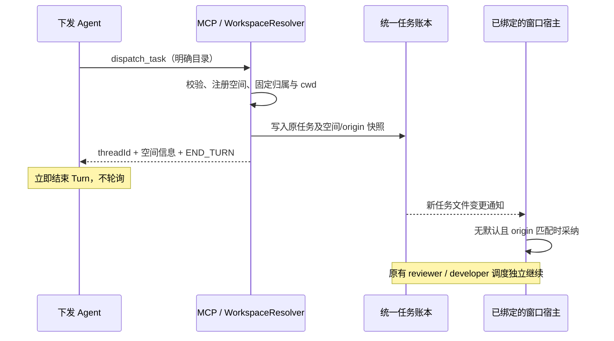

# 文件夹级工作空间设计

> **2026-11-13 决策更新（尚未实现）**：以下旧方案中涉及旧任务兼容、迁移、`workspacePath` 双读写及调用者自带 worktree 的描述已被本段取代。新任务必须持久化工作空间身份、根目录、来源、窗口来源（可确定时）和 `executionPath`；隔离 Git 任务的 `worktree.path` 是权威执行目录，必须与绑定一致。所有执行、审阅、返修、会话、Git 和 UI 路径必须经统一的任务执行目录 helper 读取。MCP 和新任务模型移除 `workspacePath`，不迁移或兼容旧账本。上线前通过运维流程确保没有未完成的旧任务（包括待 bootstrap 任务）；实现和测试不得依赖调用者的实时账本。空间可以注册非 Git 文件夹，但代码任务仍必须从有 HEAD 的 Git 仓库创建隔离 worktree。窗口不得根据调用者提供的 PID 或 MCP clientInfo 推断。空间注册和分组不构成执行锁、调度器、沙箱或权限授权。文件范围冲突按物理文件身份比较。

> 版本：0.1 · 日期：2026-11-05 · 状态：待评审，未实现。  
> 本次仅交付设计；不修改运行代码、用户设置、账本或原生会话。  
> 已确认：手动默认值仅作用于当前 VS Code 窗口；临时 Git worktree 的任务归入主项目工作空间，但保留自己的执行目录。

## 1. 目标与核心决策

新增独立的 **Bridge 工作空间（Workspace）**：以一个文件夹为身份，作为任务的归属、浏览与查询维度。

- 用户可以手动选择文件夹，注册工作空间并设为当前窗口默认。
- 首次派发的 Agent 可以通过明确的文件夹路径带入工作空间，自动注册；后续任务可以复用。
- 任务树按「工作空间 → 任务 → 摘要」分组，支持当前空间与全部空间视图。
- 同一空间可以包含主目录与其临时 worktree 中执行的任务。
- **工作空间不是目录锁、执行队列、原生会话或权限凭证。** 不增加全局锁或按空间串行锁。

关键区分：

| 概念 | 含义 | 示例 |
| --- | --- | --- |
| `workspaceId` | 任务所属 Bridge 工作空间的稳定标识 | `ws_<sha256>` |
| `workspaceRoot` | 工作空间对应的项目文件夹 | `D:\projects\shop` |
| `workspacePath` | 既有字段，保持为该任务实际执行的 cwd | `D:\worktrees\shop-feature` |
| 当前窗口默认 | 本窗口新任务在没有明确目录时的路由默认值 | 指向 shop，不影响另一窗口 |
| 视图筛选 | 当前看哪些任务 | 可看所有空间，不改变派发默认值 |

**不要把已有 `workspacePath` 改成工作空间根目录。** 否则会破坏 worktree、返修、原生会话定位、git probe 和日志清理。

首期支持本地桌面文件夹（含非 Git 文件夹）。不实现跨机器空间同步、自动搬迁目录、自动创建 worktree、任务跨空间迁移或空间级模型覆盖。

## 2. 当前代码基线

| 位置 | 当前行为 | 本方案需要补充 |
| --- | --- | --- |
| [types.ts](../src/bridge/types.ts) | 任务已有 `workspacePath`，worktree 已区分 `path/mainPath`；没有独立空间实体 | 新增归属元数据，保留原 cwd 语义 |
| [async-dispatcher.ts](../src/bridge/async-dispatcher.ts) | 目录取 `params.workspacePath \|\| process.cwd()` | 派发前统一解析空间与执行目录，不再把未知来源 MCP cwd 当可靠项目 |
| [mcp-server.ts](../src/bridge/mcp-server.ts) | `dispatch_task` 已接受 `workspacePath/worktree` | 增加空间选择、解析结果和查询筛选 |
| [task-store.ts](../src/bridge/task-store.ts) | `threads/<threadId>.json` 是权威存储，汇总文件是派生快照；全局最多 1,000 条 | 在同一账本增加归属，不能拆成多个相互独立的任务存储 |
| [task-tree-provider.ts](../src/ui/task-tree-provider.ts) | 根节点直接列任务，已有 active/all 两种视图 | 根节点改为空间节点，复用任务行内容 |
| [file-scope.ts](../src/bridge/file-scope.ts) | `findScopeConflicts()` 比较各自目录下归一化后的文件名，没有使用物理目录身份隔离 | 必须同步修正，避免不同项目的同名相对路径互相阻塞 |
| [reviewer-bootstrap.ts](../src/bridge/reviewer-bootstrap.ts)、[callback-manager.ts](../src/bridge/callback-manager.ts) | reviewer bootstrap/唤醒以任务 `workspacePath` 作为 cwd | 继续使用已固定 cwd，空间切换不得改变会话 |
| [config-sync.ts](../src/config/config-sync.ts) | 向四端用户级配置注册 MCP | 不得把某个窗口的默认目录写成所有 Agent 共用的全局 env |
| [extension.ts](../src/extension.ts) | 宿主组合服务、同步全局策略、注册视图 | 增加窗口上下文、选择命令和元数据监听 |

现有 `areFileScopesConflicting()` 有目录比较，但运行时 `findScopeConflicts()` 是另一条路径；不能只调用前者就认为跨空间隔离已经完整。

## 3. 身份、目录与 worktree

### 3.1 身份规则

1. 输入必须是当前执行环境内的绝对目录；校验存在、确为目录且可访问。不自动创建用户提供的目录。
2. 使用统一的路径身份函数处理绝对化、末尾分隔符、盘符及 `realpath`；不能直接复用无条件转小写的旧 `normalizeWorkspaceKey()`。
3. Windows 按文件系统实际大小写语义处理，POSIX 不默认忽略大小写；大小写敏感 Windows 目录必须纳入测试。无法确定身份时明确报错，不能误合并。
4. `workspaceId = 'ws_' + SHA256(environmentId + '\0' + canonicalRootKey)`，使用完整摘要；显示名不参与 ID。
5. `environmentId` 是当前本地 Bridge 存储域的持久化标识，不是 Agent ID、模型或窗口 ID。不同执行环境不得因为路径文本相同而合并。
6. 同一物理目录的符号链接/junction 别名复用空间；同名不同目录产生不同空间；父子文件夹是不同空间，不自动合并。
7. 改显示名不改身份。目录搬迁不是改名操作：旧任务仍指向原目录，目录不存在时可查历史，但执行前返回明确错误，不偷偷改 cwd。

根目录、盘符根、UNC 等边界不得因去除末尾分隔符变为空字符串。首期不接收远程 URI；WSL/SSH/容器路径不得字符串替换成本机路径。

### 3.2 worktree 归属

普通任务默认：`workspaceRoot = workspacePath`。显式选定空间后，允许在该空间的子目录执行。

worktree 任务：

- `workspaceRoot = worktree.mainPath`；`workspacePath` 仍指向临时 worktree。
- 两条路径必须确认为同一 Git 仓库的 checkout/worktree，结合 `git worktree list --porcelain` 和 Git common directory 校验，不能仅凭调用者自报 `mainPath` 归组。
- 如同时提供 `workspaceId/workspaceRoot`，必须与 `mainPath` 对应的空间一致，否则拒绝。
- 非 worktree 任务的执行目录必须位于选定根目录内；校验按 realpath 和路径段边界，不能只做字符串前缀比较。
- 同一仓库的两个独立 clone 是两个空间，不按 remote URL 合并。
- 桥接检测到实际 cwd 是 linked worktree 而调用者未声明时，返回补充 `worktree.mainPath` 的可操作提示，不静默漏掉 merge gate；不自动创建或删除 worktree。

这样，同一空间可展示多个 worktree 的任务，但它们不会仅因共享空间 ID 而串行。

## 4. 数据模型与持久化

以下为拟新增接口，不是当前已实现 API：

```typescript
interface BridgeWorkspace {
  schemaVersion: 1;
  id: string;
  environmentId: string;
  rootPath: string;
  canonicalRootKey: string;
  name: string;
  createdAt: string;
  createdBy: 'user' | 'agent' | 'migration';
  revision: number;
}

interface TaskWorkspaceBinding {
  schemaVersion: 1;
  id: string;
  environmentId: string;
  rootPath: string;
  canonicalRootKey: string;
  nameAtDispatch: string;
  source: 'explicit' | 'window-default' | 'caller-context' | 'host-root' | 'caller-cwd' | 'legacy';
  origin?: { hostInstanceId: string; generation: string };
}

interface WindowWorkspaceContext {
  schemaVersion: 1;
  hostInstanceId: string;
  generation: string;
  environmentId: string;
  folderRoots: string[];
  defaultWorkspaceId?: string;
  defaultSource?: 'manual' | 'first-dispatch';
  updatedAt: string;
  expiresAt: string;
}
```

`DelegationThread` 新增可选 `workspace?: TaskWorkspaceBinding`；原有 `workspacePath/worktree` 不改名、不改变语义。新任务必须写绑定；可选性仅用于旧账本兼容。MCP 对外统一返回 `workspaceId/workspaceRoot/workspaceName`，避免要求调用者理解内部嵌套结构。

建议存储布局（相对于 Bridge 存储根）：

```text
.agent-mesh-bridge\
  environment.json
  workspaces\<workspaceId>.json
  window-contexts\<hostInstanceId>.json
  threads\<threadId>.json
  delegation_threads.json
```

- 空间注册表只存元数据，不存任务列表、轮次、token 汇总或可漂移的任务计数；统计从账本派生。
- MCP 可以按确定性 ID 创建空间，不允许自行改已有显示名或窗口手动默认；显示名修改由用户命令处理。
- 同目录并发注册使用独占创建、临时文件原子替换与有限重试，始终复用同一 ID；读到半成品时重试，不覆盖有效记录。
- 元数据修改采用**每条空间记录的短时写租约**，锁内重读并校验 revision，再原子替换；租约带 owner token/PID/过期信息，安全回收。它不覆盖 Agent 执行周期、不参与调度，不是新增 workspace 执行锁。
- `environment.json` 也须独占初始化，失败方读取胜出记录，避免两个进程生成不同 environmentId。
- 窗口上下文只有所属宿主可写，MCP 只读；跨进程用文件监听与有界重读更新，不靠模型轮询。
- 任务绑定创建后固定。`TaskStore.upsertTask()` 必须保留已有绑定，旧副本不能抹掉，冲突 ID 不能静默覆盖。
- 注册表缺记录时，可用任务快照重建只读节点；不得因此丢失任务或改变任务归属。

## 5. 手动设置与「第一次下发带入」

### 5.1 手动设置

新增「选择默认工作空间」命令：选择已注册空间或浏览文件夹，校验后注册，设为**本窗口**默认，并显示完整根路径。

- 默认空间与当前任务视图筛选是两项设置；切筛选不改派发目标。
- 修改默认只影响之后省略空间信息的新任务，历史、排队中及运行中的任务不变。
- 显式派发到其他空间只影响该任务，不反向覆盖手动默认。
- 支持「清除本窗口默认」，不删除空间和任务。
- 不把窗口默认写进全局 `bridge-policy.json`、用户级 MCP env 或其他窗口的上下文。

每次扩展宿主激活创建独立的 `hostInstanceId/generation` 并发布心跳；旧上下文过期后不可继续充当默认。不能假定公开 VS Code API 提供可跨重启稳定的窗口唯一 ID，也不能把 `workspaceState` 当成两个相同文件夹窗口之间的实时隔离机制。

**持久性边界**：空间注册表、显示名和任务归属持久保存；首期窗口默认只保证当前活跃宿主实例内有效。重启后可从唯一打开的文件夹恢复上下文，或重新手动选择；不承诺两个相同文件夹窗口分别恢复各自默认。后续如需严格跨重启恢复，应另行设计受支持的窗口身份，不用全局最后写入值冒充。

### 5.2 首次派发带入

「第一次」指**该目录第一次成为空间**，以及**已可靠关联窗口中、尚无默认时的第一次成功派发**，不是整台机器第一次派发。

1. Agent 显式携带 `workspaceRoot`，或继续携带已有 `workspacePath`；桥接解析并注册相应空间。
2. 整次派发校验通过、任务成功持久化后，才可通知已关联窗口采用此空间为自动默认。失败的派发不能改变默认。
3. 宿主独占处理默认采纳，只接受 `defaultWorkspaceId` 仍为空的第一次成功事件；已存在手动或自动默认时不覆盖。
4. 若无法唯一确定所属窗口，仍允许显式目录派发和注册，但**不设置任何窗口默认**。该 MCP 连接可缓存此目录作为调用上下文，不能据此控制其他窗口。
5. 同一窗口后续显式派发到其他空间可正常工作，但不会自动切默认。

采纳通道复用账本文件通知：解析器在确认窗口归属时把 `origin.hostInstanceId/generation` 写进任务绑定；宿主监听 `TaskStore.changed`，只消费激活后新建、匹配自身 origin 的已落盘任务。启动时的旧任务和后续轮次更新不能触发默认采纳；候选同时出现时按 `createdAt/threadId` 稳定排序，由宿主串行处理。此通知不拉起模型、不要求调用者轮询，也不新增 MCP 写窗口文件的能力。自动采纳是异步 UI 行为，派发响应的任务归属始终以已落盘绑定为准，不承诺响应发出前窗口默认已更新。

不将 Agent 自报的 callerSessionId、MCP clientInfo、父 PID 当作可靠窗口身份；它们最多辅助定位，不构成权限证明。



## 6. 统一解析规则

新增无 VS Code 依赖的 `WorkspaceResolver`，由 MCP、内部派发和未来 Copilot facade 共用。规则顺序如下：

| 优先级 | 来源 | 规则 |
| --- | --- | --- |
| 0 | 已有任务或 bootstrap 凭证 | 从账本读取固定归属和 cwd；忽略确认调用带入的新业务目录 |
| 1 | 显式 `workspaceId/workspaceRoot` | 两者同时给出必须一致；指定无效即报错，不降级 |
| 2 | 兼容的显式 `workspacePath` | 普通任务以该文件夹注册空间；worktree 按 mainPath 归属 |
| 3 | 已绑定窗口的手动默认 | 仅限存活且环境一致的确定窗口 |
| 4 | 当前调用连接的上下文 | 包括首次成功派发已带入的目录；冲突时不能跨窗口串用 |
| 5 | 已绑定窗口的自动默认、唯一宿主根 | 多根且无法确定时返回歧义，不选第一个文件夹 |
| 6 | 可验证的调用者工作目录 | 必须有明确项目来源，且与当前环境一致；未知 MCP cwd 不采用 |
| 7 | 无法解析 | 返回 `WORKSPACE_REQUIRED` 或 `WORKSPACE_AMBIGUOUS`，不创建任务 |

补充约束：

- 显式选择空间但省略 `workspacePath` 时，执行目录取空间根；两者都给出时保留 cwd，并校验普通子目录或已验证 worktree 关系。
- 显式路径无效、空间 ID 未知、ID 与路径冲突分别返回具体错误，不偷偷回退到窗口默认。
- 不根据标题、prompt、文件名推断项目，也不把某个 Agent 的“最近活跃项目”当成所有新任务的默认。
- 窗口绑定优先来自宿主受控 provider/入口传参。通用四端用户级 MCP 无此通道时，只可在目录匹配到**唯一**存活窗口时关联；匹配多个窗口时要求显式路径，不猜窗口默认。
- 主动读取一次 MCP roots 可作为能力探测后的补充，不能假定现有原始 JSON-RPC handler 已实现；多 root 不任取其一。
- env 可以提示空间，但不得作为唯一传递通道。宿主清洗 env 时仍应能用明确工具参数、任务账本和 bootstrap 凭证恢复。

建议错误码：`WORKSPACE_REQUIRED`、`WORKSPACE_AMBIGUOUS`、`WORKSPACE_NOT_FOUND`、`WORKSPACE_PATH_INVALID`、`WORKSPACE_MISMATCH`、`WORKSPACE_ENVIRONMENT_MISMATCH`、`WORKTREE_DECLARATION_REQUIRED`。目录后来消失时，执行前返回 `WORKSPACE_PATH_UNAVAILABLE` 并沿用现有失败/中断落账路径，不新造任务状态。

## 7. MCP 契约

### 7.1 派发

`dispatch_task` 增加可选 `workspaceId`、`workspaceRoot`；兼容已有 `workspacePath/worktree`。无需增加一个要求 Agent 先调用的“设置默认空间”工具，单次派发就能完成注册和归属。

```json
{
  "title": "修复购物车合计",
  "prompt": "修复边界条件并补充测试",
  "targetAgent": "codex",
  "workspaceRoot": "D:\\projects\\shop",
  "expectedFiles": ["src\\cart.ts", "src\\cart.test.ts"]
}
```

worktree 示例：

```json
{
  "title": "修复购物车合计",
  "prompt": "在现有 worktree 内实现并报告验证结果",
  "workspaceRoot": "D:\\projects\\shop",
  "workspacePath": "D:\\worktrees\\shop-cart",
  "worktree": { "mainPath": "D:\\projects\\shop" },
  "expectedFiles": ["src\\cart.ts"]
}
```

成功响应保留原 `status/threadId/nextAction/stopInstruction`，增加 `workspaceId/workspaceRoot/workspaceName/workspacePath/workspaceSource`。可附 `workspaceNotice` 说明是否注册、是否采用窗口默认或为什么未绑定窗口。

**仍然先返回停止指令，派发后立即结束 Turn。** 不要求 Agent 为确认空间归属再调用列表或轮询工具；响应已经给出最终解析结果。

### 7.2 读取

| 工具 | 变更 |
| --- | --- |
| 新增 `list_workspaces` | 有界返回注册空间、根目录、目录可用性、派生任务计数；窗口默认仅在绑定确定时返回，否则 null |
| `list_recent_tasks` | 新增可选 `workspaceId`；省略保持全局查询兼容；**先筛空间和状态，再排序和 limit** |
| `get_thread_details` | 增加空间快照；原有有界轮次和轮询守卫不变 |
| `get_task_summary` | 外层响应携带空间快照，归档后仍能定位项目；不为补空间重写历史 verdict/token |
| `get_task_token_usage` | 不新增持久汇总；需要空间统计时只在读取层按任务归属派生 |

`list_workspaces` 的目录详情默认仅返回注册记录，不遍历整个文件系统；建议默认 50、上限 1,000，并提供续读游标。计数基于当前保留的任务，不暗示已经删除/淘汰的完整历史。

不新增 Agent 可调用的 `set_window_workspace`；手动默认归用户控制。receiver 可读取空间信息，但仍不得二次派发或改变控制面权限。

## 8. 执行、scope 与会话不变量

### 8.1 物理文件身份是互斥依据

本次不可只做树分组。跨项目误阻塞与 worktree 误串行必须同时解决：

- 将 scope 比较升级为 `environmentId + canonicalAbsoluteFilePath`，不以 `workspaceId + relativePath` 加锁。
- `expectedFiles/touchedFiles` 仍相对于各任务实际 `workspacePath`；绝不能相对于主项目 `workspaceRoot` 解释 worktree 文件。
- 目标文件尚不存在时，realpath 最长已存在父目录后拼接剩余路径，支持新建文件的稳定身份。
- 不同项目中的 `src\index.ts` 不冲突；同空间两个独立 worktree 中同名文件不冲突。
- 两个空间分别指向父目录与子目录，但声明的是同一物理文件，必须冲突；符号链接别名不能绕过。
- `findScopeConflicts()`、兼容冲突入口及各启动路径统一使用此规则；scope owner 生命周期、24h 窗口、queued 单向仲裁与显式 overlap 保持不变。
- 空间分组不是沙箱。首期新空间 API 对越出执行目录的文件声明拒绝；遗留绝对路径须按物理文件比较，不能因归属不同漏检。若后续支持共享外部文件，需要独立显式授权契约，不能把注册空间视为授权。

这属于与新增空间紧耦合的必要改动；本设计交付不直接修现有实现。

### 8.2 生命周期固定

新任务先完成目录、scope、模型等验证，再固定空间快照和 cwd、持久化并启动原有流程。注册表可能留下没有任务的有效空间，但失败派发不得留下可执行的半成品任务或改变窗口默认。

- `request_rework/retry_task/resume_task/retarget_task` 使用原任务空间与 cwd，忽略当前窗口默认；改执行者不改项目。
- dedicated bootstrap、reviewer 唤醒继续从账本读取 cwd；四条 bootstrap 识别通道和 token 一次性语义不变。
- 已有任务目录缺失时拒绝启动该任务，不在新空间另起 thread 或原生会话；不阻止其他候选。
- reviewer/developer 角色锁、原生会话、单轮在飞、默认模型/确认、token 计量、响应质量、压缩和 MR gate 不变。
- 调度器仍扫描全局 ready 候选；UI 当前空间只是过滤条件，不能让隐藏空间任务停止执行。
- 并发限额仍沿用既有全局/Agent best-effort 语义，不默认新增每空间限额。

## 9. UI 与交互

保留现有 Active 与 Recent 两个视图，根节点统一改为空间节点：

```text
工作空间：全部                 [选择默认] [筛选]
├─ shop · 默认 · 2 活跃 / 8 条
│  ├─ [CLA → CDX] 修复购物车合计 · Running
│  └─ [CDX → DSH] 补充订单测试 · In-Review
│     执行目录：D:\worktrees\shop-order
└─ agent_bridge · 1 活跃 / 12 条
   └─ [AGY → CLA] 改善任务面板 · Queued
```

- 空间节点稳定 ID 为 `workspace:<id>`；任务节点继续按 threadId，避免刷新后展开状态丢失。
- 当前默认置顶，其余按最近任务活动排序；名字相同时加父路径，tooltip 展示完整路径。
- Active 视图只列有活跃任务的空间，并可保留空的当前默认节点作为派发入口；Recent 按全局保留任务分组。
- 单独入口管理已注册但没有任务的空间，避免任务树堆积空节点。
- 用户可在「全部 / 当前默认 / 指定空间」间筛选；Active/Recent 共用本窗口筛选，但不影响默认与调度。
- 详情面板顶部同时展示归属空间与执行目录，worktree 展示主项目及 mergePending，不把两条路径混成一条。
- 既有任务菜单仅出现在任务节点；空间节点使用独立 contextValue。修改 `getChildren/getParent`、事件类型与 command 参数，避免把空间节点当 threadId。
- 空间名只是用户文本，Webview 必须转义，路径不得拼接进 shell 命令。

拟新增命令：`selectWorkspace`、`clearDefaultWorkspace`、`filterWorkspace`、`renameWorkspace`、`openWorkspaceFolder`（均使用现有 `agent-mesh-bridge.` 前缀）。打开文件夹前使用 VS Code 标准确认，不为了切默认直接替换用户当前窗口。

首期不提供「删除空间下所有任务」。注册空间保留不意味着占执行资源；现有 `delete_task` 仍是任务删除入口。

## 10. 兼容、迁移与归档

1. 不更换账本根，不按空间复制 threads，不移动已有日志；全局 1,000 条容量与最新 20 条的默认归档策略保持原语义，不变成每空间各 1,000/20 条。
2. 旧任务无绑定时，以 `worktree.mainPath ?? workspacePath` 推导归属。只用已存字段，不取当前窗口默认，不迁移 legacy reviewFlow。
3. 先提供兼容只读投影，再按单线程记录安全补写；迁移不改状态、轮次、会话 ID、执行目录、token、压缩归档或 MR。目录存在时规范化；不存在时保留历史路径并标不可用，不因为单条失败阻塞所有任务。
4. 无目录或损坏记录进入「历史未归属」虚拟组；只允许查阅和既有合法控制操作，执行前必须能解析原目录，不能默认挂到当前项目。
5. 已落盘空间 ID 不随每次读取重算。历史目录恢复后发现别名时，保留原快照，作为显式修复/别名对账处理，不悄悄改变归属。
6. `upsertTask()` 对绑定做耐久合并；归档保留绑定，压缩包的任务元数据/summary 包装附带空间信息。旧归档仍可通过其任务头读取归属，不为迁移重打包。
7. 删除某任务不删除项目文件夹、其他任务或空间记录；删除后空间计数读时变化。目录清理、native 会话清理仍遵循现有规则。
8. 新字段允许旧版读取，但旧版写入可能抹掉空间字段，而且旧 scope 逻辑不能保障新隔离。升级须重启宿主、supervisor 和各 MCP 进程；检测混跑给出明确提示，不能宣称混版本安全。
9. 如增加 `workspaceGrouping` 回滚开关，它只关闭树分组；不能关闭身份解析或 scope 校验。回滚二进制前应备份账本，不承诺自动恢复字段。

## 11. 与 Copilot 接入提案的关系

[VS Code 原生 Copilot 接入设计](COPILOT_VSCODE_AGENT_DESIGN.md) 仍是独立、未实现提案。本方案不以它落地为前提，也不新增第五端执行能力。

- 本方案提供通用 `WorkspaceResolver/WorkspaceRegistry`，四端 CLI 先受益。
- 未来 provider 可注入确定的 `hostInstanceId` 和根目录，复用同一解析器，而不是另建一套空间账本。
- 通用四端 caller 可以显式带入本地目录；Copilot requester facade 仍只允许其受控 provider 已绑定/授权的根目录与 worktree。
- **注册空间不授予目录访问权**。Workspace Trust、MCP 信任、模型确认仍独立；网关的授权检查必须先于自动注册/派发。
- env 被清洗、多窗口同目录、远端路径不确定时不得静默回退。首期远端不支持应在创建任务前明确拒绝。

## 12. 实施拆分

| 阶段 | 主要修改 | 完成标准 |
| --- | --- | --- |
| P1 核心身份 | 新增 path identity、workspace registry/resolver；扩展 [types.ts](../src/bridge/types.ts) | 路径、别名、并发注册、空间/cwd 分离测试通过 |
| P2 派发与安全隔离 | 修改 [mcp-server.ts](../src/bridge/mcp-server.ts)、[async-dispatcher.ts](../src/bridge/async-dispatcher.ts)、[file-scope.ts](../src/bridge/file-scope.ts)；核查 rework/supervisor/queue/bootstrap/callback 启动入口 | 两个项目无误阻塞，同一物理文件不可绕过；会话/cwd 固定 |
| P3 窗口与 UI | 新增窗口上下文服务；修改 [extension.ts](../src/extension.ts)、[task-tree-provider.ts](../src/ui/task-tree-provider.ts)、[detail-panel.ts](../src/ui/detail-panel.ts)、[package.json](../package.json) | 手动设置、首派发带入、多窗口和分组可验收 |
| P4 兼容与交付 | 修改 [task-store.ts](../src/bridge/task-store.ts)、[task-summary.ts](../src/bridge/task-summary.ts) 及查询契约；更新 [DESIGN.md](../DESIGN.md) | 历史/归档/旧副本写回不丢归属，既有行为回归通过 |

建议新增文件职责：`src/bridge/path-identity.ts`（物理路径身份）、`src/bridge/workspace-registry.ts`（元数据耐久）、`src/bridge/workspace-resolver.ts`（纯业务解析）、`src/ui/workspace-context-service.ts`（窗口心跳、默认采纳、命令衔接）。名称为提案，不代表已创建。

P1 是其余阶段前置；P2 的空间隔离不得在 P3 分组 UI 上线后再补。实现时先跑聚焦用例，再复用现有编译/测试命令，不新增测试框架。

## 13. 验收矩阵

| 场景 | 期望 |
| --- | --- |
| 用户手选文件夹后派发未填路径 | 归本窗口默认空间，cwd 为其根目录 |
| Agent 第一次显式填 workspacePath | 自动注册空间，响应包含解析归属；可靠关联且无默认时由宿主采纳 |
| 派发校验失败 | 不改变窗口默认、不启动半成品任务 |
| 两个进程首次同时派同一目录 | 一个空间 ID，两条独立任务；无元数据覆盖 |
| 两个窗口分别选 A/B | 各自省略目录的派发正确；不污染用户级 MCP 配置 |
| 同目录两个窗口、无法识别 caller 属于谁 | 不猜默认，要求显式目录；不错误绑定 |
| 多根窗口无默认、无明确上下文 | WORKSPACE_AMBIGUOUS，不任取第一个 root |
| 存在手动默认 A，Agent 显式派到 B | 本任务归 B；默认仍是 A |
| 两个目录同名或同相对文件名 | 两个空间，各自任务可并发 |
| 同一物理目录的盘符大小写/尾分隔符/junction 别名 | 按实际文件系统语义复用身份 |
| POSIX 大小写不同目录；Windows 大小写敏感目录 | 不因无条件 lowercase 被错误合并 |
| 父子空间、软链接文件、新建文件指向同一物理目标 | scope 正确阻塞；不按空间 ID 放行 |
| 同项目两个真实 worktree 声明同名相对文件 | 同空间显示、独立物理文件可并发；merge gate 保留 |
| 伪造 mainPath 或 linked worktree 缺声明 | 明确拒绝并说明修正方式 |
| 显式 ID/root/cwd 不一致或目录不可用 | 明确错误，不降级或切换项目 |
| 切默认后返修、恢复、重试、改执行者 | 归属/cwd/threadId/合法原生会话延续不变 |
| dedicated bootstrap 工具参数为空或 env 被清洗 | 按原凭证通道确认原任务，不新建空间/任务 |
| 过滤空间后查最近 N 条 | 先筛空间再 limit，不被其他项目挤空 |
| 归档/旧副本 upsert/注册表缺失 | 空间归属可读且不丢，已归档轮次不复活 |
| 删除单任务、空间没有任务、目录被移走 | 其他任务与项目文件不受影响，历史仍可查看 |
| Remote/WSL/Copilot facade 越出授权根 | 创建任务前拒绝，不转成本地同名路径 |
| 派发成功与既有调度回归 | 停止指令、禁止轮询、角色锁、review_failed、token/MR 不变量不变 |

**最终效果**：用户管理的是「项目文件夹」，Agent 派发固定的是「任务归属 + 实际执行目录」，界面按空间组织任务，而执行并发仍只受真实 scope、thread 角色和既有限额约束。
